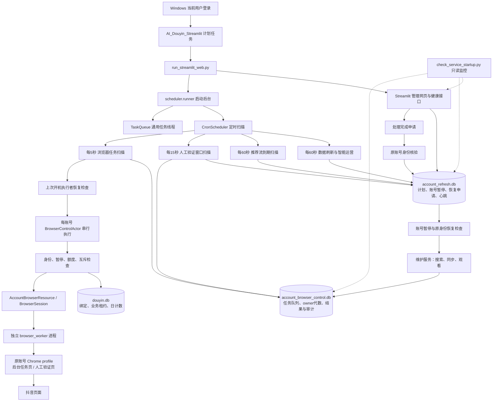

# 账号业务启动与恢复架构核查

核查日期：2026-10-22，Asia/Shanghai。依据当前源码、生产数据库只读快照及服务日志。此次为原因分析，不变更业务状态或派发任务。

## 结论

Windows 自启和后台调度已运行。未恢复的是 account01 的账号业务：旧人工窗口任务留在 running，旧浏览器执行者未交还，同时账号仍为 paused / human_required。恢复扫描存在只发现 queued 账号的覆盖缺口；任务又缺少持久化的执行阶段证据，因此无法仅凭 running 和旧错误码安全判断是否已经操作浏览器。

## 实际证据

| 检查项 | 实际状态 |
|---|---|
| 本次主机启动 | 2026-10-22 18:08:34 |
| Windows 登录启动任务 | AI_Douyin_Streamlit，18:09:09 触发 |
| 服务进程 | PID12416，18:09:20 创建；HTTP健康页200 |
| 后台组件 | 7个组件有本次启动后的新鲜心跳 |
| 账号控制 | account01，paused，human_required，revision63；没有恢复申请或核验token |
| 原浏览器执行者 | backend:20792，generation42，数据库仍为active；最后心跳为2026-10-21 01:53:06 |
| 原人工窗口任务 | 6dbb0d77e18240a49b4df7d014089e89，running，最后更新2026-10-21 01:53:06；cursor和result为空 |
| 队列发现查询 | SELECT DISTINCT account_id ... WHERE state='queued' 返回空 |
| 普通业务租约 | refresh、smart、playback 的run_id均为空、lease_until均为0；runtime lock_owner为空 |
| 旧额度记录 | day_key为2026-10-20、daily_runs为21。额度检查按UTC日判断，不能把旧记录当今天仍超限 |

原始快照：`data/service_startup_monitor/ACCOUNT_RESUME_CAUSE_20261022.json`。自启配置：`data/service_startup_monitor/WINDOWS_TASK_20261022.json`。

## 当前组件架构

通用TaskQueue与账号定时扫描是并列组件；账号业务经自己的持久计划和浏览器管控执行，不能把“通用worker有心跳”当成账号正在工作。内置浏览器属于诊断会话，图中的生产Chrome使用项目原账号profile。

## 未恢复的因果链

1. `browser_control.py:292` 的 `list_pending_accounts()` 只枚举queued；当前只有旧running人工任务，因此 `browser_control_runtime.py:1058` 的pump没有发现这个账号作为恢复候选。
2. 即使将账号送入恢复检查，`browser_boot_recovery.py:39` 发现running/paused/waiting_human/outcome_unknown时也会拒绝交还旧owner。这是保留未知结果的保护，但目前没有配套的跨重启执行阶段核对流程。
3. `browser_control.py:465` 在准入检查之前提交running。随后 `_execute()` 才检查额度和调用handler；`handler_started`仅为内存变量。进程在这两个阶段之间停止，数据库不能区分“刚领取但未执行”和“已经操作了平台”。旧daily_quota_exceeded也会随再次领取暂时保留，不能证明最后一次领取仍被额度拒绝。
4. 人工窗口扫描按事件去重；`account_manual_windows.py:46` 找到原任务即跳过，不会用新窗口覆盖它。
5. 账号paused63独立持久保存；`account_refresh.py:532`及各claim入口直接拒绝派发。没有恢复申请时不会自动核验、自动激活账号。即使处理旧owner，这道平台验证暂停仍存在。

因此，当前确定的问题在账号重启恢复发现、任务执行阶段持久化和异常可观测性。原任务最后一次到底停在准入、handler或结果提交阶段，现存记录不足以确认。不能把它直接改成成功或盲目重跑。

## 为什么显示后台健康

`scheduler/cron.py:202` 在pump未抛异常时写入healthy，表示扫描函数运行成功；即使没有候选账号或账号被阻挡，也会出现该心跳。网页健康、调度健康、单账号可运行、原业务完成应分别展示。当前只读监控已经能报告旧owner阻塞和原任务无进展。

日志另有SQLite争用及扫描重叠跳过，说明仍有性能问题需要定位；本次未确认实际持锁者，不能把它当作唯一原因。上述持久状态与恢复分支足以解释当前不派发。

## 自启与长时间未启动

当前为用户登录触发，StartWhenAvailable启用；失败退出每1分钟重试，最多3次；重复实例IgnoreNew。没有独立的周期健康守护处理“进程还在但服务卡住”或“重试耗尽后长期没有进程”。运行中的后台调度不能启动已不存在的自身进程。Codex监控是另一层，只读且目前仍PAUSED。

## 建议的修复边界（尚未实施）

- 启动恢复扫描同时发现排队账号和上次启动周期遗留的执行者/未结任务，输出明确的逐账号恢复结论。
- 持久化领取、准入等待、准备调用浏览器、实际调用、结果提交等阶段。普通额度等待应有next_retry_at，避免反复将未执行任务写成running。
- 只有充分证明尚未产生平台动作的原任务才允许安全接续；已有或无法确定平台动作的任务进入结果核对。账号身份、暂停及原任务审计继续保留。
- 前端分开显示网页、调度、账号恢复和业务执行状态；阻塞不能被一个healthy心跳掩盖。
- 如需自动补启动，单独设计系统级守护，区分进程不存在、启动宽限、服务无响应和计划维护，并记录动作与冷却。不要将业务暂停当作重启服务的理由。

这次仅核查与交付架构，没有取消旧任务、清除owner或开启新平台业务。
