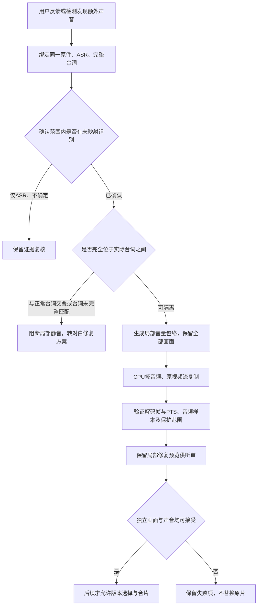

# 台词间额外声音的局部修复

范围已于用户最新反馈后调整：该模块仅作为可选底层组件开发与synthetic验证，本次真实15秒音频编辑未执行。主目标是完整生产流程的原因诊断、能力选择和返修路由，不能以局部静音代替主线验收。

本次来源是新H3第三段 `8e4e3a4b-8975-4856-b46f-724e0c9f8dac`。用户反馈“8秒到12秒一样的问题”，已绑定这份新原片，已有ASR只复用，不再次转录。原H3、原一分钟、旧55秒剪辑和所有失败记录均保留。

## 为什么不能继续只前置台词

旧片异常识别位于第一句之前；新片把第一句起音提前至0.42秒，但额外识别移到两句之间。新提示词两句各出现一次，原句和计划时窗保留；额外声音不是合片后添加，因为新片直接来自未合片的H3原件。现有证据支持音频软调度仍不稳定，不能证明唯一模型内部成因。

本次实际识别是第一句0.42—8.76秒、第二句12.82—14.285秒，未映射识别位于8.94—11.98秒。用户给出的8—12秒是粗定位：直接把该范围静音会伤及第一句。修复必须依据完整已匹配台词的实际时窗，不能依据剧本计划时窗删声音。

## 修复边界

- 当前支路是CPU音频编辑，使用淡出、静音和淡入清除可隔离的多余声音，不是H3再次生成，也不合成环境声或新音色。
- 输入必须含同原件的用户确认、已有ASR和完整目标台词。ASR文字本身不能证实准确词语、语言或说话人。
- 额外识别核心区外加80毫秒处理边缘；每句实际识别区间另保护80毫秒，交叠则阻断。40毫秒淡变必须位于额外识别核心区之外。
- 本例计划处理8.86—12.06秒，覆盖8.94—11.98秒的核心区；不能把粗定位8—12秒直接交给剪辑器。
- 视频帧数、每帧时间戳和解码像素必须与原片相同，整段时长保留。修复前的标准PCM在处理区外须逐样本相等；AAC重编码后的波形只能另作相关性等检查，不能宣称最终解码PCM逐字节不变。
- 每次执行先写claim；失败或结果未知保存原记录，缓存重入验证内部工件后返回，不重复执行媒体处理。

## 接入范围与验收限制

新入口为 `src/content_factory/audio_gap_repair_v1.py`，提供prepare、execute、qa。它只处理已确认、可与正常对白隔离的额外声音。台词本身错误、声线错误或两者重叠，不属于这条静音支路。

本次没有新H3、ASR或其他模型调用。新原片后半段的人物动作和护理对象错误仍然存在；即使声音处理技术检查通过，也不能把整段标为质量通过或自动合回一分钟。此支路尚未接入所有后台默认任务，音频自然度仍需听审。

实际工件、测试及预览结果保存于 `data/video_generation/h3_s03_gap_audio_repair_20261115_v1`；执行结果以该目录的终态回执为准。
