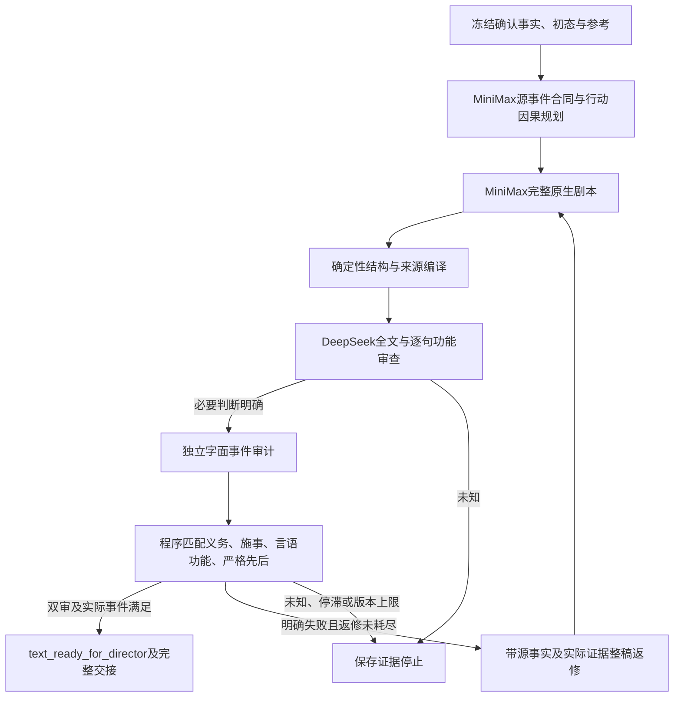

# 可复用自动文本流程（2026-10-11）

## 目标与边界

用户要求先定位问题、解释流程失效、修改可复用流程，再从新流程生成完整剧本；后续文本运行不能依赖用户逐句指出问题，也不能依赖助手另写人工核实文件。已确认事实、人物关系、观众感受和资源是输入，输出为完整原生剧本、全部模型回执、自动决定和交接。

MiniMax-M3负责因果规划及完整创作，DeepSeek-flash负责必要全文审查。沿用已验证模型与参数；参考R01全文实际进入规划、创作和主审请求。字面审计只读取冻结事实、源事件合同和当前正文，不读主审结论、参考审美或测试预期。

已知完整内容失败最多自动两次整稿返修，再审全稿；服务结果、用量或必要判断未知时停止，不运输重试。旧账本和冻结记录完整承接。视频人工审核、原始尾帧批准及发布权限规则继续有效；本次没有媒体或发布调用。

## 已落实的三层分工



1. 源规划：从每条确认事实派生 `source_obligations` 与必要 `source_order`。分别声明事件、状态和禁止项；不固定拍数、句数或漂亮台词。来源没有的承诺、行动不能加入。
2. 完整创作：模型写全部正文。返修提供完整前稿和可定位失败证据，可调整整篇；不锁旧拍，不本地替字、补动作或拼接旧稿。
3. 确定性编译与决定：核字段、角色、引用、同稿哈希及覆盖；再依据字面审计的实际步骤，核对施事、动作/对白类型、言语功能和源要求的严格先后。质问不能借总体pass冒充明确拒绝，同一事件不能冒充严格先后的两次发生。同一句完成多个目的允许共享引用，不将所有行动机械拆句。

全文审查有七项功能标准：施事对象清楚、接话有作用、阻力与策略推进、结尾行动兑现、当面口语成立、事实物理一致、语言完整性。每项及每句有明确读数；已发现错字、词义或语病即使写入建议，也会成为必修项。

结尾以交涉造成的当前可见结果判断，可以用动作完成；不强制口头宣布结束、补偿承诺或金句。FACT/INITIAL类返修的执行目标由冻结来源生成，审查模型不能要求改brief来迁就失败稿。原生审查建议保留为证据，但不作为修改来源的授权。

## 实际版本与运行结果

### v1：自动链连通，真实质量门假阳性

合同 `src/content_factory/creative_autonomous_text_contract_v1.py`；入口 `scripts/run_autonomous_text_pipeline_v1.py`；测试35项通过。真实434–436自动完成规划、完整六拍稿和全文审查，无人工decision文件，但初态、实际第一次拒签和错字漏查。原机器状态text_ready_for_director保留；不能把它当可采用文本或创作质量通过。证据在 `data/production_trials/autonomous_text_pipeline_20261011/legal_resignation_01/FAILURE_ANALYSIS.json`。

### v2：增加独立审计，真实回归仍未通过

合同 `creative_autonomous_text_contract_v2.py`；入口 `run_autonomous_text_pipeline_v2.py`；48项离线测试通过。增加逐事实、逐初态和逐步骤字面重构。437真实盲回归发现申请起态错误，却仍把唯一一次拒签称第二次，fact表的pass与自己的question/request/refusal重构矛盾；程序停止halt_gate_regression_failed，没有启动新稿。其建议改变确认初态未执行。证据在 `data/production_trials/autonomous_text_pipeline_20261011/legal_resignation_02/FAILURE_ANALYSIS.json`。v1/v2源码、输入及回执冻结保留。

### v3：源事件核对已实现，真实源规划被拒收

合同 `src/content_factory/creative_autonomous_text_contract_v3.py`；入口 `scripts/run_autonomous_text_pipeline_v3.py`；批次 `data/production_trials/autonomous_text_pipeline_20261011/legal_resignation_03`。39项离线测试通过，不代表真实规划或剧本通过。

第438次真实源规划返回完整原生结果及已知用量7490 reported tokens，但状态为 `contract_rejected`。计划把质问与拒绝合在O6中，以 `question/refusal/statement` 的任选功能表示；这样仍可能用质问代替必须发生的拒签。O11、O13又给动作义务填写混合功能，违反本地动作规则；源顺序还把状态端点及同一次请求的两种描述列为严格先后。已验证的问题是源合同本身过宽、公开Schema与本地规则未完全一致，以及严格顺序的适用范围不清楚；不能据此推断服务端无法理解所有创作规则。

这一轮未得到可采用的源计划，也未进入盲回归、新完整稿或制作交接。438次累计调用、6,840,023 reported tokens及93,117 unknown token reservations承接保留；完整失败回执、原生计划、源码与输入冻结，不本地回填计划或清零账本。

### v4：原子源义务、实际复合功能与有界完整计划返修

合同 `src/content_factory/creative_autonomous_text_contract_v4.py`；入口 `scripts/run_autonomous_text_pipeline_v4.py`；批次 `data/production_trials/autonomous_text_pipeline_20261011/legal_resignation_04`。

本版落实以下机制：

1. 每个事件源义务只声明一个行事功能，一条来源事实可以派生多个义务。实际发给模型的工具Schema直接约束动作只能使用 `action`，对白使用一个非动作功能，本地验收采用同样规则。质问和拒绝不再作为同一个任选条件。
2. `source_order` 只连接事件与事件，表示冻结来源真正要求的严格先后；状态或禁止项不能充当顺序端点。同一句可以告知并请求，不因描述了两个目的就强制拆成两句话。
3. 字面审计用 `speech_functions` 数组重建实际正文的一句对白可能具有的多个功能，主功能必须在数组内；动作只能是 `action`。程序逐项匹配源义务的唯一功能、实际施事及步骤类型，再核对必要严格先后。共享引用可以兑现同时发生的多个目的，不能兑现严格先后的不同发生。
4. 只有已收到完整原生计划、明确正常结束、用量已知且非负的内容合同失败，才进入完整新计划返修。本批以第438次失败原稿作为哈希绑定来源，最多生成两份完整新计划，各有新的版本标签和回执。未知结果、未知用量、截断或运输失败停止在原请求，不触发这种内容返修；恢复仍复用原回执。既有明确完整失败及消耗正常继承。
5. 先获得合格源计划，再用已知失败正文做独立盲回归；只发送冻结brief、源事件合同及正文，不发送旧审查结论或本地测试预期。回归满足要求后，新writer写完整新稿，主审与字面审计绑定同一正文，必要判断未知即停止；明确失败按原上限整稿返修。事实与初态类返修只要求正文兑现冻结来源，不执行改变brief来迁就稿件的建议。

v4离线回执记录26项通过、0项失败，使用实际Pipeline和ContinuationRuntime接模拟服务，未发模型、媒体或发布调用。验证覆盖公开Schema与本地规则一致、实际一句多功能匹配、严格先后、有界完整计划返修、父账本与种子原稿绑定、未知及截断停止、恢复零重派和v1–v4依赖冻结。这些是离线行为验证，真实模型的语义拆解、审计及创作质量仍须分别验证。

真实链已从第439次 `scene_plan_01` 启动。本次文档更新只记录 `in_progress`；不预写源计划、盲回归、完整文本或创作质量通过，后续真实状态由本批不可变回执及交接记录补充。

离线验证命令：

```powershell
.\.venv\Scripts\python.exe -m pytest tests/test_creative_autonomous_text_pipeline_v4.py -q -p no:cacheprovider
```

已准备批次的运行／恢复命令：

```powershell
.\.venv\Scripts\python.exe scripts/run_autonomous_text_pipeline_v4.py data/production_trials/autonomous_text_pipeline_20261011/legal_resignation_04 run
```

同一运行命令再次执行复用冻结请求与原回执，不为恢复重派或重置账本。v1–v3失败结果保留，不改为通过；v4新增机制未静默迁移旧入口。

## 必须保留的能力边界

自然语言事实拆成原子义务仍由模型完成；逐fact覆盖不自动证明拆解完整。引用真实与路由正确不证明语义判断永不漏项，真实回归只是当前案例证据，不能宣传无人监管质量已普遍可靠。

此入口落实文本的自动规划、完整创作、双审、明确失败整稿返修和交接。热度采集/标签族选择、导演与实际表演、资产、视频及发布整条运营链尚未全部整合为同一无人任务；旧v23不静默迁移。机器文本合格、用户实际采用与视频人工质量分别记录。


## v5：起态测量与证据职责修复

v4的439–441实际链证明整计划返修可自动运行，但其盲测仍失败，不能将v4交付为合格。v5另建合同和入口，旧版本、回执、状态与消耗不改。

规划从冻结初态提取位置关系、参照实体与朝向，每项带原文依据。DeepSeek独立核对源义务覆盖、物理条件及严格先后是否得到来源支持；不读旧审查或正文来反向改来源。实际字面审计还原最初动作前物理值，本地比较原子，不能让总体pass覆盖矛盾。

事件引用分occurrence_refs和support_refs，仅实际发生锚参与施事、功能、先后；同一句的前后子句可用原文唯一位置occurrence_spans表示，不能用重复或重叠证据冒充两次。

本v5验证最多2份原生规划、3份完整正文；这是已定位合同缺陷的新版本验证范围，历史规划及失败次数仍累计报告，不把新目录称为重置。服务结果、用量或必要判断未知不重派；已知完整内容失败整份返修。当前正在离线验证，真实结果尚未取得。

```powershell
.\.venv\Scripts\python.exe scripts/run_autonomous_text_pipeline_v5.py data/production_trials/autonomous_text_pipeline_20261011/legal_resignation_05 run
```

## 实际续行结果与 v8 开发（更新至450）

以上 v4/v5 的 in_progress 是当时记录，当前实际结果如下；不回写原冻结状态。

|版本|真实回执|实际结论|
|---|---|---|
|v4|439–441|完整计划返修成功；盲审仍漏判起态，停止|
|v5|442–443|原文复写字段与冻结来源不等，完整规划验收失败|
|v6|444–449|444协议失败；445原生计划与446来源核验通过；447真实盲审找出原失败稿起态和拒签顺序；448完整八拍新稿结构有效；449完整主审因期望事实复写被拒收，且漏判新增日期、承诺及语病|
|v7|450|显式继承445–449，只新增缺失字面审计；450已完整收到，部分可选片段未覆盖全部引用被本地拒收；它把“月底离开”缩窄解释为非具体日期而错误放行F6|

v6/v7分别17项和12项离线通过；这些只证明状态及协议行为，不能解释为创作质量通过。截至450账本为450次、6,977,057 reported tokens、93,117未知用量预留；未改旧上限或清零。

v8在开发中，尚未实际派发。其最小职责改变为：来源事实范围由仅读冻结brief的独立步骤生成，正文提取独立报告主张原文与明确句法问题，程序比较typed来源范围并合并全文/字面门的必修与未知。不是增加禁句表。可选精确片段缺项按既有整步窗口解释，原生审计不改；模糊、重复或不属于本事件的证据仍阻断。已返回445–450显式适配，不再次生成上游；448仍是第一完整稿，只剩两次完整内容返修，不因建目录清零。

来源分类和正文提取仍是模型判断，片段存在与步骤覆盖只证明引用/协议，不能证明语义无漏项。真实448失败稿需验证新门能否自行发现并整稿返修，未得到合格新稿前没有DELIVERABLE。新目标是文本运行不依赖人工decision文件；整条运营无人执行尚未验证，视频人工审核规则继续有效。


## 真实续行更新：451–461（v10离线验证）

v8的整句白名单误报正常改写、拒签及现场动作，错误反馈进入完整返修。三稿448/453/457均未交接；v8 creative_stalled不解释为次数不足。

v9范围收窄为敏感日期、金额、期限、后续承担及业务规定，事件先后仅用实际发生引用。21项离线通过；461实际完整收到并找到月底、办理承诺和语病，但公开Schema与本地隐藏对白限制不一致而拒收，另有个人拒签误分类。完整原因见本批FAILURE_ANALYSIS.md。

v10检测与同源裁决分离，逐原ID复核源支持、情境误报、违规或未知。明确违规先MiniMax完整重写并全文重审；仅未知停止，任何未知不能交接。日期/金额须精确源支持。尚未派发v10，04未生成。分类与裁决仍有模型语义风险，不能声称无人质量已普遍可靠。累计461次、7132953 reported tokens、93117未知预留，媒体0，旧冻结记录与消耗保留。


## 462–464真实运行及v11兼容性修复

462盲裁决找到旧稿期限/承诺/语病并排除拒签误报，但464面对改写后的同类业务保证又全部用F3私人劝说豁免，导致text_ready只接纳旧457、未生成新稿。这是已验证的错误放行，不是接口没返回。原state与handoff保留，另有legal10/POST_RUN_FAILURE.json标明不满足本次目标。

v11公开属性与情境的兼容表：具体业务未来行动、办理完成/顺序及承诺不能仅凭私人劝说语境豁免；个人拒签须同施事原意愿源，物理动作须具体源动作。原463/464格式仍完整接收，语义编译转为needs_whole_revision，不删发现或改判语。私人交差细节未固定为违规金标。用户要求本次新流程新稿，入口另要求至少一份完整新正文，不能拿旧稿结束。现只余04及全文主审/字面审计/敏感检测/裁决五请求；前三份完整稿继续累计。

当前累计464次、7184944 reported tokens、93117未知用量预留，媒体0。真正新稿与创作效果尚未获得，不以离线或接口成功当交付。


## 465–469完整新稿失败及职责边界修复（v12开发）

465是实际MiniMax完整新稿04，466–469全文主审、字面审计、敏感检测和裁决完整收到；新日期、办结保证及后续解释承诺被自动阻断，旧问题没有质量通过。v11以累计4稿creative_stalled保留，实际完整失败正文见legal11/versions/04/FAILED_FULL_SCRIPT.md。

另有三项流程原因：返修输入含原错误裁决的辩解，与必修目标相互矛盾；F4“全程不拿笔”的不变状态被源计划当单次事件，推纸之前的未拿笔被错误算成顺序违例；468找到关键句施事歧义，469却用F3预期剧情替“是我”脑补正确公司施事。

v12只让写稿模型读创作意图计划、唯一brief及原始起态，把审查诊断与可执行返修目标分离，不送旧错误对白/裁决理由作续写模板。独立仅读source的时间sidecar区分one_off/invariant/absence/unknown：仅one_off之间执行严格发生顺序，其他义务/原事实审查保留；未知源判断停止。语法放行只依据实际正文，不能凭source事实补改实际语法关系。原计划/原审查不改，修复仅添加新合同和派生证据。

此新合同验证显式承接四份正文，最多新增完整05（累计max5），不重置历史、不重派旧结果。累计469次、7252112 reported tokens、93117未知用量预留，媒体0。v12尚未实际派发，离线行为与真实新稿质量分别验收。


## v14 开发：先验创作规划，再整稿（2026-10-11）

新增`creative_scene_plan_gate_v1.py`验真实创作意图字段，独立于源合同metadata审查。`run_autonomous_text_pipeline_v14.py`的继承与冷起路径均在writer前要求同源创作计划通过；交接重演gate并保存原生/编译证据。当前专项目录`legal_resignation_14`准备中，尚未冻结或派发，不改变v23入口及旧专项任务。

父v12在474已知完整提取引用合同拒收处停止。v13仅显式重验该原回执，不改旧状态或任何原判，不新增474重试；原471第五稿经473实际F4失败，不合格。新协议继承5稿与474/7,318,920/93,117消耗；本范围上限两份完整新计划、最多第6/7稿，界限验证在派发前完成。源义务/创作意图、正文实际事件/审查判断分层，只有所有同源门均无失败/未知才交文本。

完整新稿与真实新计划尚待生成和验收，不能以本节或离线mock结束任务。


## 475真实回执与v15修复（2026-10-11）

475已完整收到，HTTP 200/tool_calls，用量34,618 reported tokens。v14本地19项Schema错误全部属于真实initial/ending引用不在过窄枚举；原回执与冻结源码不改。再次逐项核对后，475原生判断全部pass，包括SO6和open_problem；先前“SO6已检出”描述纠正，本回执不构成负例检出成功。v2公开引用域允许真实起态/结尾作为状态或上下文；事件通过仍须至少真实beat、自身逐拍/结尾绑定不放宽。原475原样重验，不再次派发。

语义原因另行处理：源合同审查只验metadata来源，整片门全表判断会漏掉创作字段的知识状态矛盾。新增creative_plan_ending_scope_v1独立只读brief及实际creative投影，逐三个ending字段提取具体命题与原文、源事实原文，区分已知结果/未解争议/未知事实/未来承担/程序假设。真实引文不等于业务命题成立；该门不能被另一个allpass覆盖，也不由本地程序代写结尾。小检查仍需真实盲测证明，不把mock视为语义质量。

独立入口v15承接475次/7,353,538 reported tokens/93,117历史未知预留及5份失败正文。先复用475验协议，再真实盲测旧计划结尾；检测明确失败后由MiniMax提交全部新plan。source audit、creative gate、ending gate三者同源无失败/未知才进入全文生成。返修只传失败与未知目标，不传旧通过解释或错误裁决作为写手权威；新正文6/7仍做同稿全文主审、字面事件、敏感主张提取与裁决。未知结果保存原身份停止，未改默认v23/运营入口，没有媒体调用。

当前新入口正在离线验证；尚无合格新导演计划或新完整剧本交付。


## v15真实运行结论：476–491（2026-10-11）

新入口真实派发16次，全部收到完整tool_calls结果，用量已知；3次MiniMax创作（新计划477、完整第6稿482、第7稿487），13次DeepSeek-flash审查/来源解析；没有运输重试、媒体或发布。新增225,524 reported tokens，累计491次/7,579,062 reported tokens/93,117历史未知预留。旧70/160未知记录保留，原475没有再派发。

476独立ending知识状态门真实检出旧445的两个结尾矛盾；477完整新计划修掉已知决定变未知的问题，478/479/480同源规划三门通过后才进入正文。第6稿实际新增离开期限和公司给付承诺，四审自动阻断并提交全部第7稿；第7稿实际漏掉首次明确拒签、仍写“手续今天走完”，自动结果creative_stalled，7稿历史保留，无第8稿/DELIVERABLE。完整正文在本批versions/06、07/FAILED_FULL_SCRIPT.md，明确标为失败诊断稿。

本次18项续行与4项cold离线通过只证明执行机制；真实运行证明盲结尾检出、有界整稿返修及停止有效，没有证明完整创作质量通过。当前输入为冻结法律故事，热度标签→主题→自动brief入口未接此独立入口，默认v23/运营/媒体路线不静默切换。

真实回执另暴露三项合同混淆，需先修合同职责，不继续堆同义文风禁令：

- 空间状态：申请的所属场景(scene/meeting_room)、周姐面前(character/zhou)、笔在申请旁(prop/application)被放在同一anchor字段逐字比较，当前INITIAL两项缺少同维矛盾依据。候选把所属场景、承载/容器/持有者、空间参照及可见状态分开；当前“推开夹子露纸”的遮盖前提和笔仅由后段倒推的问题仍需审计，不能自动把旧稿判过。
- 事件因果：源要求策略转入后的刺激—回应被编译成全部请求先于全部回应；正常交替会误报。第6稿同时存在E14间接请求分类矛盾，不能简单取任一合法配对。候选由source-only明确edge语义、同源具体发生见证，保留提前回应/缺首次拒签的失败。
- 属性审查：抽取模型把“无未来承诺”的私人请求标成business_promise，裁决的纠正又被原标签硬否决。候选按实际子命题与言语行动重新分类并逐原ID/引用审计；私人话术中真实日期、保证、业务承诺仍须独立源支持，准备状态与当前请求分开，不把整句一概免责。

三个候选的离线协议不接冻结v15，原生判语、source/plan/body、失败状态及消耗不改。通用语义可靠性和接入后的新稿质量尚未验证。完整生产结果与错误项见本批RUN_RESULT.json；这不是无人运营交付。

文本自主执行的验收目标：冻结来源与创作空间明确→完整native规划→完整native正文→同源全文审查→程序分类故障→有界整稿返修→交接。正常路径不依赖用户或助手逐句替换、挑错或写人工decision；结果未知保留原任务，明确失败自动处理，到边界保留失败产物。视频仍人工审核。当前执行机制已验证，稳定产出可采用文本的目标仍未达成。


## 三项候选合同的实际保存位置

这些代码用来替换混淆的职责，尚未接入冻结v15，不是在现有多重审查后直接追加三层审查。

| 候选 | 代码 | 离线结果 | 当前范围 |
|---|---|---|---|
| 物理角色 | src/content_factory/creative_physical_anchor_contract_v1.py | 15项通过 | scene/承载/容器/holder/空间参照/朝向/遮挡独立；未知和晚期证据保留 |
| 来源顺序见证 | src/content_factory/creative_order_witness_contract_v1.py | 19项通过 | 量词由来源单独定；全部发生覆盖与具体刺激回应关联，不删早回应、不补语用分类 |
| 主张子命题 | src/content_factory/creative_claim_atoms_contract_v1.py | 19项通过 | 逐检测ID原文片段覆盖，真实说话人与代表业务主体分开；准备状态/请求/承诺分别判断 |

对应审计：PHYSICAL_CONTRACT_AUDIT.json、ORDER_CONTRACT_AUDIT.json、CLASSIFICATION_CONTRACT_IMPLEMENTATION.json（先前分类诊断记录保留）。实际模型对新合同的语义提取尚未验证；本地原文存在、类型一致、字符覆盖不能保证模型不误分类。首次拒签缺失、具体时限及必要未知仍须阻断。

507项运行源码绑定、997项继承文件/快照及全部本轮回执hash复核无变更；477/482/487实际请求的参考全文与冻结输入相同。证据见FINAL_INTEGRITY.json。

当前真实运行有13/16次调用用于审查/来源解析。角色重新划分应减少重复审查和错误返修，后续还需验证效率；不把本轮流程直接当作稳定无人运营引擎。

候选最终离线验证合计53项（15/19/19）；源码、测试及报告SHA见OFFLINE_CANDIDATE_HANDOFF.json。当前运行与候选交接均无合格正文，不等待用户逐稿纠正；本轮收尾状态为有界生成失败、候选机制验证完成、生产接入及语义质量待验证。
