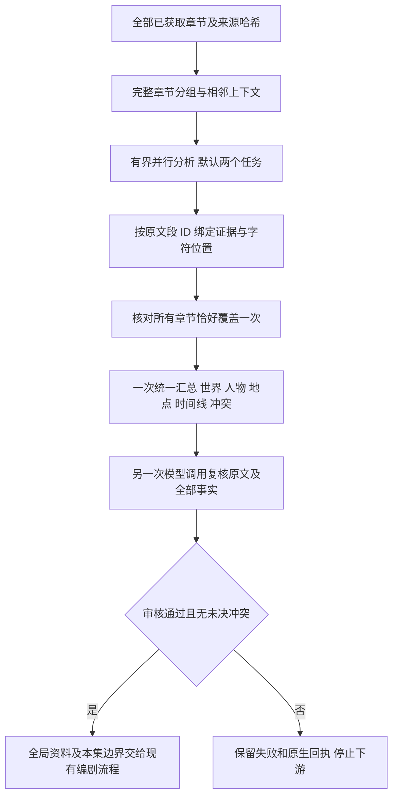

# 小说全部已获取章节的并行分析与统一汇总

本次范围是用户确认的“分组并行分析，再统一汇总”，接入现有番茄全可读章节工作流和 corpus CLI。已有自动剧本仍未验收通过；本文不把旧剧本或人工修改稿当作新流程成果。

## 实现

- 按完整章节分组，相邻章节片段只辅助理解，不算作本组覆盖。原文不由摘要替换；逐章 SHA 核验后保存来源。
- 每组产出原子事实、人物与地点、事件时序、状态、冲突和来源段 ID。程序从原文回填证据，不要求模型重新抄长引文。
- 引文保存原章节字符偏移。同一句话多次出现时按实际位置核对；旧数据缺乏位置且存在歧义时拒绝默认选择第一次。
- 汇总统一角色与别名、地点包含关系和时间线；事实与创意设计分栏。计划、回忆和已发生事件分别保留，避免后文知识提前进入本集。
- 汇总请求使用去重证据目录，复核请求合并重叠上下文，减少重复原文。结构覆盖不等于事实充分或内容正确，仍须模型语义复核。
- 新流程将 `global_bible` 和 `episode_brief` 传入现有 v4 创作与审核，修复此前删除中间字段时可能丢失全局资料及本集边界的问题。
- 本次没有实现完整的画风设计、各级场景资产、多视角角色图和视频生产；这些是全局资料通过后的后续阶段。

## 调度与记录

`corpus_analysis_parallel_v2.py` 控制并行数量、组状态与汇总顺序；`corpus_parallel_calls_v2.py` 统一持久派发、用量和请求绑定。成功组保存独立检查点，复用前校验来源、策略、请求和结果哈希。

已完整收到但格式、引用或覆盖不合格的组允许一次协议返修。已知失败组可通过显式 `retry-analysis-groups` 入口处置，成功组保持；该入口不自动增加预算，也不允许重派未知结果。已经冻结全局合并后的语义退回不通过此入口重写成功组。

超时、截断、未知用量及未知完成状态分别保留证据并停止；已有并行请求收尾保存，不因其中一个成功而清掉另一个未知状态。旧版本计划不静默升级，旧调用、失败及累计消耗保留。

## 入口

- `scripts/run_corpus_screenplay.py prepare` 新计划默认并行分析，现有番茄 corpus 工作流沿同一 prepare 入口接入。
- `--analysis-workers` 默认 2，允许 1—4；`--analysis-group-chars` 默认 12000；`--analysis-context-chars` 默认 2000。
- `--analysis-only` 冻结为仅分析，汇总审核通过后停止，不启动编剧。
- 本机测试可指定 `--analysis-local-model qwen3.5:9b-q4_K_M --analysis-local-endpoint http://127.0.0.1:11435 --analysis-context-tokens 65536 --analysis-max-output-tokens 8192`，且必须使用 `--analysis-only`。
- 本机适配器只允许回环地址，冻结模型摘要；输入保守容量超限时在 HTTP 发送前拒绝，不接受静默截断。

旧计划保持原路线。没有重启账号后台或前端服务，不能将源码接线称为所有在线网页和后台任务均已更新。实际新模型测试仅使用本机 Qwen，没有新增云端调用、媒体生成或发布。

## 测试边界与发现

真实来源为《你敢惹我？我有六个反派儿子》已获取的 69 章、150503 字符。未取得的锁定章节不算覆盖。69 章完整性、分组覆盖及调度用隔离测试验证；本次本机模型小样使用其中第 1—3 章，不将小样称为 69 章全部模型验收。

| 真实本机实验 | 实际结果 |
|---|---|
| v2 | 两组初稿与返修均有引文改写、拼接，4 次请求后停止。 |
| v2.1 | 三组通过证据校验，79 条事实；汇总因重复证据超过本机保守容量，在 HTTP 前停止。3 次实际请求，另有 1 条未发送的派发记录。 |
| v2.2 | 输入去重后，第 2 组仍把邻章参考内容当作本章事实，返修未纠正；4 次请求后停止，没有汇总或新剧本。 |
| v2.3 | 三组共 31 条事实通过来源校验，汇总及返修均把人物、事件或状态混入 world；5 次请求后停止。独立原文复核另检出继子误成亲子、面包来源错误及内心回忆误成对话等，没有内容验收通过。 |
| v2.4 | 三组来源校验通过，世界规则分类约束生效；汇总及一次返修仍将“老大叶东”和“叶东”等同一人物重复登记，5 次请求后停止。未进入全局模型复核或编剧。 |

v2.2 相关回归 182 项、v2.3 相关回归 187 项通过，报告分别为 `data/qa/parallel_corpus_acceptance_20261025_v22.xml` 和 `data/qa/parallel_corpus_acceptance_20261025_v23.xml`。此前失败的测试报告与真实模型回执均保留。最终版本与后续实测结论在文末追加，不回写旧实验。

v2.3 明确标注核心正文与相邻上下文，模型证据列表仅允许核心正文；错章错误提供具体事实 ID、声明章号及实际证据章号。真实 69 章分为 14 组，全部原文字符和 SHA 一致，核心章节恰好覆盖一次；各组保守容量均在 65536 内，证据为 `ALL_69_COVERAGE_V23.json`。

完整 69 章在一次汇总、一次复核中的容量和语义质量尚未真实验收。单 GPU 上两个请求可能由 Ollama 内部排队；并行调度测试通过不能证明本机推理变快。

## 最终验收状态

代码版本为 `corpus_analysis/v2.4-experimental`。最终 **192 项相关测试通过**，覆盖合同、并发与持久化、错误阻断、69 章隔离调度、默认入口、上下文承接及旧流程兼容。最终报告为 `data/qa/parallel_corpus_acceptance_20261025_v24.xml`。

最后一轮新增 5 次真实本机请求、59674 reported tokens，全部返回 stop，最终 `needs_attention`、`pending=null`。汇总候选同时给“老大叶东/叶东”“老二叶南/叶南”等分配不同角色记录，并互相重复别名，程序以 `entity_alias_assigned_twice` 阻止下游；不能删掉错误记录后称审核通过。

v2.4 三组原生事实与 v2.3 的源文件、输出摘要逐一相同，原文独立复核结论可精确复用。除人物重复外，亲生/继关系、面包来源、内心/说出信息、事件发生阶段、假设/确定性及第三章因果遗漏仍不合格。`INDEPENDENT_SOURCE_REVIEW.json` 单独保存这些意见，没有手工改写模型结果或替换小说正文。

本轮五个版本累计 **21 次实际本机请求、206825 reported tokens**，另有 v2.1 一次在 HTTP 前拒绝的容量记录；全部新运行已结束，无未决请求。新增云端、媒体及平台写入均为 0。总验收证据为 `data/corpus_parallel_trials/20261025_v2/DEVELOPMENT_ACCEPTANCE.json`。

结论：并行来源分析的代码和工程回归已完成；**真实自动内容质量尚未验收通过**，全局语义模型复核没有实际走到，新剧本没有生成。下一步需要处理同一人物不同称呼的归并和原文语义可靠性，再验证完整 69 章汇总容量；不能仅放宽校验、换人工稿或重复运行旧任务。

## 证据与代码

- 实验目录：`data/corpus_parallel_trials/20261025_v2/`。
- 来源合同：`src/content_factory/corpus_analysis_contract_v2.py`。
- 调度器：`src/content_factory/corpus_analysis_parallel_v2.py`。
- 并发调用账本：`src/content_factory/corpus_parallel_calls_v2.py`。
- 入口与上下文承接：`src/content_factory/corpus_screenplay_v1.py`。
- 本机适配：`src/content_factory/corpus_local_analysis_v2.py`。
- 新测试：`tests/test_corpus_analysis_contract_v2.py`、`tests/test_corpus_analysis_parallel_v2.py`、`tests/test_corpus_parallel_calls_v2.py`、`tests/test_corpus_parallel_integration_v2.py`、`tests/test_corpus_local_analysis_v2.py`。
