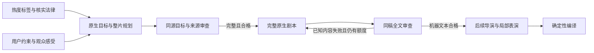

# 目标、上下文与接口合同修复交接

用户要求继续修改流程，关注规则、上下文空间和正确接口数据。按先计划、三名子 agent 分模块开发、主 agent 接线与独立交叉审查执行。本轮完成独立离线合同与请求准备入口，没有把旧冻结入口迁移成新版本。

## 实际修改

整片阶段负责人物诉求、阻力、策略变化、情绪因果及场内后果；正文负责有目的的对白与关键行为；局部表演负责反应窗口与共享状态，编译负责引用、物理前提和时间。没有把所有镜头朝向和秒级动作再塞进整片模型。



F、G 为保留的下游分工，本轮没有调用或迁移下游生产入口。机器文本合格与用户采用、实际视频通过分开。

1. `creative_goal_source_contract_v2.py`：原生完整规划区分用户硬约束、观众目标、平台观察、核实法律、虚构选择和推断。只检查可确定的结构与引用；真实标签 `tag:劳动争议` 可直接引用。人物起态、持有和所有权分离。法律问题可开放，同时需要声明场内选择、回应或后果；没有固定台词、唯一结尾或职业词禁词表。
2. `creative_stage_context_v2.py`：按目标规划、完整正文、同稿全文审查准备上下文；完整法律条件、标准、R01及当前全文保持原样。71个选中来源ID和6条代表元数据保留，重复标签/关系支持列表及无关历史全文留在本地；每项保留/省略有路径、理由、字符、字节与SHA。原故事的SHA和导演7/7继续保留，移出旧全文不等于已经证明新故事或获得新额度。
3. `creative_full_review_contract_v2.py`：同一覆盖规范生成出站Schema和本地验证。每句、每步、起态与结尾按真实ID键恰好覆盖一次；补对白作用、刺激/反应、动作前提和场内结果证据。后来动作不能补早期起态；状态链只核模型提交的断言与原文引证，不能自行证明模型理解了自然语言动作。
4. `creative_goal_context_workflow_v2.py`：将上述模块实际接到独立请求准备器。目标先完整类型验收，再做来源/目标语义审查；作者请求必须绑定同一目标、法律、平台、用户上下文及审查SHA。原生值仅复制为兼容审查视图，未知细节不手填；创作选择保留kind和authority标记，不据它创造强制源事件先后。来源目录指向真实输入路径，L001–L006不让模型猜编号。
5. `preview_goal_context_workflow_v2.py`：真实529来源的独立预览入口，核对完整来源与compact投影身份、来源有效性及1151个旧冻结文件；复演530旧回执。无客户端构造、凭据读取、服务claim、网络派发或媒体操作。

## 主 agent 发现并修正的接线问题

- 初版按键展开的全审Schema达到113172字符，改用标准JSON Schema的`$defs/$ref`复用，最终17816字符（实际529输入）。旧Schema为约12588字符；新增检查仍增加合同内容，不能宣称所有输入都比旧版本少。
- 目标审查最初只绑定目标SHA，已补实际来源/法律/用户上下文SHA；改上下文不能复用旧pass，作者请求身份包含该审查SHA。
- 追加原生规划后重新检查字符/字节预算、单次R01出现和payload身份；结构不全或超人物上限的规划在花审查费用前拒绝。
- 原生JSON对象不存在时，不建议内容返修；截断、未知结果、未知用量、缺工具、精确模型或来源身份不符各自停止。完整已知内容失败才建议在原额度内提交完整新稿。建议函数本身不发请求、不增加或清零计数；格式恢复仍需既有独立额度，不能从本函数重领。
- 完整来源校验与实际请求投影逐项绑定，不能校验新批却发送旧批。

## 接口与上下文的实际边界

MiniMax仍为已真实验收的`MiniMax-M3.1-Flash-Preview`，使用`reasoning_effort=medium`和`max_completion_tokens=16000`；没有加入未经证实的strict或强制工具字段。DeepSeek仍非thinking配命名工具选择。官方说明该组合支持命名工具；strict为另外的Beta协议，且其Schema子集不支持本合同使用的部分长度/数组约束，不能直接开strict就宣称强制保障。

官方依据：[DeepSeek Chat Completions](https://api-docs.deepseek.com/api/create-chat-completion/)、[Tool Calls](https://api-docs.deepseek.com/guides/tool_calls/)。本地`$defs/$ref`合同和实际SDK出站映射已验证，新的服务端接受与完整返回尚未测试。

独立预览配置`creative_goal_context_model_profile_v2.json`保持模型和协议，目标审查输出上限8000、完整审查24000。官方max_tokens范围允许该值；新档位没有实际付费验收。530漏21句检查仍消耗8903 completion tokens，因此新完整检查可能超过旧12000上限，这是有依据的风险推断，不是已查明服务端故障；本轮为全审预留较大输出空间并要求简明证据，截断仍停止，不能删表凑通过。旧生产profile没有修改。

最终目标规划user payload为29936字符，旧529完整正文返修payload为73789字符。两者是不同阶段，不是同条件的创作质量或token对比。新阶段的实际prompt tokens未知；R01为2313字符，恰一次，法律全文不变。

## 验证和实际产物

主 agent最终合并回归125项通过，去重计数为目标30、上下文30、全文审查38、集成27。合成故事/审查仅用于合同、状态和接线测试，不是实际生成新稿或审美金标。

真实530原稿的`dialogue_checks=[]`复演为`DIALOGUE_COVERAGE_EMPTY`，原native输出、原账本和拒绝状态不改。已known的新内容失败不会被结果未知覆盖；未知不会被解释为可以重试。

入口：

```powershell
.\.venv\Scripts\python.exe scripts\preview_goal_context_workflow_v2.py --output data\qa\goal_context_contract_refactor_20261013\request_preview_next
```

必须使用该QA根下尚不存在的子目录；已有预览不覆盖。

实际请求预览：`data/qa/goal_context_contract_refactor_20261013/request_preview_r3/`，含SUMMARY、完整逻辑请求、预期SDK body、字段manifest、用户目标和旧稿新审查Schema。最终验证：`data/qa/goal_context_contract_refactor_20261013/ROOT_COMBINED_FINAL_r2.xml`。早期预览r1/r2和调试证据保留，不当最终版本。独立复核发现r2把来源重验对象SHA误命名为原包SHA；r3分别保存原包SHA与revalidation_snapshot_sha256，原包与compact身份比较门一直有效，没有改变实际来源。

本轮新增模型调用0、媒体0、发布0；累计仍530次/10025612 reported tokens，历史未知70/160及93117预留不变。旧1151个冻结文件与两个生产账本保持原校验值。

## 未完成与恢复

这不是生产质量通过。没有实际新原生规划、新全文、新导演、表演、交接或视频；旧529不因新合同通过而变合格。新合同需要真实接口和原生完整稿验证，特别是Schema引用、语义来源分类、动作断言漏检与输出容量。

独立预览明确`production_dispatch_eligible=false`：完整旧稿的故事范围比较与候选额度、原生结果/用量证据、持久claim和运行器仍须接入生产协调门。新审查不把旧全文塞进每个阶段，也没有执行原prior_story_relation；故不能靠接入预览器就恢复7/7或重启529/530的一稿一审。未决/重入/重复派发继续由已保存的持久运行器与旧claim处理，本预览器没有派发能力。

开发前v8副本保留；本轮最终独立开发副本另存`data/development_checkpoints/creative_goal_context_release_20261013_v9_r2`，较早v9不覆盖。如果后续效果不满意，可以恢复v8或使用旧入口；恢复不能覆盖冻结、消费、凭据、原始媒体，也不能恢复次数或重派已提交请求。
