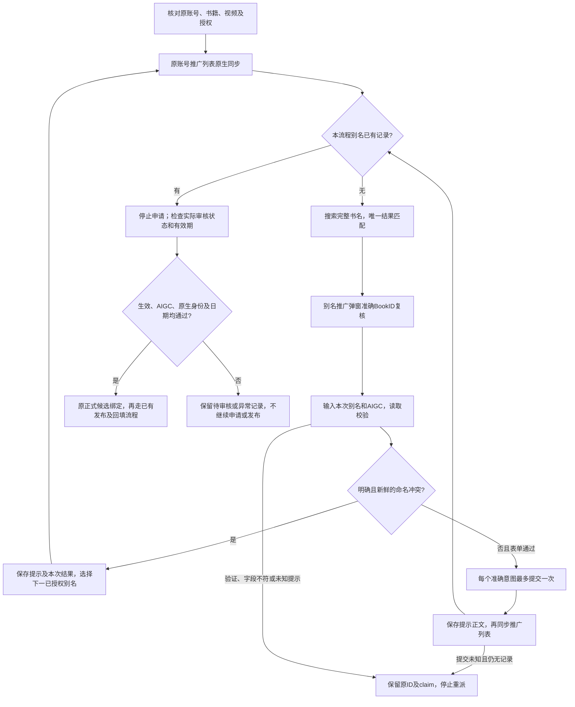

# 番茄别名申请闭环

本流程复用原绑定账号、专属浏览器执行器和正式推广台账，不重新生成视频。入口为 `scripts/run_fanqie_alias_flow_v1.py`，支持 `prepare`、`step`、`run` 和只读 `status`。运行配置绑定准确书籍、账号、已有视频候选、固定别名候选列表、用户授权及旧未知记录的校验值。

搜索只接受完整书名唯一匹配，最终以弹窗中的准确书号复核。原始附件中的高亮文本也出现在近似书名中，不能以高亮、第一项或子串代替准确匹配。异步搜索还必须有实际结果更新证据。

“与热门书籍/短剧/作者相似度高”是已观察的命名规则。只有同书、能够绑定本次别名、可见且新鲜的具体校验，才能进入下一别名；隐藏或旧提示、泛化失败、单独的空字段或按钮禁用、成功字样以及技术任务成功都不等于推广业务结果。

实际平台还会在点击提交后清空输入框，因此必须分别记录“本次提交的别名”和“回执时的字段值”。提交后清空字段时，仅在精确提交前读回、单次受控点击、同一书籍、可见的新命名提示及完整时序证据一致时，将回执绑定到提交主体；保留当前字段为空、`same_alias=false`的实际观测，不伪造字段仍有原值。旧回执的重新解释必须生成单独派生证据，绑定原回执、提交claim、准备阶段及当时源码，不覆盖原件或擅改原未知记录。空输入本身不能证明命名失败。

`AliasFlow` 每次外部排队前保存不可变意图和 `dispatch_pending`。进程中断后保留未知状态，不重新排队。单目录使用操作系统锁，防止两个调用同时推进。同一准确别名仍受原全局一次提交claim约束；旧“六子改命记”的未知记录与claim不变，新授权仅产生新的具名后继申请。

新别名候选数量由用户本轮授权范围固定，最多8个；用完即保留失败证据。遇平台验证、账户变化、读写结果未知或同步不完整即保留原任务并停止。这里不绕过验证码，也不把当前列表为空推断为历史申请已被拒绝。

真实回执另已观察到“仅支持汉字及阿拉伯数字，字数限制为4-8字”。新流程准备阶段会保守校验待申请候选为4–8个常用汉字或0–9数字，超长或带标点的候选在排队前拒绝。此规则不作用于历史状态读取或仅用于查询的旧别名，也不重写已有计划。该原句作为组合格式规则处理，不把所有格式错误都归因于长度。

别名流程本身不会发布或回填。仅在取得实际原生推广记录后，后继仍调用既有正式 `PromotionWorkspace`：绑定原候选、保存用户已授权的实际视频审看记录、冻结带AI声明及标签的发布资料、一次发布、读取真实作品链接及日期、按官方模板回填。每次写入前仍需新鲜账号和推广身份核验。不会拿旧缓存的“可发布”结论直接发文。
