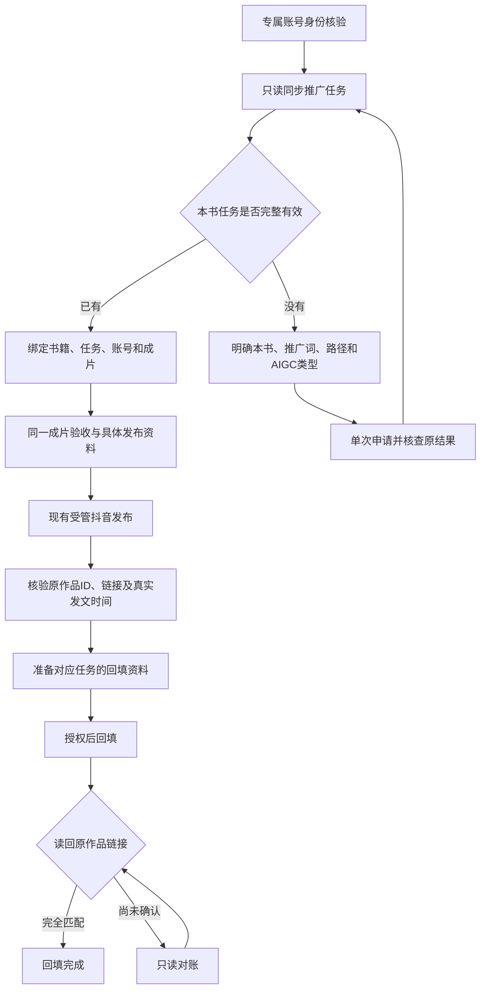

# 小说推广受管流程：实现与验收边界

本版将已有 H3 成片接入番茄推广、抖音发布和链接回填。新入口采用[原生推广词身份路线](FANQIE_NATIVE_ALIAS_FLOW_V2_20261116.md)：推广快照 v2、回填契约 v3。旧快照和旧回填契约继续按原版本解释。生成新视频、修改小说正文和恢复养号均不由本流程隐式触发。

## 模块职责

| 层 | 入口 | 职责与边界 |
| --- | --- | --- |
| 管理入口 | `fanqie_accounts_panel.py`、`run_fanqie_promotion_workspace_v1.py` | 展示原任务和业务状态，收集明确操作意图；查看状态不迁移、不调度 |
| 业务编排 | `PromotionWorkspace` | 委托现有模块，不创建第二套业务队列或浏览器 |
| 专属执行器 | `FanqieAccounts`、`BrowserControlActor` | 固定资源、账号关联、owner generation；一个资源串行执行 |
| 推广适配 | `fanqie_managed_promotion_v1.py`、`fanqie_promotion_identity_v2.py` | 从可见列表及同次受管原生观察唯一关联推广词，统一身份与授权 subject；固定准确申请 |
| 成片与发布账本 | `CandidateLedger` | 在原 P0 账本登记来源、候选、任务和原发布凭据 |
| 发布凭据 | `PublicationEvidenceReader`、`publication_time_evidence_v1.py` | 核原发布命令及作品；日期来自原发布或同账号作品同步证据 |
| 回填业务 | `PromotionLedger`、`BackfillCoordinator` | 固定原作品与任务、提交前保留意图、按同链接读回确认 |
| 回填页面 | `FanqieBatchPageAdapter` | 操作调用方拥有的页面；不新建浏览器、不复制认证信息 |

## 数据边界

- `douyin.db` 保存现有运营账号与真实身份绑定，登录核验和后台暂停是不同状态。
- `account_browser_control.db` 保存原浏览器命令、owner、绑定版本和执行记录。
- `fanqie_closed_loop_p0.db` 是唯一推广业务账本。新候选、原生身份映射与回填扩展只在一致性备份之后显式迁移。新任务增加原生身份 scope；旧“书籍＋推广词”唯一索引仅继续约束旧任务，新任务按账号内原生身份唯一。旧数据和本地主键保留。
- 工件保存固定文件路径与 SHA；工件目录不代替账本中的业务状态。
- 数据库读取失败标为不可用；不能将它解释成空数据、未部署或正常状态。

## 绑定与审查

1. 新 v2 身份是已验证的平台账号＋系统分类 `promotion_alias`＋原生字符串 `alias_id`，不再额外制造任务 ID。书籍、推广词、实时枚举映射的 AIGC 类型、实际可用状态及有效期分别校验。旧 v1 双 ID 契约仅用于原版本回读，不重新解释旧授权。
2. 提交前重新检查新鲜平台观察。稳定业务意图与会过期的观察证据分开，刷新观察不等于更换任务。
3. 已有 H3 片登记为候选时保留原质量状态与问题记录。技术校验、用户验收和发布授权分别记录。
4. 来源可以包含多份选段或修词版本，按各段真实引用保存；不强制整片只有一个选段文件。
5. 发布资料授权绑定实际成片 SHA、账号、标题说明标签和推广任务。AI 与虚构声明沿用已有发布接口。
6. 同一任务可以关联不同成片和不同作品；相同作品不能重复登记到不一致的任务或账号。
7. 回填使用原作品的 ID、链接和发文日期。当前时间、文件时间和核查时间均不能代替发文日期。

## 异常与完成语义

| 情况 | 处理 |
| --- | --- |
| 原登录任务仍在运行 | 展示原任务；不将复用的登录任务显示成新业务已入队 |
| 必要身份、类型或日期缺少证据 | 保持待同步或阻止写入，不用标题、行号或当前日期补造 |
| 已明确证明浏览器未启动的只读失败 | 仅列表/目录允许精确证据与事务 CAS 结算为本地失败，原 unknown 快照完整保留，不重派未知写任务 |
| 正常处理结束，但申请或回填尚未确认 | 命令可结束，业务仍待核查；只允许读取原结果，不能据此显示成功或自动重复提交 |
| 派发已入队，但本地未保存回执 | 按账号、原意图和完整请求找回同一原命令，不重派 |
| 进程硬崩、失联或 generation 失效 | 保留原未知状态与锁；本版不自动跨进程接管并重提交 |
| 同一推广项已有其他作品链接 | 保留已有链接；只有追加能力得到平台证据确认后才能追加，不覆盖 |
| 平台读回完全相同的原作品链接 | 才将回填业务标为完成 |

## 验收层次

需要分别报告以下结果，不能相互替代：

1. 真实 P0 表结构下的本地数据库回归。
2. 隔离页面上的真实 JavaScript/DOM 黑盒测试。
3. 当前真实成片及其来源链的本地登记检查。
4. 专属账号的一次真实只读平台同步。
5. 有具体任务、发布资料和授权后的真实申请、发布与回填验收。

当前开发记录和各层实际结果以 `data/flow_development/novel_promotion_managed_v1_20261116` 的最终结果为准。本说明不表示真实平台写入或无人生产已经验收完成。

## 真实平台契约核对

2026-11-16 的原账号只读同步最初成功读取五条推广记录，可见表格没有直接提供原生 ID。后续受管响应观察确认其有原生 `alias_id`。新 v2 公共路线 `807279140b774639a73ed6f141ba7a38` 已实际读取并核验五个原生身份；四条失效、一条审核不通过，当前小说不在其中。旧实现名为 `task_id` 的本地时间编号不能充当原生平台 ID。

新代码已让候选登记、发布授权、P0 映射和回填消费同一个原生身份 subject。身份补齐不等于可发布；这五条旧项仍不可用，也不能借给当前小说。新版写链的本地验收与实际平台写入验收分别记录。

页面实际有效期使用全角 `～`。旧 v1 新捕获使用 `normalizer_version=v1.1`，未带版本的旧快照沿用旧解析器；v2 使用 `native_alias_v2`，从原生 alias 起止日期核对可见日期。冻结证据按原观察时钟重建，当前新鲜度和有效期另行校验，避免工件正常过期被误判为篡改。

平台元数据诊断仅在专属 owner 已拥有的页面内选择实际观察到的同域路径，监听页面自然产生的响应。保存受限的推广元数据与结构信息，不复制认证信息，不猜接口参数，不据诊断结果自动申请或提交。
