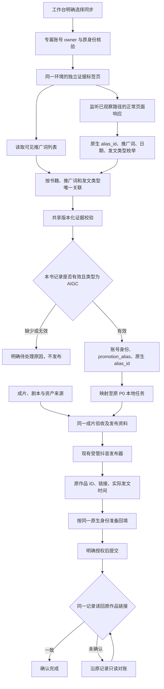

# 小说推广：原生推广词身份路线

状态：代码审查、本地整链和真实只读路线验收通过。正式迁移、后台部署及真实申请/发布/回填尚未执行；本书仍无有效推广记录。

## 身份与业务条件分开

真实平台响应中的这类记录有 `alias_id`。内部身份是“已验证的平台账号身份＋实体种类 promotion_alias＋原样字符串 alias_id”。实体种类是系统对已观察记录的分类，不能声称平台另有一个同名字段，也不能复制 `alias_id` 冒充第二个任务 ID。

书籍、推广词、发文类型、有效期和可用状态是独立的业务条件。发文类型从同次观察的 `kol_alias_post_type` 枚举映射，不把本次看到的 AIGC 编号写成永久常量。`task_type` 保留原值，含义未确认时不推断路径；其变化也不能静默沿用旧发布授权。

可见列表与原生记录必须唯一关联，不能按行序匹配。重名、冲突、类型不符、日期缺失、观察不完整或身份未确认都保留明确原因。结束日期只有日期精度时，系统采用保守截止策略，不将它宣称为官方已经证实的精确到期时刻。

## 组件边界

| 组件 | 负责 | 不得隐式执行 |
| --- | --- | --- |
| 工作台 | 显示原任务、收集具体意图 | 迁移、恢复账号、发布或补造平台身份 |
| 专属 owner | 同账号串行、原身份与 generation 校验 | 换账号环境、接管未知写任务 |
| 独立证据标签页 | 读取列表与受限原生元数据 | 导航正在填写的回填表单、猜接口参数 |
| 共享身份模块 | 唯一解析、证据重建、稳定授权 subject | 自行请求平台、创建浏览器、改账本 |
| 成片登记 | 关联原 P0、媒体 SHA、原剧本与技术记录 | 升级旧质量结论、调用视频模型 |
| 原发布器 | 执行明确授权的同一发布请求 | 丢回执后重复上传 |
| 回填 | 固定原作品与原生推广词，读回确认 | 覆盖其他作品链接、未知后重复提交 |

## 账本兼容与迁移

继续使用原 P0 账本，不建立第二套任务库。旧本地任务主键、UUID、记录状态与旧授权保持。原生身份使用独立映射，原 `platform_task_id` 对新原生推广词记录为空。

原全局“书籍＋推广词”唯一索引只继续约束旧任务；新任务按账号内的原生身份 scope 唯一。调整涉及显式迁移、迁移前一致性备份、事务内再次核对旧结构，以及迁移后逐列保留旧数据的测试。查看状态和构造服务对象不触发迁移。

旧 `snapshot/v1`、旧授权与 `backfill_contract/v2` 仍按原规则解释。新 `snapshot/v2` 和 `backfill_contract/v3` 使用共享原生 subject，不能借旧授权自动切换新语义。

## 本轮实际平台事实

2026-11-16 的原账号只读观察成功获得五条推广词记录、原生字符串 `alias_id` 和十二项发文类型枚举。四条推广词已失效，另一条审核不通过；当前目标书没有对应有效记录。身份解析补齐也不能使这些旧项变为可发布任务。

观察只保存受限推广元数据及结构，不保存认证信息或完整原生响应正文。真实写链验收还需当前书有效任务和具体发布资料。本轮未申请推广、发布作品或提交回填。

最终源码、实际工具退出码和验收结论以项目监控目录中的最终报告为准；本页开发说明不代替验收结果。
