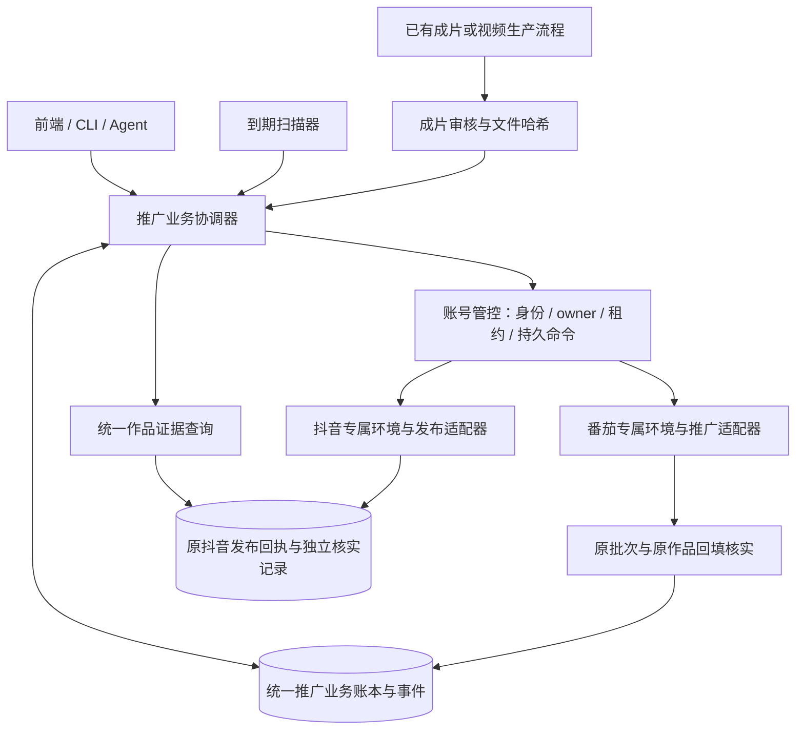

# 番茄推广接入：现有架构分析与开发规范

本文根据 2026-10-24 的源码、数据库表结构及当日页面观察制定。它是后续开发基线，**不是已上线说明**。本轮只分析和编写规范，没有迁移数据库、部署服务、申请推广词、发布或回填。

核心设计：沿用账号管控层管理浏览器和命令；由推广业务层统一关联书籍、推广任务、成片、抖音作品与番茄回填；平台适配器负责页面操作和结果观察。已有成片可以直接进入审核与发布准备，不要求重新生成或先完成养号。

后续开发状态见[第一批实现与验收](FANQIE_ARCHITECTURE_IMPLEMENTATION_20261024.md)。本文保留设计基线，具体已实现和待接通范围以实施记录为准。

## 1. 现状与缺口

| 模块 | 已有实现与证据 | 接入前仍需解决 |
|---|---|---|
| 账号与浏览器管控 | `src/operations_accounts/browser_control.py`、`browser_control_runtime.py`：owner、generation、持久命令、账号互斥、安全切换 | 当前身份绑定和运行路径主要针对抖音，不能直接宣称番茄也受同等管控 |
| 身份与环境 | `models.py` 有 AccountProfile.platform；`repository.py` 保存 DouyinIdentity、绑定版本、专属环境和运行租约 | 平台字段存在不等于多平台绑定完成；需要番茄稳定身份和独立环境 |
| 抖音发布 | 管控层执行发布，`creative_delivery.py` 保存媒体哈希和发布核验依据 | 建立统一作品证据查询，兼容原成功回执及独立核实后的历史未知结果 |
| 番茄推广申请 | `src/platform_adapter/fanqie_promotion.py`：申请、列表读取；默认类型已改 AIGC | 仍直接打开全局 `data/browser/fanqie/user_data`，未按番茄账号接入 owner；旧生成路线不作为本次视频入口 |
| 回填首版 | `src/services/fanqie_backfill_workflow.py`：发布回执绑定、模板导出、占位；`src/platform_adapter/fanqie_backfill.py`：批量弹窗适配 | 身份探测和 guard 尚为注入接口，无生产接线；缺批次结果追踪、持久核实事件及后台调度 |
| 业务数据 | `data/fanqie_closed_loop_p0.db` 已有书籍、任务、发布、回填、审核和事件表 | 当前未确认有完整维护这些表的现行仓储及迁移链；不能把历史表存在当成闭环可用 |
| 任务调度 | 账号扫描器与通用 TaskQueue 已存在，业务通过管控命令执行 | 未发现完整番茄回填注册链；需要统一到期扫描、原任务追踪及去重 |

首版回填的 48 项联合回归和官方模板导出检查证明了局部实现，尚未证明真实上传、平台接收、回填成功或无人值守恢复。详见[开发记录](FANQIE_BACKFILL_DEVELOPMENT_20261024.md)。

### 需要优先修正的具体设计问题

1. **业务记录分散。** P0 数据库已有 `fanqie_bindings` 等表，首版又在调用者指定数据库建立 `backfill_jobs`。生产接线前确定唯一写入路径，不能各自更新“完成”。
2. **身份不足。** 首版的番茄账号字符串不能证明登录身份；别名文本也不能替代稳定推广任务 ID / alias_id。昵称只用于展示。
3. **去重键不稳定。** 当前准备逻辑对整条命令记录及绑定内容计算摘要，更新时间等变化可能改变 job_id。业务唯一键与证据版本摘要应分开。
4. **去重范围偏窄。** 当前按番茄账号、别名、链接去重，仍可能把一个抖音作品填到另一个任务。默认一个作品只绑定一个推广任务。
5. **结果分类不足。** 上传、提交和结果读取失败统一进入 outcome_unknown，无法区分“已接收、待处理”和“是否提交不明”；观察到已存在时还缺少持久核实结案。
6. **异步结果缺失。** 提交后立即重读当前列表不能覆盖批量历史、行级失败、分页和延迟处理，必须追踪原批次及原行。
7. **数据来源需固化。** 展示抖音号、发布日期和授权引用目前可由调用者提供；生产服务必须校验来源并保存不可变绑定，不能仅信任字段格式或调用者传入的 `verified=True`。

## 2. 目标模块边界

下图为目标结构；“推广协调器、统一作品证据、番茄身份管控和回填核实器”仍需开发或完善。

| 层 | 必须负责 | 边界 |
|---|---|---|
| 交互层 | 选账号、书籍、成片；展示准备内容、状态与待办 | 不直接打开独立生产浏览器，不直接改任务终态 |
| 推广业务层 | 关联实体、冻结输入、审核和授权范围、阶段推进、去重、核实与审计 | 不实现页面选择器，不越过账号管控 |
| 账号管控层 | 各平台身份、环境归属、owner 世代、租约、暂停、命令准入与安全切换 | 不承担书籍内容判断或把网页健康认作业务完成 |
| 平台适配层 | 读取实际页面、上传、点击一次、返回结构化观察与平台 ID | 不自行换账号、重新提交未知操作或决定全流程成功 |
| 调度层 | 领取到期业务、投递原命令、跟踪原结果、有限退避 | 不因超时创建新发布/回填请求 |
| 证据与文件层 | 保存输入版本、回执、模板、文件 SHA 和审计附件 | 不保存账号密码；日志不写 Cookie、token 或认证头 |

## 3. 身份与数据绑定规范

### 3.1 两个平台分别核验

运营账号 `novel_account_02` 当前代表抖音运营身份。新增番茄平台身份绑定，以平台稳定标识、绑定版本、专属环境键共同确定资源；不得用抖音 UUID、昵称或当前任意浏览器登录状态代替番茄身份。

建立显式的“番茄身份 → 抖音绑定”关联及关联版本。一个番茄身份可支持多个经确认的抖音绑定，但任务必须固定其中一个；切换账号不改变已冻结任务。新绑定的创建与确认沿用管理员身份确认流程，不把临时观察到的昵称自动绑定。

番茄稳定身份获取尚待实现。如果页面不能可靠提供，显示“身份待核验”并阻止外部写入，不能降级成昵称相同即通过。

### 3.2 必备业务合同

| 对象 | 必备字段与约束 |
|---|---|
| 推广任务 | 本地 task_uuid、番茄身份及绑定版本、平台任务 ID / alias_id、书籍 ID、别名快照、指定发文类型 AIGC、推广路径的原始值与展示名、有效状态与有效期、观察时间 |
| 成片 | asset_id、绝对路径、SHA256、来源、审核决定及审核版本；使用现有资产入口，不能因为没有旧 video_job 就强制重新生成 |
| 抖音发布意图 | 原命令 ID、原账号 UUID / 绑定版本、成片 SHA、标题正文标签快照、AI 声明要求、授权记录；已提交后不可原地换片 |
| 已验证作品 | 稳定作品 ID、规范链接、原账号、实际发布时间及来源、验证证据 ID、原发布意图；审核中与已发布分别表示 |
| 回填意图 | 推广任务、已验证作品、番茄身份版本、跨平台关联版本、模板版本/SHA、填写内容摘要、授权范围、稳定业务键 |
| 执行尝试 | attempt_id、原命令 ID、owner generation、当前阶段、开始/结束时间、平台批次/行 ID、结果与证据引用 |

推广路径必须来自任务实际选项及其含义，不能只保存页面序号；指定发文类型 AIGC 与抖音 AI 声明是两个独立字段，均需验证。旧任务类型不静默改成 AIGC；不匹配则作为明确阻塞原因。

日期以可信的实际发布时间转换为 `Asia/Shanghai` 的日历日期，再按官方模板格式输出；禁止用回填当天替代。展示抖音号来自原身份验证证据，不能用 open_id、sec_uid 或内部 UUID 替代。

### 3.3 唯一性和证据版本

- 一个书籍可以有多个推广任务，一个任务可以有多个成片和作品。
- 默认一个 `(douyin, post_id)` 只关联一个推广任务；冲突显示既有关联，不生成新 job 绕过。
- 回填业务键由稳定推广任务、番茄身份和抖音作品 ID 构成；昵称、更新时间、列表顺序、命令整行 JSON 不进入业务键。
- 参数变化形成新准备版本，并重新判断原授权是否覆盖；不能删除原占位。稳定业务键仍约束跨版本重复提交。
- 证据摘要独立记录输入内容和来源版本。原回执保持不变，后续核实以追加事件关联原 ID。

## 4. 业务账本与跨库一致性

### 4.1 唯一业务事实来源

推荐沿现有 `fanqie_closed_loop_p0.db` 的任务、发布、回填及事件模型做受控增量迁移，先补齐现行仓储和迁移版本。必须先核对实际列、索引、外键、历史引用及备份，才能确定迁移脚本；本文不授权直接改表。

已核对存在：`fanqie_books`、`fanqie_promotion_tasks`、`fanqie_promotion_task_aliases`、`fanqie_video_jobs`、`fanqie_reviews`、`fanqie_publish_records`、`fanqie_bindings`、`fanqie_operation_events`、`fanqie_performance_daily`。历史 `fanqie_douyin_accounts` 只经可审计映射关联当前账号管控身份，不另存一套可自行换绑的登录环境。

首版 `BackfillStore` 作为原型和既有证据保留；生产调用迁入统一仓储，不能与旧业务表双写后各判成功。旧 JSON 任务、审核包和测试记录不覆盖、不自动解释成生产批准。

数据库保存关系、状态投影与证据索引；文件保存冻结输入、模板、回执和附件。阶段事件追加保存，当前状态可更新但必须能追溯事件。上传、提交和结果核实不能只保留最后一个 `evidence` 字段。

### 4.2 不跨浏览器操作持有数据库事务

1. 在业务库事务内冻结意图、记录待投递命令和唯一键。
2. 投递器使用稳定 dispatch_key 向账号管控层投递；重复投递应返回原命令 ID。
3. 投递结果和原命令 ID 写回业务库；中途退出后先按 dispatch_key 查原记录。
4. 原命令结果以幂等消费方式进入业务账本，使用唯一源事件键防重复应用。

业务库与账号管控库不是一个原子事务。采用业务库 outbox、原命令查询和幂等消费解决崩溃窗口，不声称外部平台能够 exactly-once。现有管控层如缺少 dispatch_key 原子去重接口，须先补齐再接线。

## 5. 发布证据规范

提供统一 `PublicationEvidenceReader`（拟新增），输出已验证作品或具体阻塞原因，避免各业务直接读取并自行解释底层命令行。

- 原命令成功：核对账号、绑定版本、原媒体、作品 ID/链接及发布核验依据。
- 原命令未知：读取关联的独立核实事件；只有原账号、目标作品和发布意图明确匹配才能提供“后续核实成功”的证据，不回写原未知事实。
- 只有上传成功、点击发布、通用提示、作品管理页跳转，不能证明作品已发布。
- 评论执行结果与作品发布结果分开表达。不能因为后续评论失败就重复发视频，也不能因作品已发布就把评论记成功。
- 当前审核中、已删除、不可访问或身份有歧义分别记录；首版回填要求已验证发布且符合当前推广任务条件。

## 6. 回填状态与恢复规范

不要用一个总 `running/succeeded` 覆盖全部阶段。下列为目标阶段，映射到现有数据库时保留原始状态及迁移说明。

| 阶段 | 完成依据 | 中断后的处理 |
|---|---|---|
| prepared | 绑定、审核、模板及实际填写行已冻结 | 可重新检查，不产生外部提交 |
| ready | 当前身份、任务有效性、作品证据和授权范围通过 | 队列中继续原意图，外部写入前再次检查 |
| upload_started | 上传前已持久记录尝试及阶段 | 核对原上传；结果不明不自动重传 |
| uploaded | 平台确认收到具体文件/上传产物 | 检查原表单和产物；不能仅凭文件选择完成判断 |
| submit_started | 点击提交前持久记录该阶段 | 查原批次和原作品，不能再次点击 |
| accepted | 平台明确接收原提交，关联批次或等价可核验依据 | 只读跟踪原结果，不重传 |
| verify_pending | 已接收但尚未获得明确行级最终结果 | 有界轮询原结果，超出窗口登记待排查 |
| confirmed | 原任务下查到精确作品链接/ID，且批次行结果一致或有等价独立核实依据 | 结案并保存回填时间、来源和证据 |
| failed_known | 平台明确拒绝且错误可定位 | 修复原因，按阶段和授权判断是否允许新尝试 |
| outcome_unknown | 外部动作可能发生，且无法确定结果 | 保留原 ID/占位，继续只读核实；禁止自动重派 |
| human_required | 当前真实验证码、登录失效或需确认身份 | 展示原账号相关页面，人工处理后核验原身份 |

`blocked` 记录具体依赖，不等于失败；`cancelled` 对未派发任务可直接结案，已派发未知须独立审计处置，不能靠取消抹掉外部结果。

一次准备需要明确区分：调度尝试、上传尝试、提交尝试、结果查询次数。读取重试不消耗或扩展提交许可；平台已明确接收后始终追踪原批次。

发现精确作品已回填时，追加核实事件并幂等结案原意图，不只返回 `already_present`。发现同作品在其他任务下，进入冲突待核实，不覆盖。

## 7. 浏览器与平台适配规范

抖音和番茄使用各自绑定的 profile、owner、generation 和租约。不同账号不能共享当前全局番茄 profile。业务按阶段顺序取得资源：读取并冻结抖音作品证据，释放抖音资源，再取得番茄资源；不同时长期锁住两个浏览器。

同一账号任务沿原管控模型串行，发布优先只在可保存进度的安全点切换。禁止在文件上传、提交请求或结果尚未确定时抢占。验证码窗口与业务共用该账号资源，不另外开一个登录环境绕过验证。

页面适配器接收管控层页面与生产上下文，不自行创建 BrowserSession。首版使用的 Playwright `reload`、`evaluate`、locator 和上传方法必须逐项验证与受管控 page 代理兼容；不能以测试中的原生 Playwright page 代替生产代理验收。

生产 guard 从服务端读取真实绑定、owner、租约、暂停和授权记录，调用者不能通过传入恒真函数放行。读取身份失败按未知处理；不将无验证码、空白页或昵称匹配解释为身份已验证。

### 页面与接口策略

当日已观察申词记录、批量回填弹窗和官方 XLSX 模板。目标适配器还须识别原批次、批次状态、行级错误与原任务发文记录，支持必要的分页/详情读取。通用“提交成功”提示只能作为接收线索。

公开前端脚本中的 `/api/platform/promotion/...` 是站点内部接口线索，版本和响应契约未完整验证，不作为公开免费 API 承诺。首版沿已观察的官方网页入口实现；若以后取得官方开放接口权限，在相同业务合同后替换适配器。

模板应维护获准版本、来源、下载时间和 SHA；生成文件必须绑定服务端准备记录并校验实际每个字段，不能只信任调用者自报摘要。表头、列含义或平台发文类型变化时停止提交并记录差异。

## 8. 调度、自启与异常展示

启动链继续沿现有 Windows 登录任务、后台服务、扫描器、账号管控执行器。健康页正常、扫描心跳新鲜、账号可执行、业务有实际进展分别展示，不合并成“自动化正常”。

服务恢复先核对原命令、执行阶段、owner 与原批次：已完成的消费原回执，已接收的继续查结果，未进入执行的沿原 ID 接续，结果未知的保留并核实。不能重启一次就重新发视频或回填。

到期扫描设置退避、查询上限及下一检查时间。初版不新增第二套常驻浏览器循环；接入现有调度生命周期。各阶段的超时和查询窗口应配置化，并在真实批次测试后确定生产默认值。

暂停按实际资源和原因处理：番茄验证问题不解除或伪造抖音健康；抖音观看失败也不能自动改写发布结果。首版保守沿用既有账号准入，若要允许利用冻结发布证据执行番茄独立阶段，需实现并测试明确的阶段准入策略，不能临时绕过全局暂停。

前端每个任务至少显示：目标双平台身份、书籍/推广词/路径/类型、成片审核、抖音作品状态、回填阶段、最近实质进展时间、下次检查、阻塞原因、操作入口。源码已修改、测试通过、服务已加载和真实业务验收分别显示。

用户需要处理的事项限于实际登录/验证码、身份或内容选择与明确授权范围；数据库锁、选择器错误、进程超时属于系统排查项，不提示用户反复登录。正常无变化不反复弹窗，新验证按事件去重展示。

## 9. 实施顺序与验收标准

| 阶段 | 开发内容 | 通过条件 |
|---|---|---|
| P0：数据与身份 | 当前 schema 盘点及迁移、统一仓储、番茄稳定身份、关联版本、dispatch_key | 旧记录保持；串号、绑定变化、重复命令均被准确拦截；迁移备份及恢复验证 |
| P1：业务协调 | 统一作品证据、成片接入、准备版本、授权记录、阶段事件、outbox | 原发布成功和独立核实结果都能正确读取；未知不重发；同作品跨词冲突不能绕过 |
| P2：页面执行 | 受管控代理适配、上传/提交阶段、批次与行结果读取、持久核实 | 隔离浏览器测试覆盖异步处理、分页、延迟、行失败及超时；guard 用生产实现 |
| P3：真实单条验收 | 一个有效 AIGC 推广任务、一份获准成片、原小说号作品、一次回填 | 双平台身份可核实，作品真实存在，番茄原任务精确回填成功，证据和账本一致 |
| P4：自动调度 | 有界扫描、重启接续、停用入口、运行状态展示 | 各中断点恢复不重复提交，原批次可继续核实；再启用明确范围内的自动化 |

关键故障用例必须覆盖：身份或绑定版本变化；词失效/类型和路径不符；同名词；文件审核后变化；模板变化；重复扫描/双进程竞争；占位后退出；上传或点击提交时超时；平台接收后服务退出；批次成功但单行失败；已回填但本地未结案；原发布未知经后续核实；评论失败但发布成功；多数据库写入中断；有验证码及读取失败。

验收记录至少包含源码版本、进程加载证据、原任务/命令/批次 ID、输入和输出摘要、实际状态与未完成项。通过单元测试、隔离 Chrome 或页面静态观察，不能替代 P3 真实验收。

停用仅阻止新的外部写入；保留已提交任务和原结果查询能力。回滚不删除历史事件、不覆盖旧审核、不改变原未知事实。

## 10. 实际验收还需要的业务资料

架构设计不需要用户再决定底层实现。真实验收前需从项目资产和平台现状确定：具体书籍及成片、人工审核结果、对应生效 AIGC 推广任务与推广路径、番茄与小说号的可靠绑定、该次发布及回填的授权范围。已有明确授权应复用，不重复询问。

2026-10-24 先前页面观察到的 5 条旧推广记录均不生效，这只是当时快照；实际执行前重新只读核对，不假定仍旧如此，也不擅自申请新词补齐验收条件。

## 11. 依据与关联文档

- [系统架构](SYSTEM_ARCHITECTURE.md)
- [账号管控实施](ACCOUNT_BROWSER_CONTROL_IMPLEMENTATION_20261018.md)
- [启动与业务组件关系](ACCOUNT_STARTUP_ARCHITECTURE_20261022.md)（故障状态为当时记录）
- [番茄回填首版开发与页面观察](FANQIE_BACKFILL_DEVELOPMENT_20261024.md)
- [推广默认 AIGC 修改](FANQIE_AIGC_DEFAULT_20261024.md)
- [历史闭环方案](archive/2026-09-video-pipeline-reset/pre_reset_mainline/docs/FANQIE_PROMOTION_CLOSED_LOOP_PLAN.md)（仅作为旧实体设计来源，不恢复旧执行路线）

本文新增要求在实施前均属于待开发项；具体运行状态仍以当前原任务回执为准。
