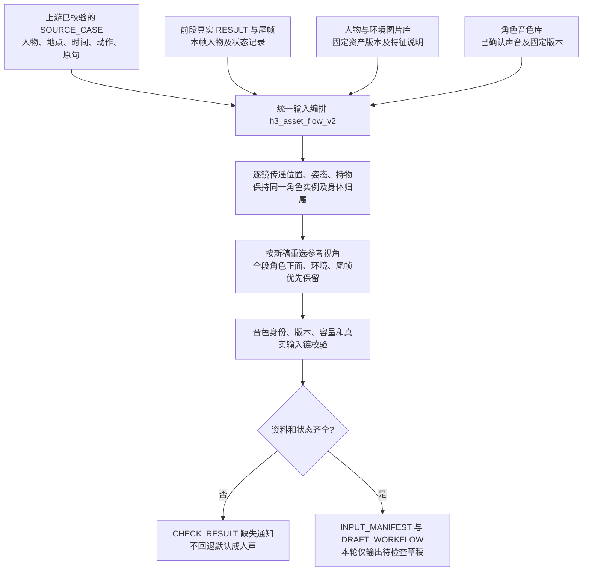

# H3 人物状态与音色资产流程 v2

本轮按“先修改流程，不运行模型生产”实施。新增统一的输入编排入口，只做本地准备和校验；没有文本模型调用、视频生成、ASR、ComfyUI 上传或服务变更。旧生产脚本、已冻结请求、原视频和未知任务记录保留。

## 流程与接入位置



新入口已将图片解析、状态承接、动态视角选择、音色解析和 H3 输入图编译连在一起。当前提供 `prepare`、`validate` 两个离线动作，没有生产动作。旧运行入口及后台默认线路没有被悄悄切换；下一次生产接入应消费这份统一输入结果，再由执行层核实实际上传和返回记录，不能只登记资产 ID 就声称模型收到了资产。

现有旁白判断节点是上游独立的可选入口，接入位置在选段后、`SOURCE_CASE` 冻结前：旁白可以放场景开头、动作或停顿中，不插入连续问答；改成人物口述时只能讲其当时知道的事。该节点本轮没有调用模型。新编排只消费并校验场段资料，不自动调用该节点，也不强制核其模型审核回执，不能声称任意传入稿件都已经过旁白模型审核。

## 本次修正

1. **声音成为独立版本资产。** 新库以书籍、角色 ID、音色资产 ID、版本和音频 SHA 绑定，记录实际 WAV/FLAC 格式、时长、参考文本、声音特点、来源及确认记录。候选、拒绝、撤销或文件变更均不能冒充已确认音色；不自动切换到最新版本。
2. **音色图片分别处理。** 原图片库继续只负责图片。声音通过独立 `LoadAudio` 接入 `MiniMaxH3ReferenceToVideo.ref_audios`，并连接音频 VAE；仅在输出端用 AudioVAE 解码不算输入了音色。模板必须区分 H3 视频 VAE 和音频 VAE，解码端口也须匹配。
3. **视角随新稿重新选择。** 取消旧 `ACTIVE` 固定组合，以本稿发声时长、近景时长和身体动作复杂度排序。先保留全段每位演员的正面、两张环境图及真实尾帧，再分配余下侧面槽位；不静默截掉角色，不强制所有人同框，不锁机位。本次真实 S04 文本的 CPU 重算会优先给叶东侧面参考。
4. **逐镜延续同一人物。** 每镜显式传递镜前与镜后的位置、姿态、视线、持物和角色实例。切近景及切回中景不重新创建一具身体；看自己的手腕必须归属同一角色实例。改变姿态等状态须绑定上游确认的原文动作，不从人物立绘姿势猜当前姿势。
5. **前段尾帧有真实来源。** 校验前段计划、原请求、历史回执和四份已保存原件；状态资料绑定这张具体尾帧及其观察记录。已知复制出第五人的尾帧不可当作正常承接。这里没有增加一般性的“外观兼容”自由改写门。

状态编排模块只检验结构、已声明的动作权限和跨镜承接。`source_actions` 的语义必须由上游小说分析/审核负责；给一条无据动作套上原文 ID，仍然可能形成错误语义。不能把本地结构测试当作小说理解或画面质量通过。

## 使用入口

```powershell
.venv/Scripts/python.exe scripts/prepare_h3_asset_flow_v2.py prepare --spec <绝对路径的RUN_SPEC.json> --out <新的输出目录>
.venv/Scripts/python.exe scripts/prepare_h3_asset_flow_v2.py validate --out <同一输出目录>
```

输入规范为 `h3_asset_flow_spec/v2`：

| 字段 | 内容 |
| --- | --- |
| `source_case` | 已校验的场段 JSON，固定路径与 SHA |
| `library_binding`、`binding_approval` | 本书的角色/环境图片绑定及确认记录 |
| `base_workflow` | 已绑定 SHA 的 H3 模板 JSON，不读取模型权重 |
| `guide` | 真实前段尾帧、前段 RESULT 与该帧观察记录 |
| `state_plan` | 原文动作权限、各角色初态、逐镜变化、身体归属；初态绑定同一尾帧和观察记录 |
| `place` | 地点 ID、环境视角和当前故事时间 |
| `voice` | 声音库路径、书籍 ID、角色固定版本绑定及模式 |
| `profile` | 本版固定 736×1312、362 帧、24fps、12 步 |

默认 `voice.mode=voice_required`。每段最多三个独立音色参考；超过容量时返回拆分通知，不混成一个音轨冒充多个独立角色。显式 `prompt_only` 是没有音频参考的文本提示模式，不自动继承旧 `voice_profiles` 声线描述，不能称为已使用音色资产。

准备成功只写 `INPUT_MANIFEST.json`、`DRAFT_WORKFLOW.json`、`CHECK_RESULT.json`；缺材料只写通知。不会生成 READY、任务 CLAIM、原生生产 PLAN，也不会复制文件到 ComfyUI 输入目录。输入变更必须使用新输出目录，原记录不能被覆盖。`validate` 会重算绑定并检查草稿、状态、声音确认是否被变更。

## 本轮验证与实际资料状态

测试涵盖独立声音库、逐镜状态、统一输入编排及带阻断器的真实 CLI 子进程黑盒。黑盒禁止网络连接、模型导入、读取权重和启动其他进程；官方 H3 节点函数的 CPU 替身检查只证明图片/声音/Guide 端口和编码调用可达，不执行推理。

最终同版联测为 **77 项通过、13 个子用例通过**，独立黑盒为 **28 项通过、13 个子用例通过**（是上述联测的子集，不重复相加）。证据为 `data/qa/h3_asset_flow_v2_20261113/FINAL_TESTS.xml` 与 `data/qa/h3_asset_flow_offline_blackbox_v2/ACCEPTANCE.json`。

声音测试数据是明确标注的正弦测试信号，仅存测试目录，不是听审通过的真实角色音色。本轮没有创建或确认任何真实儿童声样，也没有把旧片中疑似成人声直接纳为标准。

真实资料离线检查结果为 `data/flow_development/h3_asset_flow_v2_20261113/current_material_check/output/CHECK_RESULT.json`，使用原 S04 文本及前段正常四孩尾帧。新入口正确返回叶南、叶嫣儿、叶东的固定音色绑定缺失通知，`validate` 返回 `notice_verified`；没有回退成人声，也没有输出生产草稿。该例中的结构化状态是本地明确整理的适配资料，不冒称本轮由模型自动提取。

是否能改善童声音色、减少复制人物，需要之后获准生产时检验。参考音频是软条件，H3 没有本流程可用的硬声纹锁定保证；新增状态与视角约束也不保证模型绝不复制人物。本轮没有新视频可供画面验收。

主要实现：`src/content_factory/voice_asset_registry_v1.py`、`src/content_factory/shot_actor_continuity_v1.py`、`src/content_factory/h3_asset_flow_v2.py`。统一入口：`scripts/prepare_h3_asset_flow_v2.py`。
