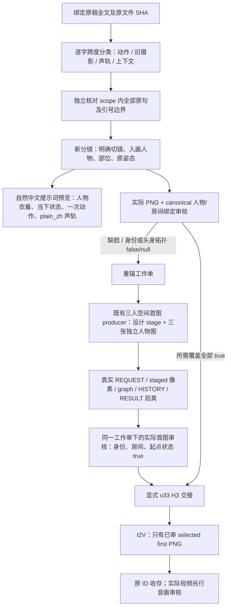

# v33：把实际首图覆盖与镜头需求绑定

本版是显式启用的 CPU 输入与交接合同，不是新视频模型或已完成的成片修复。现有 v32 四段视频、PLAN、REQUEST 和失败画面保留。真实四段输入的预检均为 `reanchor_required`，没有把缺脸、未知身份或头身归属不清改为通过。

## 修复针对的流程缺口

- I2V 只有实际首图，资产库的三张人物照片并未直接输入视频模型。尾帧里没有父亲脸时，后续要求父亲面部表演会要求模型重建未覆盖身份。
- 旧原稿混合动作、对白、摄影指令。直接追加新分镜，会同时保留两套机位指令。
- 27 秒附近的手部、下前景头部和上方父亲面部属于构图及身体归属风险。仅凭这些图不能断言出现第四个人。
- 字幕早在首段出现。关闭后期字幕轨只解决系统后期轨，不能保证 H3 不生成原生烧入文字。



## 接口

`src/content_factory/visual_h3_continuity_input_v33.py`：

```python
prepare(plan_binding, out)                     # 写 CPU 预检 / 工作单
preflight(plan_binding, shot_id, actual_first_image=None)
preview_prompt(plan_binding, shot_id)           # draft_not_dispatchable
compile_prompt(row)                            # 不以 draft 冒充准入
load_for(packet, plan_binding, shot, frame, timing)
prepare_reanchor(plan_binding, shot_id, run,
    handoff=..., render_result=..., inputs=..., authorization=..., config=...,
    item_id=..., source_binding_review=...)
```

`visual_h3_handoff_v3.py`：

```python
prepare_from_continuity(plan_binding, h3_run, config)
# config 必须给真实共享服务、input/output、gpu_lock_root、protected_pause_path。
# 该接口使用新的 h3_continuity_packet/v33、selected_inputs/v33、shot_bindings/v33。
# 不建立假的 v3 READY，不扩大旧 compile_bindings 的两人上限。
```

旧 `prepare_from_ready` 可通过 `config.continuity_input_plan={path,sha256}` 显式启用；与 `native_prompt_plan` / `native_prompt_contract` 互斥，只支持 first-only。没有该字段的旧图、prompt 与 PLAN 结构保持原行为。三人使用新独立入口，不借旧两人资产包伪造资格。

## 输入范围

Plan schema 为 `h3_continuity_input/v33`，`shots` 内每项包括：

- `source`：原文件绝对路径和原始字节 SHA。`source_scope` / `source_spans` 使用通用换行解码后的 Unicode 字符位置，各 span 有 `id/kind/start/end/text/sha256`。
- `kind=action` 只包含实际动作，且每段动作按源顺序恰好调度一次。旧摄影指令分类为 `camera`，留在审计中，不再次渲染。未分类非空隙或混入摄影/对白的动作返回分类工作，不声称覆盖完整。
- `source_state_span_ids` 只选当下起点，`character_description_span_ids={actor_id:[context_span_id]}` 只选原人物服装/关系说明。选中的事实在自然正文渲染一次；不回灌整段全局前缀。
- `audio` 每项为原 `quote_index/quote_sha256/speaker/mode/start/end`。原引号段独立于分类逐一核对，不能通过把引号丢进 context 隐去对白，也不能把 scope 切在一句中间。
- `camera_beats` 连续覆盖本段时长。每项给 `start/end/cut/framing/actors/source_span_ids`；actor 给 `visible_parts/pose`，姿态是该 beat 动作或当前状态的原文子串。enum 仅在 JSON，模型正文使用自然中文。
- `audio_format` 本版仅接受 `plain_zh`，默认同名。原中文引号台词逐字一次；本人对白、具名内心画外音明确分开。不加入英文官方模板、Subject 编号或 `<d>`。
- 可选 `audio_context_span_ids` 只引用原声线、普通话等 context 原段，不混入旧摄影条款或台词。画外人物只要求其入镜时闭口，不因心声自动增加其身体。
- `canonical_characters/canonical_room/actual_first_image/coverage_review` 全部为实际文件绑定。所需面部覆盖取各 beat 实际出脸者的并集，不按画外声音人数扩演员。
- `postproduction_subtitles=false`，后期轨独立关闭；`native_text_absence_guaranteed=false`。

实际四段回归材料在 `data/qa/h3_prompt_identity_v33_20261108/REAL_CASE_r3`。这是本小说的明确案例，不是通用自然语言抽取器。

## 审核与重锚证据

Coverage review schema 为 `h3_continuity_coverage_review/v33`；绑定目标 PNG 和同一 canonical 字典。`topology_coherent/room_identity/faces/identities` 为严格 true/false/null。必须有非空实际观察证据。任何 true 均要求 `completion_known=true,outcome_unknown=false`。这两个字段只表示观察任务结果已知，不会把 null 身份提升为 true。

重锚后实际图片还需绑定 `work_order_sha256`，并明确 `source_current_state_matches=true`；仅脸正确不足以证明起点持物/站卧状态正确。

三人重锚通过已有 `visual_spatial_stills_v24` 的 stage + 三人物图 producer：`prepare_reanchor` 只准备和 stage 原图，不调用 tick/模型。`generation_receipt.kind=spatial_still_v24` 绑定 run、batch、item、CANDIDATES、源状态审核。审核 schema `h3_reanchor_source_state_review/v33` 还绑定工作单、entry_base、真实 spatial plan/item/state SHA、canonical 文件，并具备已知观察和非空证据。

验真检查真实 Blender render 文件与 metadata，重建该 producer 的 prompt、参考顺序及 native graph；再核 REQUEST/CLAIM/RESPONSE、各原始和 staged 像素、HISTORY 原图、输出文件与 RESULT。身份图必须实际通向所选 SaveImage 分支，独立槽位不会因 SHA 相同合并。房间是**设计 stage 与 canonical 房间的已绑定审核**，不是谎称整张 canonical room 图直接输入 Klein。

旧 v3 `asset_ready` 资格仍受原两人上限限制；无 generation proof 的 legacy READY metadata 不足以批准新重锚。

## 派发与收存边界

Prepare 和每次新 dispatch 均重新检查 source、coverage、compiled prompt、实际首 PNG 与 frozen graph 映射。v33 使用自己的输入派发锁和既有 GPU 锁，不读取不存在的 legacy library。旧 v3 仍使用原 registry fence。

新审核失败会阻止新 POST；已有原生 ID 通过冻结图、REQUEST、HISTORY 和输出绑定继续收存，不能因审核变化丢失原结果或重派。未知提交保留原记录，不自动重放。程序测试和合成 CPU AV 黑盒只验协议，不能替代真实视频的身份、口型、动作与字幕验收。
