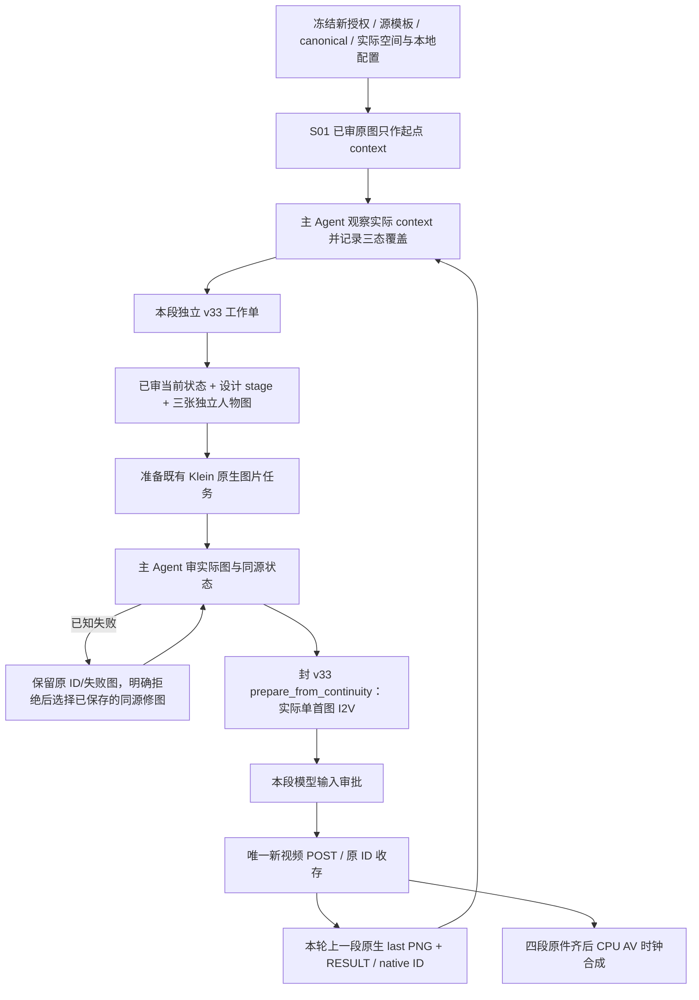

# v34：新一分钟的逐段连续性协调

固定新根：`data/video_generation/h3_continuity_full_minute_20261109_v1`。目标为四个新的 362 帧、24fps、736×1312、12 steps 原生有声 H3 段，共 1448 帧 / 60.333333 秒。只沿用已审源稿的十句对白、动作、自然中文分镜及人物资料；不将旧 v32 成片作为本轮交付，也不改旧 PLAN、旧暂停或账号服务。

## 实际接线



空间 stage 是根据原文约束作的设计，不宣称小说提供了房间米制测量。图片 producer 实际消费 stage 加三张人物图；整张 canonical 房间作为已绑定的观察参考。实际上一段尾帧用于本段连续性来源、观察和状态对照，不谎称它已经成为 Klein 的第五个像素输入。头身归属坏或未知时，尾帧也不自动成为姿态真值。

## 输入与入口

`MINUTE_SPEC.json` schema 为 `h3_continuity_minute_spec/v34`：

```json
{
  "source_case": {"path": "实际 REAL_CASE_r4/SPEC.json", "sha256": "实际 SHA"},
  "initial_context": {"image": {"path": "原 approved A 起图", "sha256": "实际 SHA"}, "origin": "来源证据"},
  "spatial": {"handoff": {}, "render_result": {}, "inputs": {}, "config": {}},
  "stage_items": {"S01": "S01_start", "S02": "S01_start", "S03": "S03_start", "S04": "S04_start"},
  "h3_config": {"service_url": "本地实际服务", "input_root": "实际目录", "output_root": "实际目录", "gpu_lock_root": "共享锁目录", "protected_pause_path": "原 PAUSE", "base_workflow": "已审 I2V 图", "runs_root": "本轮根/visual_h3_v3", "video_enabled": true, "width": 736, "height": 1312}
}
```

以上是字段说明，花括号处必须填真实文件绑定；不能把示例当作可执行输入。S02 与 S01 同物理状态时，明确复用 canonical stage 是合法的；不选择 producer 标为 `alias_of` 的条目冒充独立资格。每段图片任务、视频任务仍为独立的新原生 ID。

`USER_AUTHORIZATION.json` 保留原用户指令，`engineering_limits` 为工程边界：图片至多 8、正式视频至多 4、云媒体 0、文本模型 0。为了兼容既有图片 producer，新增显式 `IMAGE_AUTHORIZATION_PROJECTION.json`：绑定原授权，只投影同一 8/0 工程限制及原 user_statement。它不是另一份用户授权，也不能重置额度。所有同根图片分支、失败和未知 claim 都计入同一范围。

CLI：`scripts/run_h3_continuity_minute_v34.py`。

- `prepare / status / context / context-entry / anchor / video / advance / approval-request` 只进行本地 CPU 准备或读取。
- `collect` 只跟踪已有原生 ID；`assemble` 只做 CPU 合成。
- `execute` 才允许在真实主 Agent 审批齐全后派发媒体。

常用调用：

```text
python scripts/run_h3_continuity_minute_v34.py prepare
python scripts/run_h3_continuity_minute_v34.py context --shot S01
python scripts/run_h3_continuity_minute_v34.py context-entry --shot S01
python scripts/run_h3_continuity_minute_v34.py anchor --shot S01
python scripts/run_h3_continuity_minute_v34.py approval-request --shot S01 --kind image
python scripts/run_h3_continuity_minute_v34.py video --shot S01
python scripts/run_h3_continuity_minute_v34.py execute
```

## 每段文件与来源

每段使用 `segments/Sxx/`：

1. `CONTEXT.json` 绑定实际图片；S02—04 必须绑定本轮前段已保存的 RESULT、last PNG、native ID。前段未保存时保持 `awaiting_predecessor`，不会创建假的图或审核。
2. 主 Agent 写 `CONTEXT_REVIEW.json`，生成 `CONTEXT_SPEC.json`、`CONTEXT_PREFLIGHT.json`、`REANCHOR_WORK_ORDER.json`。不能用旧四张 bad tail 作为新后继输入。
3. `SOURCE_STATE_REVIEW.json` 将实际新 stage/state 与同一工作单绑定；图片任务准备在本轮 `stills/<本轮名>_Sxx`，不动旧图。
4. 实际图片收存后写 `ANCHOR_REVIEW.json`。人物、房间、拓扑及当前持物/站卧状态必须已知并通过；缺失或未知不能提升为 true。
5. `EXECUTABLE_SPEC.json` 只绑定本段真实已审输入；新单段 H3 PLAN 在本轮 `visual_h3_v3/<本轮名>_Sxx`，避免只用 `S01` 名称造成输入/输出前缀碰撞。
6. `VIDEO_BINDING.json` schema `h3_continuity_minute_video_binding/v34`，固定 `segment/shot_id/h3_run/segment_spec/h3_plan`，另记录实际首图、context、prompt SHA 和实际 seed，供独立 QA 使用。

视频仍使用封 v33 的 seed 派生方式：由本段绑定与首图 SHA 生成。旧 base graph 内的 seed 会被该接口覆盖，因此不声称是旧原词配方的 exact seed 重现。模型、encoder、VAE、sampler、steps 与 AV 接线均保留实际图证据。

## 已知失败图片的显式后继

不会自动语义重拍。原图片必须已按原 ID 保存，主 Agent 明确写 `ROOT_ANCHOR_REJECTION.json`，绑定原 RESULT、图片、native ID、同工作单和实际拒绝证据。新的修图 producer 使用同一工程授权 projection，保留同源动作、尾帧与 canonical，实际新原生 ID 保存后才可选择：

```text
python scripts/run_h3_continuity_minute_v34.py select-anchor --shot S01 --receipt 实际后继receipt.json --coverage-review 实际后继审核.json
```

`select_anchor` 为纯 CPU：验证实际新的 spatial receipt、同工作单、同预算及已审首图。未知任务、metadata、同 native ID、改掉原 tail/source 或已封 H3 PLAN 都不能借此换路径。原失败图、拒绝和全部原记录保留；新选择单独冻结为 `SELECTED_ANCHOR.json`。

## 派发与恢复

全局 `ROOT_LAUNCH_APPROVAL.json` 绑定本轮 PLAN、原授权、执行源码与 CPU 验收。图片和视频各有逐段 `ROOT_IMAGE_APPROVAL.json` / `ROOT_VIDEO_APPROVAL.json`；`approval-request` 输出具体待审绑定，不自动填写通过。

协调器只串行派发，使用原 GPU mutex 和新 RUNNER 锁。每轮先跟踪已有 ID，才检查当前输入、暂停和新审批。暂停或源文件变化不会丢掉已知在途原件；未知 claim 不会重复 POST。图片语义失败只保留并等待明确后继，视频没有自动语义重拍。

## 已提交首图的重复准备修正

S02 图片原 ID `714e9e6c-4975-4b3b-b848-e603b989766b` 提交后，本地再次准备曾将动态 `batch.state` 和全局预留数量与初次 `ANCHOR_PREPARED.json` 整包比较，错误报告 `frozen_record_changed`；这是本地幂等缺陷，不代表原生任务失败。

新准备记录只保存稳定投影：工作单、producer PLAN、批次绑定、job_id、plan_sha256、分支数及授权上限。运行 status/prompt_id/paused 等不属于准备合同，全局已预留数量仍由实时预算验证。已存在的旧格式记录保留原字节，只比较同一稳定投影；不将 prepared 快照改成当前 running/saved。静态内容变化仍拒绝，不能用忽略运行字段放宽源或任务身份。

本轮新封板审批另存 `ROOT_LAUNCH_APPROVAL_REVISION_V35_R3.json`。在 v35 opt-in 生效时，只有该精确文件存在才优先选用，必须 `prior_launch` 绑定原 `ROOT_LAUNCH_APPROVAL_REVISION_V35.json` 的实际 SHA，并继续完整验证源码、授权、opt-in 和 CPU 验收；原审批不覆盖。没有 R3 文件时维持原审批选择。已知任务收存仍先于这些新派发审批。

四个不同的新原生视频保存后，复用 v30 计时验真和 CPU ffmpeg：核真实帧数、24fps、736×1312、48kHz 音轨及每段允许的容器舍入，最终固定 1448 帧、2,896,000 音频样本。结果 `H3_CONTINUITY_MINUTE_736x1312.mp4` 与 `FINAL_RESULT.json` 绑定四段 RESULT、原视频和顺序 native IDs。技术保存、CPU 测试与实际内容验收分别记录。
