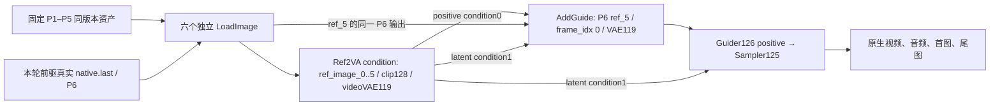

# H3 每段全资产延续 v1

用户纠偏：“每段的视频需要使用的资产都要发送的啊”。本路线把整段所需的人物、环境和当前动作画面**实际送入模型**，不再以单张尾帧或资产登记代替全段引用。

当前根目录为 `data/video_generation/h3_full_asset_continuation_20261111_v1`。本文建立时，仅新 S03 原任务 `0d593261-9156-498f-aa31-331a76d71033` 正在真实运行；尚未完成视觉验收，不能宣称人物已修好或成片完成。实际进度以原任务状态、保存原件和 QA 为准。

## 六张图的固定分工

固定版本：`accepted_S02_identity_environment_20261111_v1`；资产清单 SHA `01e170a4…ab62de2`。S03/S04 必须使用同一版本、同一顺序、同一五个文件 SHA。

| 标签 / 实际槽 | 输入内容 | 文件 SHA 前缀 | 用途 |
| --- | --- | --- | --- |
| `<Picture 1>` / `ref_image_0` | 已接受 S02 派生的苏墨独立图 | `b2841b88` | 父亲脸部与上衣身份 |
| `<Picture 2>` / `ref_image_1` | 同版叶南独立图 | `bb0aaad8` | 哥哥脸部与上衣身份 |
| `<Picture 3>` / `ref_image_2` | 同版叶西决独立图 | `e5a220a0` | 弟弟脸部与上衣身份 |
| `<Picture 4>` / `ref_image_3` | 同房家具、墙材局部 | `0d9e505b` | 无人物的环境 detail |
| `<Picture 5>` / `ref_image_4` | 同房窗、墙材局部 | `7015c27d` | 无人物的环境 detail |
| `<Picture 6>` / `ref_image_5` | 前一段真实原生尾帧 | 动态 | 当前姿态、持物、空间与 frame0 承接 |

五张固定图都是原视频帧的精确整数裁图，没有重画、旋转或放大；P4/P5 **不是完整房间正面、侧面双视图**。人物图约束身份和上衣，不要求照搬参考图的躺姿、视线或表情。`REVIEW_ONLY_CONTACT` 仅用于人工核对；模型接收独立原 PNG，不接联排板，也不把其标签作为水印烧入图片。

## 实际像素消费链



使用本机已有 `minimax_h3_ref2va_pruned_int8_convrot.safetensors` 与 `MiniMaxH3ReferenceToVideo`，`ref_image_size=match`。六图逐槽独立编码，不经过 `ImageBatch` 隐式裁剪；视频 VAE 使引用进入正向参考 latent，P6 另经 AddGuide 锚定第 0 帧。原 736×1312、362 帧、24 fps、12 steps 和原生音轨保持。

`required_actor_assets` 表示全段所需身份；`guide_visible_actor_ids` 只描述实际首画可见者，允许为子集；`world_actor_state` 保留人物当时状态，画外不等于离场。即便 P6 只拍父亲，三张独立人物资产仍全部发送，不能据此删掉孩子资产。画面接续约 0.5 秒，声音从 0 秒开始，随后沿原分镜自由切近景、反打和动作；不要求全程三人同框。原 5 句对白、动作及“对白文字仅作声音内容”的说明保留。

## 入口、保存与后续迁移

新增模块为 `src/content_factory/visual_h3_full_asset_continuation_v1.py`，CLI 为 `scripts/run_h3_full_asset_continuation.py`。

```powershell
.venv/Scripts/python.exe scripts/run_h3_full_asset_continuation.py prepare
.venv/Scripts/python.exe scripts/run_h3_full_asset_continuation.py prepare-video --shot S03
# 根审核当前 LAUNCH_REQUEST_VIDEO 后，使用原任务执行/收存。
.venv/Scripts/python.exe scripts/run_h3_full_asset_continuation.py video --shot S03
```

当前版本限定四段：原 S01/S02 按原 ID、四原件 SHA 与顺序导入；S03/S04 计划各生成新的 Ref2VA 输出。S03 的 P6 为已接受 S02 的真实尾图 `9ead0f52…`；S04 只能在本轮新 S03 原件保存、实际观察并填写 guide 状态后准备，不能取旧诊断任务尾帧。准备操作不 POST；未知结果保留原 CLAIM/ID，不重复派发。常规合片会重编码，前两段沿用不等于旧成片压缩字节或解码像素完全不变。

未来默认路由的最小迁移点是新任务的**资产清单与调度构建层**：每段按全段角色、场景和当前状态确定实际引用，选择 `actual_full_assets_and_native_guide/v1`，不得再用首镜人物集合过滤整段资产。首镜构图仍管理景别和表演。本轮实片验收后，再决定任意镜头 ID 队列及管理平台入口迁移；目前没有切换全系统默认，也没有质量保证。
