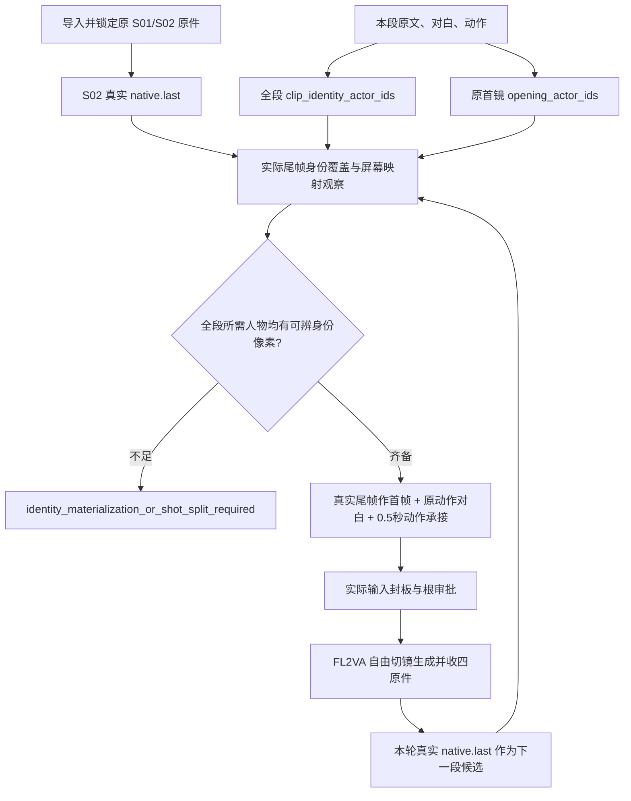

# FL2VA 实际尾帧与全段身份延续 v1

本文对应 `src/content_factory/visual_h3_identity_continuation_v1.py` 和 `scripts/run_h3_identity_continuation.py`。2026-11-11 本轮已完成开发、CPU 与本地受控 HTTP 测试，并已开始 S03 真实运行；S04 和最终成片仍需后续实际证据。**当前不能宣称人物身份已经修好，也没有切换全系统默认入口。**

本轮根目录：`data/video_generation/h3_identity_continuation_from_s03_20261111_v1`。实际状态以该目录的原生 `STATE.json`、`RESULT.json`、启动审批与最终 QA 为准，本文不充当运行完成回执。

## 本轮入口与边界

当前 CLI 固定到本轮新目录。通用模块接收明确的 `spec`，本版调度范围是导入 S01/S02、生成 S03/S04，再合成四段；任意章数、任意镜头 ID 的长队列尚未接入本模块。

```powershell
.venv/Scripts/python.exe scripts/run_h3_identity_continuation.py prepare
.venv/Scripts/python.exe scripts/run_h3_identity_continuation.py prepare-video --shot S03
# 根代理审实际 graph/prompt/首图后，写该段 ROOT_LAUNCH_VIDEO.json。
.venv/Scripts/python.exe scripts/run_h3_identity_continuation.py video --shot S03
# S03 原件保存后，读取它的真实 last，实际观察并填写 S04 coverage review。
.venv/Scripts/python.exe scripts/run_h3_identity_continuation.py prepare-video --shot S04
.venv/Scripts/python.exe scripts/run_h3_identity_continuation.py video --shot S04
.venv/Scripts/python.exe scripts/run_h3_identity_continuation.py assemble
```

`prepare`、`prepare-video` 默认不 POST。`status --shot ...` 读取状态，`collect --shot ...` 仅继续收存已知原 ID。新提交需实际计划、代码、输入与 graph 绑定的根审批；未知回执保留原 CLAIM/ID，不重复 POST。S04 的审批与执行不能跳过实际尾帧观察。



## 人物集合与首镜构图各管什么

- `clip_identity_actor_ids` 来自本段所有动作与镜头所需人物。当前 S03/S04 均为苏墨、叶南、叶西决三人。
- `opening_actor_ids` 来自原首个剧情镜头。S03 是弟弟，S04 是父亲；它不再用来删掉整段稍后会出现的人物身份输入。
- `actual_anchor_actor_ids` 是根实际看到的输入尾帧人物。每个全段人物还须有 `present`、`identity_matches` 及屏幕位置、真实服装映射，保存在 `TAIL_ANCHOR_COVERAGE_REVIEW.json`。

`first_camera_beat/v1` 继续表达首个剧情镜头的景别、动作和神情。FL2VA 的真实首帧身份载体与该近景分开处理：本轮先接续约 0.5 秒递面包时的自然画面，声音从 0 秒开始，随后进入原近景、反打和动作分镜。没有固定机位、合影停顿或全程要求三人同时入镜。

实际 S02 尾图中的父亲是卧床侧脸，存在转正脸推断风险。覆盖观察通过只证明输入身份材料完整，不保证生成期间始终不换脸。房间、声音、表演等完整质量继续由真实成片 QA 和用户验收判断。

## 材料不足时的出口

缺少任一全段人物、身份不匹配，或实际尾图角色集合不足时，`prepare_video` 返回 `identity_materialization_or_shot_split_required`，不准备可派发视频、不静默传入单人图，也不因名字或资产 SHA 出现在元数据里就算作像素引用。

该返回值是后续材料补齐或合理拆镜的 workorder 出口；本版未自动调用图片模型补齐。还没有本轮 S03 `RESULT.json` 时，S04 返回 `upstream_native_tail_required`，不会预造未来首图、覆盖观察或实际图请求。

## 实际像素、模型与原片复用

本契约明确为 `FL2VA_first_frame_only`，沿用当前 FL2VA 权重、736×1312、362 帧、24 fps、12 steps、原生音视频。实际前驱 `RESULT`、`REQUEST`、成功 `HISTORY`、四原件与 `pick_last` 索引 361 均需认证，再核尾 PNG SHA → staged 文件 → 实际 POST graph。保存 PNG 与有损 MP4 解码末帧不要求逐像素相等。

本机另有支持独立参考图槽的 H3 `ReferenceToVideo`/Ref2VA 权重。这一轮未切换；如果实际尾帧路线仍失败，可另立对照实验，不把当前 FL2VA 限制误写成整个 H3 系列的限制。

前两段 S01 `5fad6720…`、S02 `ad632988…` 仅按原 ID、四原件 SHA 和顺序导入，0 重生成。新 S03 必须使用已接受 S02 的真实 last `9ead0f52…`；新 S04 只能用本轮新 S03 保存后的真实 last。原台词 2+3 句与原动作保留；外观映射取实际尾图，不回灌相冲突的旧衣领描述。原有“对白文字仅作声音内容”的说明继续保留。

四段合片为 1448 帧、60.333333 秒、48k 双声道、2,896,000 个有效采样。常规合片会重新编码；“前两段沿用”指源原件及内容沿用，**不宣称新文件前 724 帧或压缩音频 packet 与旧成片逐像素、逐字节相同**。

## 本轮验收后再切换默认路由

旧 `run_h3_story_opening_sample.py`、`run_h3_story_opening_minute.py`、`run_h3_story_opening_diagnostic.py` 仍可显式调用，当前没有路由开关阻止调用方再次选择独立 opening 图路线。它们继续用于旧实验回看和原 ID 收存；这次没有改旧源码、旧 PLAN 或媒体。

最小迁移点在**新任务的调度/构建层**，不是再放宽 first-camera 图审核：

1. 同场景连续片段选择 `actual_native_tail_identity/v1`，从所有本段镜头计算全段人物集合。
2. 第一次有可复用原生尾帧后，后续段走 `review_request → prepare_video → 审批 → execute/collect_known`；新尾帧保存后才准备下一段。
3. 始终保留 opening 构图资料，禁止用 opening 人物过滤全段身份要求；材料不足转 workorder。
4. 真实本轮后两段及整片验收通过后，再新增调度映射与必要的任意镜头 ID 支持，复用该技术契约；旧冻结任务继续按原入口收存。

当前仅完成该受限修复入口及其验证，没有安装上述全局调度迁移，也没有新增前端模块。
