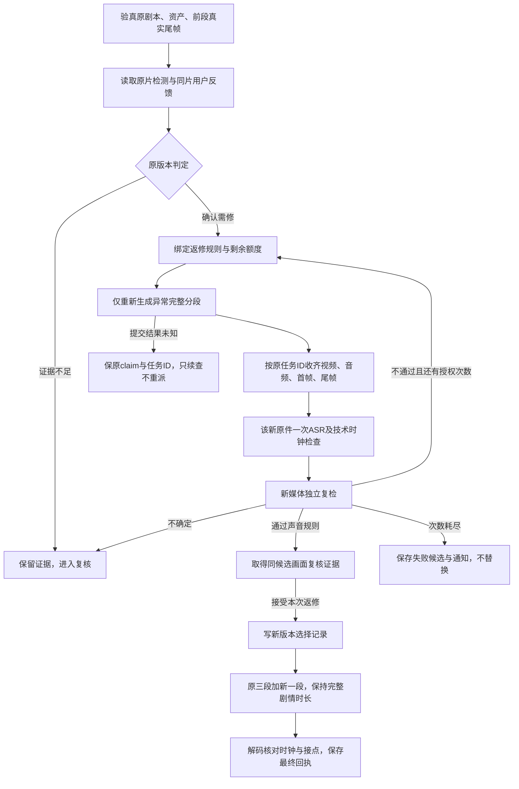

# H3检测、单段重生成与替换闭环

本轮目标是把已生成的视频交回检测和返修节点，真实重新生成有问题的完整第三段，复检后再决定是否替换合片。55秒剪辑修复版是历史对照，不算本轮重生成成果。本轮保留原9f8一分钟中的S01、S02、S04，只允许一次新的本地H3 S03及一次属于该新原件的CPU ASR；不发布，不改账号或服务配置。

## 判定边界

- 人物、背景、资产版本、原句及说话人来自绑定的来源资料。每段仍发送所需完整资产和真实前态。不能改写剧情来迁就模型，也不默认删掉异常时段、缩短剧情或强行补静帧。
- 人物近景、手部特写及合理画外人物允许存在；不露脸本身不是失败。实际多余肢体、身体拼接、接触对象错位等才需要依据画面定位，不能仅由画外手入镜推断畸形。
- 声音检测读取来源中的完整台词和时窗。标点可归一，得／的／地仅作限定匹配并保留原文；不把名字、声线说明当台词。
- 默认声音时间误差不超过1.5秒可容忍；1.5—3秒记录为小偏差；达到3秒为明显调度偏离。阈值可配置，检查不代表模型能按硬时间驱动。
- ASR未识别到完整句或出现未映射碎片时进入复核，不直接宣称确实漏说、说了乱码、换了语言或换了说话人。绑定同一原片的用户已确认需修问题可拒绝该版本，不能套到新片。
- 音频规则通过只表示本次文本／时间规则可接收。声线年龄、声纹、语言、口型和整片自然度不由ASR自动保证。本轮实际画面由Root代理看同候选的原帧后提供绑定复核记录；不冒称已接入独立的全自动视觉审核模型。

## 代码与证据

通用控制器 `src/content_factory/media_repair_loop_v1.py` 是状态与接口的唯一规范来源，公开SPEC_SCHEMA、CANDIDATE_SCHEMA及WIRE_FIELDS。CLI是 `scripts/run_media_repair_loop_v1.py`，三个已绑定的factory分别提供生成、审核和合片。

生成器是 `h3_repair_generation_adapter_v1.py`：在独立命名空间重算完整实际图，保留来源、9张参考图、原句、时窗、状态和采样参数；只精简为本段Xi/Dong两人的文字声线并把两句原文前置。只按原ID收存，不能重派未知结果。当前没有经过验证的H3局部音频修复入口，不能把底层音频遮罩能力冒称现成一键修音；本轮使用完整S03重生成路线。

声音规则是 `h3_audio_conformance_v1.py`。实际审核factory `h3_repair_audio_auditor_v1.py` 对旧片只复用旧ASR；对新片在FFmpeg与CPU转录之前先写一次性claim。固定关闭标点模型、清空原法律领域热词。失败或未知结果保留，不再次转录。原生音频时钟、视频帧时钟、48k交付目标分别记录，不能把32k原件伪填为48k。

合片器是 `media_repair_assembly_v1.py`：只有接受的新候选及绑定审核／复核记录可进入版本选择；非目标三段逐字段保留来源绑定，四段帧数和完整总时长保持不变。最终真实解码验证每帧PTS、有效音频样本与AAC尾垫，避免把编码尾垫误当声音延迟。

每次调用前写claim；完成后写已知任务ID、原件SHA和回执。新审核必须匹配该候选的result、media、native_id、attempt_id、来源与资产。缓存重入还会验证内部波形、原件、审核与时钟证明，不能只校验一层JSON后假报成功。完成、失败、待复核和未知均有明确状态。旧原件、失败候选及历史回执保留。

## 本轮验收

先通过各模块CPU回归、独审及实际三factory黑盒接线，黑盒的GPU／ASR／编码仅是显式替身，不作为生产成片。再由Root唯一启动已审的新S03，自动原ID收存、一次新ASR和复检；接受才替换合片。若新候选仍失败或不确定，保留它供审并显示终止原因，不把测试完成等同于成片质量通过。

这是本轮新入口及生产试验，不代表所有旧默认任务已迁移。原冻结任务、旧unknown、原PAUSE及账号发布不变。

## 本轮真实结果

本轮已完成一次完整S03的真实H3重生成、原ID收存和一次新ASR。新原ID为 `8e4e3a4b-8975-4856-b46f-724e0c9f8dac`，原视频SHA为 `07c3774eacc7f4915a3c6b7a778a07e443fd22b8152a0ab58b0f13b182a1f677`。保留完整362帧，没有删掉开头来冒充生成改善。

首句ASR起点由旧片约5.25秒提前至新片0.42秒；两句目标台词均能对齐，长句有得／的识别差异。8.94—11.98秒另有未映射识别片段，未经人耳确认，不能据此确定实际说了什么或谁在说。音频判定为 `needs_review`。

Root及独立代理查看了同一新候选的四张半秒抽帧板、尾帧与原S04首帧对照：约12.5—13.5秒由灰翻领孩子承担了蓝衣叶东的握拳转门动作；14秒后女孩护理对象变为灰翻领孩子，而来源指定为米衣叶西决。手部特写本身允许存在，不作为拒绝原因。

这些画面证据通过 `record_review` 绑定到同一候选，控制器随后进入 `attempts_exhausted`。未写选择记录，未执行替换或合片；原一分钟及失败候选均保留，运行队列已空。真实验证的是“收存→新检测→同候选复核→拒绝并保留”的分支。接受、替换和合片分支本轮仅通过CPU及替身黑盒测试，没有拿这份被拒绝的新片证明生产通过。

本轮模块测试分别为23、24、15、12、9项，另有实际三个factory接线黑盒及独立审查。新入口尚未迁移全部后台任务；视觉复核目前由代理实看原帧，声音身份及音色年龄尚无自动验收保证。
