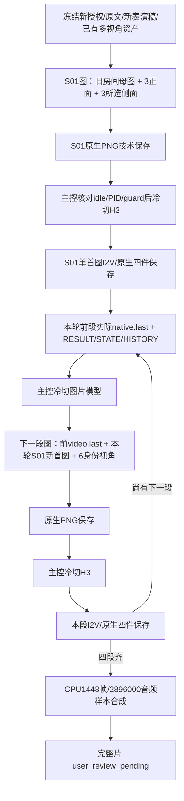

# v37：多视角身份、原生尾帧实际入图、逐段完整一分钟

固定新根 `data/video_generation/h3_multiview_continuity_minute_20261109_v3`。旧 v36 的源码、运行、计划和媒体均不迁移或修改。保留四段原十句、每段 362 帧 / 24fps、736×1312、12步、H3 原生声音，合计 1448 帧 / 60.333333 秒。

用户自己审核完整片。流程不运行 VLM、ASR、OCR、正脸或内容通过检查，不等待主 Agent 看图，不伪造 ROOT 视觉通过。只检查原文台词、绑定、图接线、原件、分辨率、原生 ID 和音视频时钟。



S02—04 的八图输入中，第一槽是本轮前段视频真实 last，实际经过 LoadImage→VAEEncode→ReferenceLatent 进入正向 guider；第二槽是本轮 S01 已保存的新首图，作为同批房间与演员上下文。它不再重复旧正面合影，且不能把动作复位。其后是三人的正面和本镜选定侧面；每个人的两个视角均以原 INDEX 同身份、同设计版本和原 SHA 绑定，不能把正面复制冒充侧面。

尾帧不仅存在于 metadata。图片 producer 对实际正向依赖链、顺序、像素 SHA、前段原四件、STATE、成功 HISTORY 和本轮输入来源作技术校验；生成的新图片才是 H3 唯一首图。H3 不直接混用多图 Ref2VA 或 AddGuide。

## 准备与逐段执行

主 `MINUTE_SPEC.json` schema `h3_multiview_continuity_minute_spec/v37`，绑定新 `source_prompts/PROMPT_PLAN.json`、`SCENE_IMAGE_SPEC.json` 及同服务/路径/锁的 H3 配置。新授权 schema `h3_multiview_continuity_minute_authorization/v37`，工程范围八图、四片、零云，原未知与旧消耗保留。

`prepare` 只准备 S01 的真实七参考图片任务。S02—04 状态为 `unprepared`、没有原生图片 PLAN；前段未保存时不能生成假的 tail 或 future image。四个视频 STATE 只表示待执行，并不声称已有首图或原生任务。

```text
python scripts/run_h3_multiview_continuity_minute_v37.py prepare
python scripts/run_h3_multiview_continuity_minute_v37.py execute --stage images --shot S01
# 本图saved正常退出；主控按现有idle/服务代次/guard限制冷切
python scripts/run_h3_multiview_continuity_minute_v37.py execute --stage videos --shot S01
# 本视频saved正常退出；主控冷切后准备/生成S02图，依此到S04
python scripts/run_h3_multiview_continuity_minute_v37.py execute --stage images --shot S02
python scripts/run_h3_multiview_continuity_minute_v37.py execute --stage videos --shot S02
```

每段 images 阶段保存后返回 `image_saved_cold_family_transition_by_owner`；videos 阶段保存后返回 `segment_saved_next_image_required`。S04 保存后自动 CPU 合成，直接交用户审核，不加内容门。

`LAUNCH_APPROVAL.json` 是技术源码/计划/授权/CPU 验收绑定，schema `h3_multiview_continuity_technical_launch/v37`，`review_policy=user_reviews_completed_film`，不包含逐图或逐段视觉审核。主控独占媒体派发和服务冷切；协调器不启动、kill、重启、改 flags 或绕开原共享 GPU 锁。

## 恢复与证据

每轮先按已知原 ID 收存，再检查当前输入和新派发条件。POST 前留 CLAIM；未知请求保留原记录，不盲重 POST。当前源或授权变化、暂停不会挡住已有 ID 收存；当前失效只阻止后继派发。

本段 `GRAPH_BINDING.json` 包含原 prompt、实际首图、前段真实尾帧来源及图片 producer 的原 receipt。原 `RESULT.json` 保持 sealed native collector 四件格式，另存 `USER_REVIEW_STATUS.json`。`FINAL_RESULT.json` 绑定四个原 ID/RESULT 和合成时钟，标记 `user_review_pending`、后期字幕轨关闭；没有声称模型自身已完全不烧字。

CPU 黑盒使用独立本地 HTTP、真实暂存 PNG 和 CPU 音视频。完整链测试使用四段真实 362 帧的 CPU 测试片，验证 1448 帧/2896000样本及真实尾帧像素进入下一图的正向链；它不是生成的小说视频，也不是视觉内容验收。
