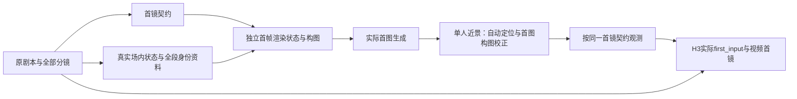

# 剧情首帧自动规划规范

原来的首图同时承担“确认整段人物身份”和“视频第0帧”两个用途。v33把整段15秒需要出现的人物及面部合并后审核首图；v34又为验脸将人物朝向机位，并扩大构图容纳所有头部。即使剧本第一镜是父亲近景，实际传入H3的图仍可能是三人合影。v38、v39沿用同一冻结首图，修改视频描述不能改变这个输入事实。

本次新增显式策略 `first_camera_beat/v1`，从已有 `camera_beats[0]` 提取首帧要求。不推翻已确认的v34基线，也不把固定裁去1.5秒加入默认流程。没有选择新策略的旧记录保持原行为。

## 数据流



首镜契约包含首镜构图、应入画人物、可见身体部位、需要确认的脸、起点状态原文和后续动作原文。全段人物身份及后续对白仍完整保留。例如S02首镜只有苏墨头肩近景，孩子仍在房间内；孩子未出现在这张近景里不等于已经离场，也不能据此删掉后续孩子的身份资料。

世界状态与渲染状态分别保存。世界状态承接上一段的真实人物位置、持物和出入场；渲染状态只决定本镜画到哪些人及如何构图。不得为了只画父亲而在世界状态中让孩子消失，不得把视频稍后发生的起身或接袋提前画入第0帧。人物视线沿原文的剧情对象，身份照片不再作为全体看镜头的指令。

首图生成、输入回执和首图审核采用同一首镜人物范围。H3仍使用真实的合成首图像素，不声称其他人物资料图成为独立的视频参考槽。已生成图片必须绑定真实PNG和原生任务回执；保存了首镜计划不能代替真实首图生成。

## 实际首图后的自动构图校正

真实小样中，Klein虽收到头肩近景要求，仍可能生成较远的床景。不能把提示词写了近景等同于实际输出已经通过。现在可在单人 `face_close` 首镜采用独立的 `visual_opening_crop` 步骤：先定位实际照片中的唯一人脸，再根据人脸五点与头肩方向推导构图范围，保存校正后的首图。这个步骤处理静态首图，不删除视频开头或台词。

检测使用固定SHA的 OpenCV YuNet 2023mar、CPU执行，至少两个不同旋转角度的高分五点结果必须指向同一人脸；检测框逆变换回原图坐标，输出仍保持原图方向。模型版本与 OpenCV 4.x 的兼容性见 [OpenCV官方说明](https://github.com/opencv/opencv_zoo/tree/main/models/face_detection_yunet)。多脸、低置信度、五点异常或构图超出源图时停止，不用固定中心框补齐。Haar多角度曾把床单纹理误作人脸，没有用于生产准入。

`DETECTION.json` 保留模型、程序、原图、首镜契约、全部检测候选、共识、自动整数框及警告；`CROP_RESULT.json` 保留父图与结果SHA、实际放大倍率、Pillow版本和LANCZOS规则。派生回执 `derived_opening_crop/v1` 先核验原生父图的真实history及参考输入，再逐像素重算裁取与缩放。派生图单独接受首镜核对，不能继承原图失败的构图结果，也不能登记为模型原生近景。

本次实例的源区域为303×539，输出736×1312，约2.43倍放大。它修正构图，不增加真实人物细节；分辨率警告必须保留。局部背景变化和后续镜头中人物身份是否稳定，仍需实片检查。

实际生产小样入口为 `scripts/run_h3_story_opening_sample.py`。该入口先执行现有图片生产器，核对原件及新首图，再经现有core→native接线生成H3；未知结果保留原ID，不因为构图问题重新提交原任务。真实观测和派发审批仍独立保存，尚未宣称无人视觉审核闭环完成。

## 准备入口

```powershell
.venv/Scripts/python.exe scripts/prepare_h3_story_openings.py prepare --out data/qa/h3_story_openings_20261110_v1
```

`--source` 可指定现有v33格式SPEC，默认使用v34的真实四段案例。入口校验原章节/分镜和图片绑定，复制为新 `SOURCE_CASE.json`，逐段添加新策略，写出 `OPENING_CONTRACTS.json`，再调用v34的新首镜分支生成 `spatial/SPATIAL_PLAN.json`、CPU示意图及交接文件。最后的 `PLAN_REPORT.json` 比较首帧人物范围与整段人物范围。

入口只准备文件和CPU示意，不调用图片或视频模型、不访问HTTP、不裁剪视频、不写入新审图通过结果。原 `actual_first_image` 和 `coverage_review` 原样保留为历史上下文；新构图仍需新首图和对应的真实观测。重复运行时内容相同可以复用，内容冲突则报错；输出根目录不能等于原文件或其任何上级目录。

现有v34空间适配器仍针对这份四段小说案例，已接通头肩近景、中景和全景的首镜规划。手部近景及局部细节镜头尚需相应的几何规划器，遇到这些首镜会明确停止，不悄悄降级为合影。这不是任意小说、任意场景均已验收的通用分镜生成器。

## 观测与失败处理

首图观测绑定当前PNG、完整规范来源及首镜契约校验值，并检查应入画人物、构图、当前动作状态和注意对象。只对首镜确实需要展示的脸作身份判断；镜外人物使用未观测值，不伪造为“已经验脸通过”。近景不因无法观察整间房屋而要求扩大成全体合影，但画面中可见的环境仍须符合当前房间。

若实际图与首镜不符，进入首图修复步骤，保留原图及失败证据。不得仅更新文字记录便把旧合影登记为近景；不得清除未知任务或直接重发原ID。视频输出中的字幕等问题属于独立检查范围，本策略没有宣称解决H3原生字幕。

## 验收边界

CPU回归可确认首镜需求没有混用整段需求，生成器/回执/审核范围一致，真实场内状态不变，旧策略不受影响，并确认实际H3输入绑定未被替换。它不能证明新生成画面的身份、注意方向或构图已经达标。

v34调度仍保留前情、源状态、实际首图和派发前的真实审核门。当前能力是已接入的自动首镜规划与生成输入约束，不是已经验收通过的无人视觉审核闭环。需要真实新首图及视频小样后，才能评价实际开场效果；不因本文或CPU通过而自动启动旧任务或整分钟重拍。
