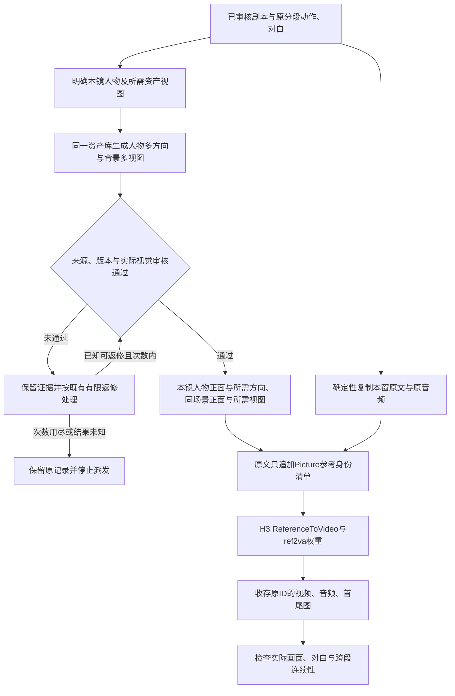

# 人物、背景参考图直接交付H3：v20

本轮用户要求保留人物/背景资产自动化，取消视频适配层额外固定机位，只添加参考内容说明。新路线与正在运行的Seedance原提示词对照分开；不改旧剧本、资产PLAN、原生请求或暂停文件。



## 提示词与参考图边界

- 视频正文优先取明确的完整视频提示词；新文本接入从已审核scene/window逐字复制本窗动作和完整音频。人物/环境设计模型仍可以规划资产造型与参考视图，但其再次编写的visual_prompt不会取代原始视频正文。
- 动作和声音按原时间交织，展示本段从0开始的相对区间；原始场景时间与原记录继续保留，避免把原场景第16秒直接误当成15秒视频的第16秒。
- 只追加Picture编号、具名人物的外观/服装参考、具名场景的环境参考。适配层不加统一固定机位、禁切镜、禁推拉、定构图、时序重排或新的声音指令；剧本自己已有的镜头内容按原文保留。
- 每段从资产库重核本镜人物canonical front与所需view、场景front与所需view。同一人物多方向不会被描述成多个人，双胞胎同像素也保留各自角色槽。
- 不把上一段尾帧作为人物、背景的唯一依据。纯组件支持经过审核的辅助尾图，默认生产交付器只传本镜完整人物/环境资产。尾图不能替代必需参考。
- 旧v6分镜正文已经含额外固定侧面/无切镜等文字，无新的明确完整原始提示词时拒绝回灌。不会偷偷用正则修改旧稿或把旧改写稿当原文。
- 本地参考模型最多9张图片，超限明确返回缺口，不静默丢图、拼贴或把多图batch当多个独立引用。只选本镜相关人物和场景，不把全书81图塞入每段。

## 真实模型能力

旧MiniMaxH3ImageToVideo只支持首尾帧。新MiniMaxH3ReferenceToVideo使用独立ref2va权重，通过ref_images.ref_image_0起的独立槽与Picture 1起的提示词标签对应。D盘已有该20.97GB权重；本轮没有下载模型、升级依赖或重启ComfyUI。

节点、官方缓存模板、权重来源与纯适配API详见[原文与参考图合同](H3_RAW_REFERENCE_CONTRACT_V20_20261107.md)。该合同发布后的真实小样已完成加载、生成与音视频保存；这里只证明本次288×512能够运行，不代表高清速度或人物/环境跨段一致性通过。

## 接入与执行

新make_policy默认h3_delivery.mode=reference_assets/v20，planning.source_prompt_contract=source_window/v20；video_enabled仍默认false。旧已有policy没有该字段时保留原首图路径，不迁移、不自动放行旧批次。

资产tick在已审核资产齐备时返回reference_assets_ready，跳过旧组合首图与其两人限制。原watch根据新policy准备独立visual_h3_ref_v20计划；明确video_enabled=true时才按原ID收存/串行提交。管理页快照可读取新路线状态。实际后台仍可能缓存旧模块，本轮没有重启/重载账号后台，不声称新界面已经在线加载。

独立入口：

```powershell
.venv/Scripts/python.exe -B scripts/run_visual_h3_reference_v20.py prepare --asset-run <资产run> --run <新v20run>
.venv/Scripts/python.exe -B scripts/run_visual_h3_reference_v20.py status --run <新v20run>
# 仅冻结计划明确启用视频时可提交；execute串行收存，不进行语义失败自动重拍
.venv/Scripts/python.exe -B scripts/run_visual_h3_reference_v20.py execute --run <新v20run>
```

prepare不访问服务、不提交模型；原文文件可用--shot-id及--source-prompt明确绑定，必须包含本镜全部原音频句。config和输入冻结，不能靠改配置重播原未知结果。POST前重核资产、源稿、暂停SHA、共享GPU/输入锁与实际服务路径，独立暂存每张引用。响应未知保留CLAIM/原ID；暂停或上游变化仍能收存已经提交的原ID，禁止盲重派。

## 本轮实际验证

真实F0012资产完成CPU准备：苏墨正面、叶西决正面、苏墨房间正面与侧面，共4张已审核引用；使用该段原source_evidence文本，不用旧v6固定机位描述。新run为data/video_generation/visual_h3_ref_v20/dry_actual_F0012_20261107_v1，video_enabled=false、prompt_id=null、0媒体POST。证据data/qa/h3_reference_flow_v20_20261107/ACTUAL_CPU_PREPARATION.json。

最终合并CPU回归、源码SHA与范围见同目录ACCEPTANCE.json。初轮测试目录缺失造成的setup错误已保留；不能计为有效测试，最终只采用release.xml的唯一测试ID。

原一分钟原词对照已在h3_seedance_prompt_parity_60s_20261107_v1完成4段与合成；该片仍是首帧fl2va路线，不能冒充本次ref2va参考图模式的样片。原5分钟风格hold、原b12暂停、账号与发布均不动。

## 新参考图模式真实短样

按用户本次新流程要求另做一次本地完整“递面包”段验证：data/video_generation/visual_h3_ref_v20/novel_F0011_ref_probe_288_20261107_v1，原生54b2b75f-e08a-42ed-80b3-25ece82d73b8，288×512、209帧、8.708333秒。实际图为ReferenceToVideo+ref2va，4个独立人物/环境图，无首尾帧输入。原动作/台词源字节保留；仅追加Picture参考清单，PROMPT.actual.txt可核实际POST。视频、独立音频、首尾图四原件已从原ID保存；CPU ASR与“爸爸，这是好心人给我的面包。”归一完全一致。

root实际看6帧与原生末帧，画面主要是面包和手部近景，缺人物脸与足够背景。因此技术加载/生成/保存通过，人物身份、完整交接动作与跨段环境一致性没有获得验收；没有因技术通过扩片或发布。证据data/qa/h3_reference_flow_v20_20261107/REAL_REFERENCE_PROBE_20261107.json及新run的ROOT_SAMPLE_REVIEW.json。原词一分钟对照已另外完成60.333秒，不能把两次路线混为一片。
