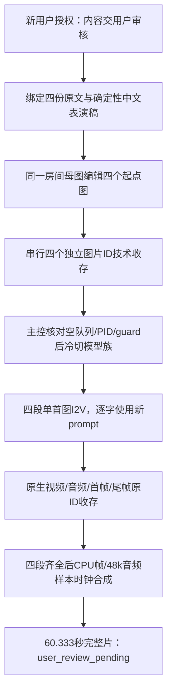

# v36：同一实景、自然表演、用户审核完整片

新根 `data/video_generation/h3_scene_performance_minute_20261109_v2`，独立于已冻结的 v34/v35。用户授权修改背景变化、正对镜头和字幕问题，并明确由用户审核新完整片。这里不运行 VLM、ASR、OCR、身份或内容通过判断，不因没有正脸中止，也不创建假的 ROOT 视觉审核。



图片阶段和视频阶段不在一个暖模型进程中自动切换。协调器没有启动、kill、重启或修改服务的能力；主控负责现有队列、具体服务代次及 guard 的冷切限制。每轮先收存所有已知 ID，再核验当前输入和新派发资格。

## 固定内容与技术范围

四段各 362 帧、24fps、736×1312、12 steps，合计 1448 帧 / 60.333333 秒；保留原十处逐字台词及自然中文声音模式。视频沿已封 I2V 基础图，实际文本等于 prompt 文件原始 UTF-8 内容，不追加旧 JSON 包装、统一固定机位或别的提示词。每段只输入新 producer 保存的一个完整首图，实际接入图像编码与 VAE 条件；不混五图 Ref2VA 或 AddGuide。

S02—S04 的 `GRAPH_BINDING.json` 记录本轮前段真实原生 last、RESULT 和 native ID。这个 tail 只作可追溯连续性资料，明确不作为额外模型图像条件，也不被当成重画整间房的背景底图。

此轮不添加后期字幕轨。模型自行烧入文字是否仍发生，交给用户看实际成片；流程不会凭提示词或技术测试声称画面已无文字。

## 文件与接口

协调器 `visual_h3_scene_performance_minute_v36.py`；CLI `run_h3_scene_performance_minute_v36.py`。

`MINUTE_SPEC.json` schema `h3_scene_performance_minute_spec/v36`：

```json
{
  "schema": "h3_scene_performance_minute_spec/v36",
  "prompt_plan": {"path": "实际PROMPT_PLAN.json", "sha256": "实际SHA"},
  "scene_spec": {"path": "实际scene SPEC", "sha256": "实际SHA"},
  "h3_config": {"service_url": "http://127.0.0.1:8190", "input_root": "实际目录", "output_root": "实际目录", "gpu_lock_root": "原共享锁", "protected_pause_path": "原PAUSE路径", "base_workflow": "新根内已封基础图", "timeout": 30, "video_enabled": true, "width": 736, "height": 1312}
}
```

新 `USER_AUTHORIZATION.json` 是用户原话及工程八图/四视频/零云媒体范围；不是伪称用户给过具体次数。`LAUNCH_APPROVAL.json` 只绑定新 PLAN、授权、执行源码和 CPU 验收，`review_policy=user_reviews_completed_film`；不包含逐图或逐段语义通过资格。

```text
python scripts/run_h3_scene_performance_minute_v36.py prepare
python scripts/run_h3_scene_performance_minute_v36.py execute --stage images
# 图片完成后由主控按现有服务代次/队列/guard约束冷切
python scripts/run_h3_scene_performance_minute_v36.py execute --stage videos
python scripts/run_h3_scene_performance_minute_v36.py collect
```

图片阶段四图收存后正常返回 `images_complete_cold_family_transition_by_owner`。视频阶段只串行提交四个新 ID，四段技术保存后自动 CPU 合成，不等待主 Agent 做内容审核。`RESULT.json` 为封 native collector 的原件回执；每段另有 `USER_REVIEW_STATUS.json`，新总 PLAN 和 `FINAL_RESULT.json` 均标 `user_review_pending`。

`CLAIM` 在 POST 前冻结，响应不确定保持 unknown；已有 claim 不会重新 POST。已知 ID 在暂停、当前 prompt 或授权失效时仍按原始图和记录收存，当前失效只阻止新派发。旧运行、旧暂停、原未知记录及已消耗次数都不修改。

CPU 测试使用独立本地 HTTP 服务和真实暂存/PNG/短音视频，不连接生产 ComfyUI，不生成模型媒体；不能把这些技术测试当内容验收。
