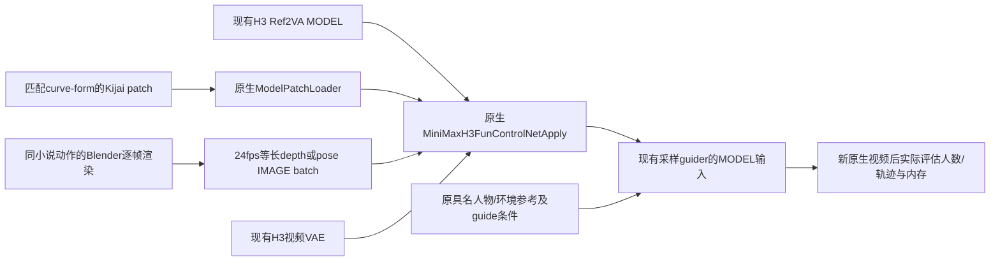

# H3 逐帧空间控制候选：只读调研

2026-11-08 北京时间约05:55。本次只读本机代码、`8190/object_info`、现有模型文件头及官方/作者资料；没有下载模型、安装依赖、重启服务、提交GPU任务或修改A/B输入。当前B四段按原冻结版本继续。本报告是候选设计，尚无本机ControlNet效果或16GB适配实测。

**有技术入口：本机已具备逐帧ControlNet节点，可以把Blender逐帧depth/pose，或特定v2权重的layout视频，作为结构条件。它不是人数硬约束，也不能直接修复声音归属。** 优先考虑匹配现有pruned/curve-form backbone的小型转换权重；不能把Alibaba原版文件直接接到当前量化base。

## 本机实际确认

只读GET `http://127.0.0.1:8190/object_info` 返回以下已加载节点。此检查不运行推理。

|节点|实际接口|
|---|---|
|`MiniMaxH3FunControlNetApply`|必需MODEL、MODEL_PATCH、视频VAE、strength、start/end_percent；可选 `control_video: IMAGE`、`mask: MASK`、`source_video: IMAGE`；输出MODEL|
|`ModelPatchLoader`|从 `models/model_patches` 加载MODEL_PATCH；当前下拉列表为空，本地只有0字节 `put_model_patches_here`|
|`LoadVideo` → `GetVideoComponents`|VIDEO解出逐帧IMAGE批次；MP4路径不能直接连到control_video|
|`MiniMaxH3ReferenceToVideo` / `MiniMaxH3AddGuide`|现有参考图和首尾guide节点仍可用，不需要把控制视频伪装成第六张Picture|

本机实现位于：

- `D:/IT/AI_vido/ComfyUI/comfy_extras/nodes_minimax_h3.py:411` 起：控制视频经H3视频VAE编码；按目标帧数/尺寸拟合。短批次会重复最后一帧，超长批次只取目标前部，不按动作语义重定时。因此应提供与目标同帧数、同相机和同时间线的输入，不能依赖自动拟合补全动作。
- 同文件约514行：控制skip的audio位置明确置零。这是视觉结构控制，不是声音speaker、声线或内心独白闭口的专用控制器。
- `comfy/ldm/minimax/controlnet.py:47` 起：检查base与control的AdaLN宽度；不一致会报错。约62行对keyframe/reference位置留零控制行，结构上支持其与参考/guide同时存在；不能由此推导本小说效果已验证。
- `comfy_extras/nodes_model_patch.py:236` 起：量化patch使用mixed-precision操作；约306行从权重推断5/10控制块及注入位置，读取 `minimax_h3_fun_controlnet=adaln_basis`、`inpaint_masked_pixel_mode=post_norm` 等metadata。v2不能按v1结构强行加载。

上述三个本机源码SHA依次为 `5999ed8c22b13c8251084c0629fd82137d2fb52b55106abfc73bf5cafc73841d`、`729966b7bb5e6bb9959cefe8d61af7d6368b0b3b91f1c110fe9f5bc6e6cb949b`、`25e2e0ee146084f52ab34a39e3a4ab7ca5120acec7fe3007fcaeeca7ca463e39`。可对照[Comfy核心作者源码](https://github.com/Comfy-Org/ComfyUI/blob/master/comfy/ldm/minimax/controlnet.py)及[原生节点文档](https://github.com/Comfy-Org/embedded-docs/blob/main/comfyui_embedded_docs/docs/MiniMaxH3FunControlNetApply/en.md)。

## 权重候选与backbone边界

本机现有FL2VA、Ref2VA各20,970,379,616字节。仅只读safetensors头，二者首层 `blocks.0.adaln_proj.linear.weight` 均为 `[96768,8]`，属于curve-form；没有加载进GPU。原版full-width ControlNet的对应宽度为2688，不是当前base的8。

|候选|训练/转换来源、体量|可提供条件|当前判断|
|---|---|---|---|
|Alibaba PAI Union v1原版|训练作者发布，文件约6.81GB|Canny、Depth、HED、MLSD、Pose，5个控制块|不是当前curve-form base的直接可用文件；不建议为它换大base/框架|
|Kijai v1 pruned INT8 ConvRot|作者转换量化文件约2.30GB|沿用v1条件；不含v2新增Layout|最小新增模型候选，可先试depth或pose；尚未下载/加载|
|Alibaba PAI Union 2.0原版|训练作者发布，文件约13.6GB|10块，另加Scribble、Layout、Gray；post_norm inpaint|原版也不能直接假定兼容当前curve-form base，额外体量更大|
|Kijai v2 pruned INT8 ConvRot|作者转换量化文件约4.53GB|v2结构条件，含Layout|若要显式每人物bbox布局，这是更相关候选；内存成本高于v1，未本机验证|

训练作者一手依据：[Union v1模型卡](https://huggingface.co/alibaba-pai/MiniMax-H3-Fun-Controlnet-Union)、[Union 2.0模型卡](https://huggingface.co/alibaba-pai/MiniMax-H3-Fun-Controlnet-Union-2.0)。2.0的Layout采用VACE式彩色逐人物bbox、白背景RGB视频；并非任意ID分割色块都等价。作者结果使用40步、guidance_scale=1.0、704×1280像素预算；这些是作者样例条件，不是本机12步生成的已有效配置。

转换作者文件及可核对SHA：

- [Kijai v1 INT8 ConvRot](https://huggingface.co/Kijai/MiniMax-H3-experimental/blob/main/model_patches/minimax_h3_fun_controlnet_union_pruned_int8_convrot.safetensors)，SHA `9c645c0a308c8af361efd43b409710f6f8fec0db297c29503e141a84991fed0c`。
- [Kijai v2 INT8 ConvRot](https://huggingface.co/Kijai/MiniMax-H3-experimental/blob/main/model_patches/minimax_h3_fun_controlnet_union_2.0_pruned_int8_convrot.safetensors)，SHA `890af58bb350f0c2f6c409b1c67ea8f4196654297d037769b72de1e6f504c612`。
- 同作者目录另有v1 BF16约4.22GB、v2 BF16约8.38GB，不是本硬件优先项。文件大小来自作者文件页面；补查HF API请求20秒超时，未将超时视为元数据核验成功。

这些是社区作者对Alibaba权重的转换，不是MiniMax另发的官方小模型。[实现作者的Ref2VA+depth/pose示例](https://github.com/wyzborrero/ComfyUI-H3-FunControl/blob/master/workflows/02_depth_plus_pose_reference.json)确实引用与本机同名的Ref2VA INT8 base，支持“可以组合”的候选依据；其中示例为社区节点，不能原样当成已跑通本机原生节点的生产图。

## 能约束什么，不能保证什么

depth可以给床、门、人体轮廓及相对远近；pose可以给三个人各帧关节、起身/跪下/牵手位置；v2 layout可以给每个可见人物的bbox。它们比首尾两张图多提供中间时刻约束，有机会减轻中途复制角色、越过床或错走位。

但是当前节点只向模型加结构特征，没有“最多3人”的程序开关，也没有人物ID与生成像素的一一硬分配。仅三个人的控制图仍可能生成重复角色、身份互换或额外袋子；Depth也不携带“这位正在说第2句”的声画归属。候选有效性必须在真实输出中按时间抽样、必要时密集检测人数/身份/持包人及轨迹核验，不能只看首尾相近。

现有Blender九个静态状态图不能直接当逐帧运动控制。还需同一相机下的连续时间调度和动画/rig：明确每人从哪里起身、何时跪、手与袋子如何移动、两人怎样经过床尾到门。Depth用整段一致的归一化范围，避免逐帧自动拉伸；近远亮度极性须与作者控制样例核对。Pose须投影成作者DWPose风格，而不是把彩色胶囊人物图当骨架输入。若渲染器直接提供depth/pose/bbox，不需要额外下载深度或姿态估计模型。

人数QA应与该镜真实可见性对照：面部近景只见一人不等于另外两人消失；遮挡和离场也应由原时间线定义。Layout仅是软条件，不能冒称演员数量绝对锁定。

## 16GB GPU / 32GB RAM下的可尝试边界

**没有找到训练作者对16GB/32GB这一具体组合的适配保证，也没有做本机试验。** 官方VideoX-Fun全精度路径的base/text encoder体量明显超出本机，不应据官方脚本直接另装全套。当前已跑通的量化Comfy路线可复用base、15,687,142,551字节的现有NVFP4 text encoder及视频/音频VAE，只新增2.30GB或4.53GB patch；仍会增加控制流、VAE编码和帧批次内存，不能按磁盘GB直接认定能装入显存。

一个RGB float32控制批次的最低数据体积（不含复制、latent、模型或控制stream）：

|帧数/尺寸|仅IMAGE数据|
|---|---|
|124帧、288×512|219,414,528字节，约0.204GiB|
|124帧、384×672|383,975,424字节，约0.358GiB|
|362帧、736×1312|4,194,705,408字节，约3.907GiB|

所以本硬件有合理的小样入口，但不宜承诺736全长能稳定运行。原生代码还保存pristine/control hidden stream，权重offload也无法消除全部激活开销。模型目录当前为空，仅有节点不等于现在已经能直接运行ControlNet。

## B完成后可选的最小试验设计（本次未执行）

优先v1 INT8单一控制，124帧、288×512、24fps，约5.167秒；保持训练帧合同 `17*n+5`、宽高32倍数。选择真正包含中途站位/起身的短动作，而不是只看静态首帧。单depth和单pose先分别比较，不一开始链两个control。若首轮可运行再考虑v2 Layout，对照两个孩子、一父亲的每帧布局。此建议不是新增调用授权，也没有创建PLAN。

小样可先12步诊断，但若结构弱，不能直接用低步失败断言ControlNet无效；训练作者样例40步是另一个需区分的条件。起始strength=1、start=0/end=1、guidance=1符合作者控制样例；社区示例也有CFG4等不同经验，本阶段不要把两者混成必需配置。若后续链depth与pose，其强度会相加，不能两条都直接满强度。初试避免新增稀疏attention优化，先减少兼容变量。

要正式试验仍应在B四段完成后另建独立输入、记录所用权重SHA/metadata、逐帧控制图来源、相机、尺寸、时钟与模型峰值内存，保留失败再判断。当前raw B不因本报告改提示词、guide、模型或调度。

## 许可边界

Alibaba两版明确继承[MiniMax H3 Community License](https://huggingface.co/alibaba-pai/MiniMax-H3-Fun-Controlnet-Union/raw/main/LICENSE)，不是Apache/MIT。许可允许适用区域内按条款使用和修改；排除EU、英国、韩国、美国，另有商业收入门槛、标识及AUP等条件。中国大陆不在列出的排除区域，但本次未核验实际部署/使用地点，不能无条件宣称全球可用。此类普通家庭剧情实验未见额外的非商业专用限制。

Kijai repo卡当前没有明确YAML许可元数据；其转换仍须遵守基础H3许可，不能因节点代码开源就把权重称为Apache授权。社区节点作者代码为Apache-2.0，不改变底层权重许可。仅要“全是原始官方权重、且对16GB有官方保证”的候选，本次未找到；可行的小体量路径依赖上述作者转换量化与后续本机实证。
