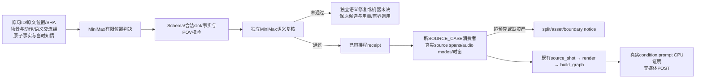

# 旁白位置判决与 SOURCE_CASE 接入

本次增加了独立的 opt-in 文本节点及真实消费者，没有修改在途 H3 口述一分钟、旧冻结 producer、服务、账号或发布流程。新节点不是“禁止旁白”：允许场景开头交代背景，允许完整交流组之外的动作间隙叙述，也允许有亲历依据的简短角色口述。

## 可执行线路

主模块：`src/content_factory/narration_placement_policy_v2.py`。消费者：`src/content_factory/narration_source_case_adapter_v1.py`。

新的 `materialize()` 接受基准 SOURCE_CASE、case/receipt 绑定、完整 quote-ID 映射，以及每个原动作 span 对应的 case action/quote 锚点。它写入真正的新原文和 spans、保留原对白顺序与字句、保留旁白为 `voiceover`、转换口述为 `onscreen`，并让口述人物面部覆盖整条音轨。不能静默沿用旧动作的 11–15 秒时间。

`prove_narration_source_case.py` 实际调用既有 `continuation.source_shot()`、`render()` 和 H3 `build_graph()`。`prove_narration_parallel_variant.py` 另输出来源支持的听话反应并行变体。两入口均只做 CPU 消费证明；没有上传图片、模型 POST 或服务修改。

## 已修正的通用边界

- 完整问答/连续劝阻按语义分组。原稿夹了旁白仍保留同一组，不靠机械拆组绕过保护。
- 旁白和口述一律选完整交流组之外的合法位置。原问答不因改成角色声而被长解释打断。
- “本人倒地、拿到面包”“路人为什么给面包”“上贡/战利品的作者评价”分别作为亲历、他人动机、叙述评价。混合整句不强行全部转口述。
- 保留旁白不受惩罚；不确定和语义失败进入独立修复，不伪装 ready，也不生成“人工待确认”占位稿。
- 明确 `after` 的位置按动作结束执行。合理动作与对白并行可作为独立、有原文依据的排程变体，但不能偷换已有合同。
- 超 15 秒输出机器可处理的拆分通知，不截字、不加速。拆分保留完整交流组，后继部分仍需上一新片的真实尾帧。

## 本轮真实测试

证据目录：`data/corpus_production_trials/20261113_narration_placement_v1/`。

共 6 次 MiniMax-M3.1-Flash 文本流请求，均为 `medium`、`thinking=adaptive`，均收到 `stop` 与完整用量。返回的推理 token 非零；本轮没有比较其他强度，也没有使用私有推理内容作人工解释。请求、原始 CHUNKS、RESPONSE、PARSED、usage 全部保留。总 reported tokens 为 41,566，reported reasoning tokens 为 8,232。

原 4 次没有语义验收通过；`CASE.json`、C001–C004 和 `UNRESOLVED.json` 保留。C005 语义走对，但提示词未列精确 enum，模型用了三个别名并把口述对象写成字符串。经明确授权，只做有限白名单字段规范化，不改原文、位置、POV 或事实；`NATIVE_NORMALIZATION.json` 保留原生及派生 SHA。C006 独立审核完整规范化候选。后续提示词从同一 Schema enum 生成，并有回归核对。

最终位置是：职场回忆保留开场旁白；碘酒瓶环境保留动作旁白；S03 混合动机/评价的原叙述保留组外旁白；S04 在两句劝阻结束、停拳动作结束后让叶东口述。

## 实际消费与限度

S03 严格 after 的新 source/graph 在 `source_case_consumers_strict_after/S03/`：动作 0.2–1.2 秒，旁白 1.2–14.771 秒，9 张真实参考绑定进入 CPU graph。

严格顺序预算下 S04 估算需要 15.972 秒，包含南/妹对白并行动作、独立 2 秒停拳动作和叶东口述。这是文本速度预算，不是实测音频断言。保留的确定性兜底位于 `source_case_consumers_after_split_v2/S04_SPLIT/`，完整南妹劝阻一部分，停拳后叶东口述下一部分。逻辑内容预算分别约 7.543 和 8.829 秒。固定 362 帧图只是 15 秒容量的技术探针，不表示这些短部分应被拉长静止；未来生产 driver 须匹配真实计划时长和实际尾帧。

独立来源支持的并行单段变体位于 `source_case_parallel_variant/S04/`：南 0.2–3.533，妹 3.533–7.343，叶东听妹妹末句时停拳 5.343–7.343，东 7.343–13.772 秒。妹妹与叶东在反应重叠窗为中景、妹妹面部仍可见。该具体排程经主任务及独立来源审查，不声称 C006 审过具体毫秒；不覆盖严格拆分兜底。

这证明局部 SOURCE_CASE → renderer → positive prompt 已接通，不代表所有全局入口已迁移、声纹固定、资产和真实未来尾帧已就绪或新视频内容已通过。当前冻结的口述分钟继续使用它原先已派的源与图，本次不重拍。
