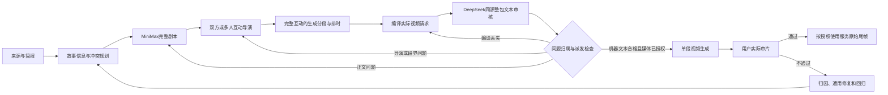

# 剧本到视频全流程质量改造计划

日期：2026-10-18。状态：全流程方案，尚未开发接线或进行新生产验证。

## 1. 用户目标与范围纠正

用户明确：“我需要整个流程不需要出现这种问题不是当次”。因此目标是建立后续新任务默认执行的创作、导演、分段、编译、审核与派发流程，持续预防信息稀薄、单句拉满、角色无互动、视线不明确及关键神情不可见的问题；不能以修好《渡口的单程票》首段作为功能完成。

本方案取代上一份计划中以当前影片压缩稿/首段试片作为主要交付和验收的范围。上一份[节奏与表演计划](NOVEL_PERFORMANCE_PACING_REVISION_PLAN_20261018.md)保留为问题分析、标准细则和历史案例；其中8–10秒只是当时试排建议，不成为通用段长。

适用目标是小说改编和原创剧情的新任务，共用质量规范及派发检查。优先补齐已发现缺口的小说支路，并核对原创、网页、CLI、后台及试片入口。旧冻结任务保留原版本和历史，不能静默迁移或借新版本清零消耗。

本轮仍执行“先给计划”：只修订方案、记录长期要求，不开发新生产代码、不调用MiniMax/DeepSeek、不生成媒体。

## 2. 全流程应形成的闭环

返修和派发均有原版本预算/次数边界；图中的箭头不授权无限重写、自动视频重试或自动续段。

## 3. 每一层要负责什么

| 层级 | 通用改造 | 必须提前识别或阻止的问题 |
|---|---|---|
| 来源/简报 | 冻结故事范围、人物关系、观众要理解的内容、节奏偏好、目标时长与容许范围；新任务绑定同一规范版本 | 世界背景写得完整，但正片没有演出来；目标时长在下游被淡化 |
| 编剧 | MiniMax写完整自然文本，规划可见行动、对白及由此改变的判断/关系；减少重复说明 | 空讲设定、对白冗长、只有气氛没有推进，重要前提只能靠读背景才知道 |
| 导演 | 按叙事拍安排刺激、说话对象、双方/多人动作与反应、视线落点、头身朝向、空间轴线和可见景别 | 角色各看前方、听者冻结、关键表情在背面或远景、道具动作替代所有反应 |
| 服务分段/排时 | 先选完整且可理解的互动单元，再按模型能力安排时长；对白与动作/听者反应合理重叠 | 用第一条performance代替整段；只留说话人；切掉回应；固定15秒；把并行动作全串行加时 |
| 编译 | 同一编译器产出实际SDK载荷与可读预览，保留已审信息、角色交互、视线、镜头及段首尾因果，内部证据留本地 | 审核的是双人交互，发出去变成单人静候；硬编码模板覆盖导演；JSON证据污染表演提示词 |
| 文本审核 | DeepSeek对照来源、完整稿、导演、生成段计划和最终实际prompt，既审整片又审每段能否理解 | 字段都有但内容仍空；台词、动作、视线互相矛盾；时长解释不能支撑实际内容；信息在转换中丢失 |
| 派发 | 核对同规范、同源同稿、实际请求与审核绑定、未决问题及既有授权；新任务入口共用一个判断 | 旧审查被拿来放行新prompt；试片/CLI绕过质量检查；内容未修就进入付费生成 |
| 视频/反馈 | 接口与文件完整性另记；用户审实际内容。拒绝绑定原视频，不得续用原尾帧；失败按原因回到责任层并形成通用回归 | 技术成功写成内容通过；每次靠用户指出同类问题、助手临时加几句话兜底 |

有意义的静默、回避目光、画外对白和慢节奏情绪段可以成立，要审其具体表达目的；不能把“全程互看”“每几秒必须切镜”“每段固定数秒或固定字数”当作通用质量规则。

## 4. 真实接线要求

1. **同一规范绑定全链路。** 新任务创建时保存规范ID/版本/内容哈希，编剧、导演、分段、编译和审核消费同一份要求。网页/CLI/后台不能各用一套模板；新任务不能悄悄回退到未接标准的旧入口。
2. **保持MiniMax自然文本路线。** 继续MiniMax创作、DeepSeek审内容。程序保存来源、映射与用量；不恢复逐句原文引文、空行/引号字面匹配或writer指定工具交稿硬门。
3. **分段前后都检查语义保留。** 导演表演、API分段和最终prompt有可追溯映射。编译器不能擅自删掉听者/回应、重写剧情或拉长静候；模型不支持当前安排时回到导演调整。
4. **审核必须收到最终实际文本。** 审查的prompt从与派发相同的编译/SDK构建结果取得；记录其请求指纹。审查后任何剧情、视线、镜头或时长变化都使相关放行失效，须按既有有界范围重新核对。
5. **一处作决定，所有新派发入口执行。** 质量检查至少核对来源/规范/审核/请求一致性与未决内容问题。原单次试片入口只作历史已耗尽例外，不成为新任务免审通道。
6. **失败回到正确层修通用原因。** 正文因果错由编剧整稿返修；导演/节奏/段界问题由导演修；编译丢失先修编译器并重新审核派生内容。不能因为编译错误无谓重写小说，也不能直接手改原生模型稿冒充流程成功。

## 5. 自动化与审核的分工

- 程序验证引用对象、角色/段落覆盖、时间范围、模型能力、版本/来源/请求哈希与审核状态；这些结果只证明合同和输入一致。
- DeepSeek判断从实际动作/对白能否理解剧情、双方互动是否有动机、视线与摄影安排是否合理、停顿是否有表达价值及节奏是否符合简报。不能以字段非空、字数或动作数量冒充语义通过。
- 视频是否真的按要求看人、表现情绪、说清台词，继续由用户实际审核。文字审核不能替视频模型兑现作保证；不通过时不续拍，反馈必须进入责任定位和通用回归。
- 文本已知完整内容失败按有效有界整稿/导演修订处理；未知结果、用量、截断或未决claim保存停止，不盲重派。视频不因文本自动化目标获得自动重试权限。

## 6. 验证方法：跨故事，而非只测当前片

在修改提示词前冻结案例与评价口径。渡口案例只作历史回归；开发案例和验收留出故事分开，至少保留两份未参与提示词调试的完整故事做端到端验证。候选题材覆盖：

| 场景类型 | 要验证的通用能力 |
|---|---|
| 两人家庭对话 | 双方意图、合理避视、误解变化及克制情绪可见 |
| 职场冲突 | 来回接话与行动推进、权力关系、自然语速与快节奏 |
| 三人或更多在场 | 说话对象明确，其他人物确有合理状态，视线不串人 |
| 行走/道具交接 | 头身/空间方向、手与道具连续，动作对白可并行 |
| 有意义的沉默 | 不把留白一律误杀，也不能用“情绪”标签为长静候开脱 |
| 电话/画外音/转场 | 镜内外身份、视线对象与时间线正确，不为缺席角色伪造现场动作 |

测试分层：

1. **反例与正例回归**：拦住单句拉长、删回应、互相朝错方向、无近景承载关键反应、审发不一致等；合理沉默/避视/单人场景不得被误拦。规则夹具不能冒充自由文本理解能力。
2. **真实文本端到端**：从正式新任务入口载入新故事，自动完成规划、完整创作、导演、分段、编译和整包审核；不靠主agent逐稿手补眼神、改秒数或改API提示词才通过。
3. **跨故事留出验证**：按事前冻结的评价口径报告每份完整稿和全部段的通过/问题；不能只挑最好一段，不能事后换金标或把未通过故事排出统计。
4. **媒体验证分开**：在有效单段媒体授权内生成，交用户审核；分别报告机器文本、请求一致性、技术生成和用户视频结论。单个视频变好不足以证明全流程已改好。

## 7. 开发阶段和完成判据

| 阶段 | 可审查的交付物 | 完成条件 |
|---|---|---|
| P0 统一规范与基线 | 全链路规范、入口清单、断点与冻结样例/留出集 | 每个问题有责任层和验收依据，不以当前片特例定规则 |
| P1 实际接线 | 共用规范绑定、编剧/导演/分段/编译/整包审查/派发入口及模块测试 | 新任务所有相关入口实际消费同一要求，绕过用例被阻止 |
| P2 真实完整文本验证 | 不同故事的原生稿、实际请求、审查、问题归因及同稿修订 | 正式入口自动跑通，完整保留用量/失败，没有人工逐稿补丁 |
| P3 留出与单段媒体验证 | 未调参故事报告、授权范围内原片和用户决定 | 质量改善覆盖新故事；实际视频未通过如实退回、不续用尾帧 |
| P4 新任务默认启用 | 网页/CLI/后台一致的新默认及旧版本追溯说明 | 测试和真实验收证据齐全后才启用，默认不回退绕过规范 |

子agent按模块边界实施，主agent审查真实调用链、实际输入及失败/正例，不能只汇总测试数量。开发完成、真实文本通过和用户视频通过分别报告。

最终交付是可复用入口、实际质量检查、跨故事验证和反馈回归机制；当前影片的修订稿/试片只占其中一项案例。

## 8. 当前实施边界

本次尚未开始P1，也没有新模型或媒体请求。旧v7/试片、完整稿及账本保持；当前被拒视频和原尾帧不续用。未来新执行范围/冻结继承历史，不把新规范等同于预算重置或额外媒体、发布授权。
