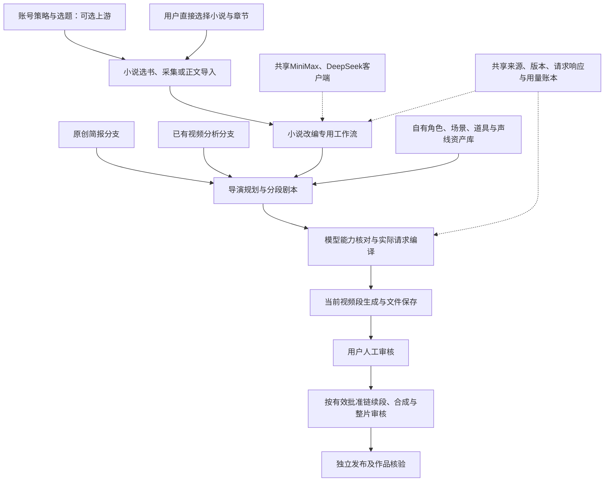
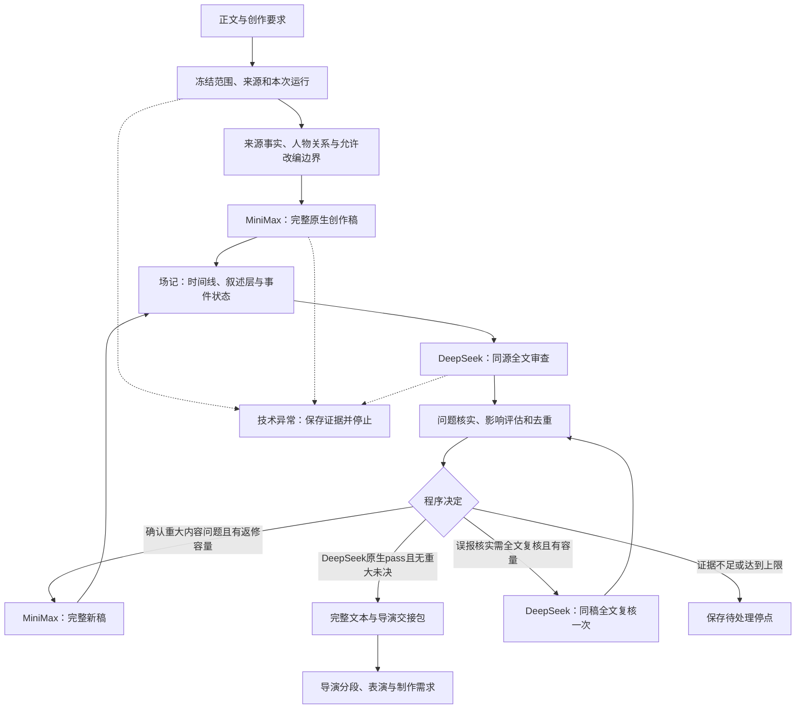

# 小说转视频剧本分支：总体架构与开发规划

版本：方案 v1.1（交叉审查修订）　日期：2026-10-17

本文是该分支的总体设计与开发依据。当前代码、真实试跑和拟开发能力分别标注；本次交付不启动新的小说生成或媒体任务，Claude Code文档核对属于另记用量的开发审查。

## 1. 分支目的与目标产物

本分支负责把**已取得的小说正文，稳定改编为人物清楚、因果成立、表演可执行、适合视频分段的剧本**，并交给平台既有导演与视频制作流程。

目标支持两种使用方式：用户直接选择一本小说及章节开始改编；或由账号选题模块提供目标小说和创作方向，再进入同一个小说任务域。直接改编不依赖账号登录或选题卡完备。目前独立v3与旧账号`novel_creation`入口仍各自运行，统一适配属于后续接线规划。

主要解决四个问题：

1. 从小说叙述转换为可见的动作、对白、神情、视线与反应，保留主线动机和关键因果。
2. 检查时间线、在场人物、动作过程、道具转移和人物知情范围，减少前后矛盾。
3. 核实审核意见，允许合理改编，减少误报和无效返修。
4. 自动保存完整稿、同稿全文审查、问题处理及版本，再产出导演可以继续使用的交接包。

目标产物分为两个里程碑：

| 里程碑 | 主要产物 | 完成含义 |
|---|---|---|
| A：机器文本交接 | 完整原生创作稿、场记状态账、全文审查、问题核实记录、导演交接包 | 本次文本达到机器验收条件，可进入导演规划 |
| B：视频剧本交接 | 逐段导演稿、每段起止状态、动作对白反应窗口、人物场景及参考需求 | 导演文本具备制作交接条件，实际模型输入仍须编译核对 |

完整创作稿包含故事背景、角色选择、主线与高潮分析、改编规划、完整剧本。导演分段在完整故事成立后进行，不能先把小说机械切成若干句再各自扩写。

## 2. 在平台总体架构中的位置

现有平台以剧本与视频制作为主线，原创、小说、已有视频分析是不同来源入口，共享模型客户端、任务证据、资产、导演和媒体执行能力。本方案新增小说领域能力，不整体替换平台。下图表示目标接线；账号上游统一、小说v4及实际导演适配均待开发，当前已实现状态见第3节。

小说分支的主要职责到文本和导演交接。视频内容由用户审核；发布沿用独立流程和现有规则。小说文本机器通过不会自动启动媒体或发布。

## 3. 当前实际状态

| 能力 | 2026-10-17状态 | 本次设计的增量 |
|---|---|---|
| 番茄采集及本地正文导入 | 已有采集桥接；本书已取得第1章 | 统一来源范围、章节选择与缺失提示 |
| 独立“小说改编”入口 | 网页新任务默认v3，已有CLI | 增加场记、问题核实和交接展示 |
| 账号选题进入小说创作 | 旧独立路线存在，与小说改编v3尚未统一 | 按同一小说任务域增加上游适配 |
| MiniMax完整原生创作 | 已接真实服务，保留五部分内容 | 加强事实边界及修复目标表达 |
| DeepSeek同源全文审核 | 已真实执行，九维审查 | 增加事件状态证据，纠正改编误报 |
| 有界整稿返修与恢复 | 已实现，已收结果可恢复，未知停止 | 问题核实后再决定是否返修 |
| 场记状态账、问题核实与去重 | 尚未实现 | 第一优先开发内容 |
| LangGraph适配 | 尚未安装、未接入 | 独立环境验证后接显式状态图 |
| 小说专用导演分段交接 | 本轮尚无通过文本交接 | 后续里程碑B |
| 视频与账号运营完整闭环 | 平台有独立模块，本小说分支尚未完成 | 按文本、导演、媒体、运营分阶段验收 |

最近一次v3真实测试：第一章含标题6045字符；MiniMax三份完整稿、DeepSeek三次全文审查均完整返回，最终仍为`revise`，达到两轮完整返修上限。相关离线回归279项通过，不能据此声称内容质量通过。

本书历史累计20次调用、310301 reported tokens，原冻结调用容量剩0；原请求、失败、用量和停点保持。方案、框架安装或换目录不会解除这一停点。

## 4. 分支内部流程

创作和返修按版本串行推进。不同职责的检查可以并行，但必须使用同一份冻结来源与同一稿件；待需要的检查全部完成后才能汇总。首版优先合并相关检查，避免每轮固定调用多个重复审稿模型。

## 5. Agent职责与程序职责

Agent表示独立职责及其输入、产物和规则，不要求每个角色独占一个模型或产生一次额外付费调用。

| 职责 | 输入 | 输出与边界 |
|---|---|---|
| 来源编辑 | 已取得正文、章节范围、用户目标 | 人物关系、关键事件、核心事实、已知与未交代内容；不以书名猜后续 |
| 改编编剧：MiniMax | 正文、来源边界、创作要求；返修时加完整旧稿和核实反馈 | 五部分完整原生稿；可以调整对白、场景、支线和顺序，不交零散补丁 |
| 场记 | 完整稿及来源 | 人物、时间线、事件、动作前后状态和歧义；抽取结果不自动成为真值 |
| 全文审核：DeepSeek | 完整正文、完整稿、场记辅助信息 | 九维内容审查、具体问题、合理解释、实际影响；不代写完整稿 |
| 问题核实 | 原审查、同一正文和稿件、事件上下文 | 成立、建议、不成立、不确定；合并同一根因，不按重复报告次数升级严重程度 |
| 导演规划：MiniMax | 已通过完整稿、场记及交接 | 分段、情绪重点、动作对白反应窗口、连续性与素材需求 |
| 程序执行层 | 冻结配置及各阶段原生产物 | 身份、文件、预算、唯一派发、恢复、技术校验和最终路由 |

来源整理可以先与编剧分析合并，场记与全文审核也可先合为一次DeepSeek调用。每份完整稿都必须产生本版`full_review`，包含同一完整正文和完整稿的程序绑定、九维完成情况及问题表；合并调用时，同一原生回执可派生`scene_ledger`和`full_review`两个独立可核对的产物。两者必须对应当前稿，不继承旧稿场记或审查作为新稿通过依据。

只有确需独立消歧或纠正误报的重大意见才进行有界复核，实际调用数在运行前冻结。辅助场记格式不可读作为技术问题保存，不要求编剧整稿重写来补辅助字段。首版继续使用MiniMax与DeepSeek，不增设第三家审核模型。

## 6. 主要设计决策

### 6.1 来源范围与长小说

本节的长篇分集、跨章索引与跨集承接是目标设计，当前只完成已取得正文范围内的v3试跑。

每次运行明确“哪本书、哪些章节、改编到哪个事件”，保存正文原文件、范围及身份。只读第一章就只对第一章范围负责；整本任务必须先证明所需正文已取得。

长小说按章节建立人物、事件、世界规则和悬念索引，分集选择连续或明确关联的事件范围。摘要用于检索，关键事实回到原章核对。本集审查始终覆盖本次冻结的全部正文和完整稿；超过实际上下文容量时显式分集或停止，不静默截文，也不把摘要审查写成全文审查。跨集承接登记为已接受的前集终态，不能仅依赖模型记忆。

拟议的单集范围包至少冻结：实际正文范围、必须覆盖事件、承接前集状态、本集目标、启下线索、尚未揭晓的信息与不得提前泄露的后续事实。跨章索引逐项标记待核实、已核实或已采用，索引推断不能直接升级为来源事实。前集修订时，依赖其终态的后集标记失效，重新核对后才能沿用。

### 6.2 原生剧本与辅助状态分开保存

MiniMax原生文本是创作稿权威。场记、问题、核实结果和导演映射是辅助产物，都绑定该稿版本。辅助抽取失败作为技术问题处理，不能让编剧反复改内容迎合JSON、空行或规定工具。

程序分配文档、章节、场景与事件ID，并保存原生文件身份。模型解释内容，不猜hash；审核证据用于定位语义问题，取消逐句引文和标点排版匹配硬门。

### 6.3 现实逻辑与世界状态

场记按事件记录：

- 时间线：现在、前世、回忆、想象；检查小说既定世界规则下的内部一致性。
- 叙述层：背景说明、段首概述、实际表演、段尾摘要。
- 人物状态：在场/缺席、相对位置、姿态、视线、正在进行的动作、已知信息。
- 道具状态：实际对象、持有或共同持有、转移、使用及丢失。
- 事件关系：同一事件重述、持续动作、新事件或无法确定。
- 解释状态：明示、推断、有歧义、未知，连同上下文一起保存。

确定性检查只对证据充分的条件冲突作结论；省略、比喻、摘要或语义歧义先消歧。小说阶段使用相对空间即可，不能强制模型猜米制坐标再据此拒稿。

例如，段首说“父亲揪领往上拽”，正文再展开“将他拖起”，可能是同一个事件；需要明确两个独立事件以及无法衔接的中间状态，才可判定重复动作。“更小”也须区分年龄与体型。

### 6.4 改编自由与审核尺度

允许自然改写对白、合并场景、压缩支线、调整叙述顺序、补充不改变主线的表演细节。新增关键前史、改变人物关系或动机、无依据推进未取得后续，需要说明影响并审查。

问题严重程度按观众理解和表演影响判断：缺完整剧本或主线无法成立是阻断问题；造成实质矛盾或无法拍出的重大问题必须修复；轻微重复、普通措辞和风格建议可保留。原文没有某句对白、两人说相似骂词、画面有普通走廊或表情，不自动构成重大错误。

每条重大意见必须说明违反了什么条件、涉及哪些事件、是否存在合理解释，以及实际影响。同一根因关联多个维度时只记一条问题；问题核实可以驳回错误意见，但不能篡改来源来迁就剧本，也不能直接替代DeepSeek的最终全文通过结论。

问题分别记录成立性、影响范围、严重度确定性和是否阻断。只有已确认影响轻微的建议才可随稿保留；严重度未知或可能重大的争议不能先降为minor，再以“没有重大问题”放行。核实时发现新问题，另建问题记录并保留关联，不能覆盖或抹去原报告。

### 6.5 完整返修与全文复审

默认初稿加最多两轮完整内容返修，具体容量以新运行冻结为准。只有服务结果完整、用量已知且问题已经核实，才能进入完整新稿生成。

返修输入包含原正文、完整旧稿、确认问题、允许改编边界及修复目标；MiniMax提交完整新稿。每次新稿重新进行全文审核，同时检查旧问题是否解决、是否引入新问题。未解决的重大争议先有界核实，不能自动消耗编剧返修轮；达到核实或内容上限且仍需新增调用时保存待处理状态。

#### 最终程序决定

新增独立`GATE_DECISION`，记录来源、稿件、原生审查、问题核实、规则版本及决定理由。该产物由程序根据完整证据计算，模型不能直接宣布最终放行。

| 决定 | 必要条件或处理 |
|---|---|
| `pass` | 当前同稿同源的有效DeepSeek全文审查原生为pass；九维全部完成；所需场记和核实产物完整；全部问题有可追溯处置；无成立的重大问题和无影响放行的重大未决；文件与原生响应身份复验通过 |
| `revise` | 存在已确认且必须修复的实质内容问题；仅在完整结果、已知用量和有效容量内生成完整新稿，否则停止派发并记录容量原因 |
| `needs_attention` | 技术证据不完整、同源同稿绑定失败、审查覆盖不足，或有可能重大而未解决的内容歧义；保存缺少的证据和对应阶段 |

如果原生审查为revise，而问题核实认为退回意见不成立，应把核实证据交回DeepSeek，对同一完整来源和完整稿复审；只有新原生审查给出pass且满足全部条件才可交接，原revise原样保留。该次复核可以合并逐项核实与九维全文审查，不能只审争议句子。新的冻结配置本身不授予“保留revise却直接放行”的权限，旧v3稿也不追认通过。

#### 容量、歧义与终态

技术未知与内容歧义分开：运输结果、用量、结束状态未知或截断仍停止；语义歧义登记合理解释及可能影响，只有影响放行的争议进入有界复核。

新版本的拟议默认值按实际服务请求计：每稿最多一次独立核实/全文复核，整次运行最多两次；完整内容返修默认仍最多两轮。默认每稿一次时，应将核实与其全文复核合并为一个请求；如果拆成两个请求，就需要在新冻结中明确每稿至少两次容量，并仍受运行总量约束，不能把两次请求当一次核实少计。全部请求均进入同一个调用/用量账本。所有取值和总容量须在新运行冻结，以上设计默认值不构成本书新增付费容量。

“程序决定”与“执行停止原因”分别保存：如`evidence_insufficient`、`transport_unknown`、`usage_unknown`、`truncated`、`revision_limit`、`call_budget_exhausted`、`token_budget_exhausted`。仅当下一步需要新增请求却无容量时才阻止派发；已经取得完整pass的结果仍可本地登记和交付，不因剩余额度为0而丢弃。

核实次数在权威派发事务中领取，绑定同一逻辑运行和稿件；换目录、重启、改问题ID或改变问题分组不重新领取。达到核实上限且仍有重大未决时保存待处理状态，不能为了继续流程伪造通过。

### 6.6 导演分段与视频制作交接

导演在完整稿通过后安排分段，每段至少交代：时间线、地点与环境、所有在场人物、起始状态、动作神情视线、说话人与对白、对方反应、情绪重点、结束状态和下一段因果。

时长结合对白量、动作与反应窗口制定，不能默认把一章拉成15分钟，也不能用长时间静候凑时长。文本时长估计与最终服务视频时长分别核验。

导演稿保留角色/场景/道具需求和分段连续性，实际素材从自有资产库检索。制作适配按已核实模型能力编译参考输入和时长；导演文本完成不等于素材资格、视频生成或人工审核完成。

导演消费合同增加“上游事件→本段动作/对白”的覆盖映射，允许一个事件跨段持续，重述时标记同一事件。逐段记录可检索的人物/场景/道具标签、候选稳定ID与版本或明确待准备项，不能把文字需求冒充素材已绑定。

导演层检查事件遗漏、无依据新增、段间状态衔接、对白动作反应窗口，以及所选模型的实际模式和时长能力。排时、镜段拆分或素材适配失败返回导演层；只有确证上游全文内容存在实质错误，才在有效范围和容量内登记上游问题、生成完整新版本并失效旧下游。导演修复不自动改写已经通过的全文。

## 7. 数据与产物设计

以下为拟开发的逻辑产物，具体schema和文件名在接口冻结时确定；不表示当前v3已全部存在。

| 产物 | 核心内容 | 主要使用方 |
|---|---|---|
| 来源包 | 原文、书籍与章节范围、采集回执、原文件身份 | 全流程 |
| 创作要求 | 受众、改编起止、目标时长、风格、核心事实与改编边界 | 编剧、审核、导演 |
| 完整稿版本 | 五部分MiniMax原生文本、父版本、原生响应身份 | 场记、审核、导演 |
| 场记状态账 | 时间线、叙述层、实体、事件、前后状态及歧义 | 逻辑检查、导演 |
| 审查问题表 | 九维结论、问题根因、上下文、影响和建议 | 问题核实、返修 |
| 问题核实表 | 成立/建议/不成立/不确定、反证、合并关系 | 程序决定、编剧 |
| 程序决定 | 有效全文审查、逐项处置、无重大未决的证据、决定及停止原因 | 文本交接、执行路由 |
| 文本交接包 | 采用的机器合格版本、对应审查、场记及未阻断建议 | 导演规划 |
| 导演分段包 | 逐段可表演内容、首尾状态、素材需求、来源映射 | 请求编译与媒体工作台 |
| 执行证据 | 冻结配置、不可变请求/响应、用量、状态和停止原因 | 恢复、主审、成本核对 |

一次运行内，来源版本、稿件版本、审查对象和交接对象必须可核对。源范围改变后登记新版本并失效旧下游审核，不静默继承通过。阶段可恢复并不意味着可改写旧原生文件。

P0先冻结最小字段不变量，具体实现schema在此基础上细化：

| 对象 | 必备字段 |
|---|---|
| 通用产物头 | `artifact_id`、`schema_version`、`source_binding`、`draft_binding`、`producer_version`、`parent_artifact_ids`、`status` |
| 场记事件 | 时间线、叙述层、实体、事件关系、前置/后置状态、解释状态、上下文位置 |
| 审查问题 | 根因ID、关联维度与事件、证据、合理解释/反证、实际影响、严重度及其确定性 |
| 核实决定 | 原问题ID、处置、依据、新问题关联、是否仍阻断；逐项保存，不能仅写整体“都不成立” |
| 调用证据 | `claim_id`、`dispatch_request_id`、`ledger_record_id`、原生响应引用、派生产物ID、图检查点引用及停止原因 |

成稿前阶段可明确没有`draft_binding`，但场记、审查、核实、放行和导演阶段必须绑定实际稿件。一个服务响应可派生多个产物，不能据此少计或重复计调用；每个实际服务请求均须能回到唯一请求/claim和账本记录。

原生响应已保存而图检查点未提交时，只有在原请求、来源、稿件、模型、唯一claim、明确结束、完整正文和非负已知用量均可核实时，才复用原响应做本地解析和登记；缺失或无法核对则停止，不当作新请求。新稿使旧场记、审查和核实决定失效，保留历史与问题映射检验修复。解析器/规则变更仅生成新派生版本或新冻结，不改写原生文件和旧运行结论。

## 8. 执行架构、入口与恢复

建议采用三层实现：

| 层 | 职责 | 设计要求 |
|---|---|---|
| 领域核心 | 场记、逻辑规则、改编尺度、问题核实、交接 | 可脱离编排框架离线测试 |
| 编排适配 | LangGraph状态图、阶段路由、检查点、进度 | 不直接绕过项目模型派发入口 |
| 执行与证据 | 现有模型客户端、唯一claim、账本、原生文件及恢复 | 同一调用只有一个权威执行记录 |

LangGraph是优先研究的编排适配，不替代原账本。当前已有SQLite任务DAG可以作复用基础；具体复用方式需避免两套状态各自判断可派发。检查点只引用原生证据身份，框架恢复时先查看已有claim和响应，未知请求不重新发送。

客户端若会自行续写、工具子调用或自动重试，每个实际服务请求也必须受同一派发门和预算约束，不能把一次Agent回合等同一次模型调用。运输重试关闭不代表输出续写已关闭；无法控制或核对这些内部调用的客户端，不直接用于本分支生产派发。

网页沿用“小说改编”入口，提供来源范围、创作要求、阶段进度、完整稿比较、场记、审核与问题核实、停点和交接查看。CLI保持准备、预览、执行、检查等清晰动作；准备和预览仅本地，付费调用只从实际执行入口进入。当前网页对v1/v2只读；旧任务恢复必须沿原绑定入口、匹配的冻结环境、有效执行范围和原预算进行，新v4不接管旧运行。本书v3已达原调用上限，保持原停点。

概念状态包括：待准备、创作中、待审核、问题核实中、待完整返修、机器文本可交导演、导演文本可交制作、待处理。运输未知、截断、用量未知与预算耗尽分别记录原因。视频另记`awaiting_human_review`，机器文本状态不会升级为用户批准。

## 9. 开源取用与代码边界

| 项目或本地模块 | 采用方式 |
|---|---|
| LangGraph | 拟作为显式状态图适配；独立环境锁版本并验证本地兼容性 |
| FilmAgent | 参考找问题—修订—验证及角色协作方法；其预建3D空间能力不等同任意小说物理正确 |
| `novel_plaintext_pipeline_v3.py`及合同 | 复用源冻结、原生文本、同稿复审和恢复机制；通过独立新版本接入 |
| `creative_studio_task_store_v1.py` | 参考/复用事务、claim、revision和恢复，保留服务账本唯一权威 |
| `creative_studio_reference_previs_v1.py` | 后续已有明确几何来源时用于白模，不直接约束自然语言小说 |
| `personal_catalog_v1`资产库 | 导演阶段优先发现已有角色场景等素材，另记当前使用映射 |

拟新增模块按职责拆为场记、逻辑审查、问题核实、编排适配和导演交接；接口确定后由子agent分别实施，主agent审查真实入口、失败用例及冻结记录。

开源依据：[LangGraph官方仓库](https://github.com/langchain-ai/langgraph)、[工作流模式](https://docs.langchain.com/oss/python/langgraph/workflows-agents)、[检查点](https://docs.langchain.com/oss/python/langgraph/checkpointers)、[FilmAgent历史目录](https://github.com/HITsz-TMG/VideoClaw/tree/main/FilmAgent)与[论文](https://arxiv.org/abs/2501.12909)。能力和取用限制已于2026-10-17核实，详细比较见[技术方案](NOVEL_AGENT_LOGIC_WORKFLOW_PLAN_20261017.md)。

## 10. 分阶段开发规划

| 阶段 | 主要工作 | 交付及进入下一阶段条件 |
|---|---|---|
| P0：冻结设计与样本 | 明确输入输出、改编边界、问题类型、程序放行合同、核实容量和最小产物字段；三稿三审用于研究 | 带标签与证据的正反/歧义样本、留出清单、分集及导演消费字段、统计分母和目标阈值冻结 |
| P1：场记与问题核实 | 实现叙述层、事件状态、歧义、问题合并与核实；改进审查尺度 | 成对离线测试能同时检出真矛盾、放过合理改编；旧入口与原生文本回归通过 |
| P2：编排与入口接线 | 独立验证LangGraph、运行状态、CLI/网页、claim与恢复 | 同一入口调用实际新模块；已收结果恢复0重复调用，未知与篡改被拦截 |
| P3：真实文本验收 | 在新冻结和明确容量下生成完整稿、核实问题、整稿返修与全文复审 | 得到同源机器合格全文及交接；如失败如实保存，不以测试数替代内容验收 |
| P4：导演分段验收 | 完整稿转换为连续分段、表演窗口和素材需求 | 逐段可执行文本、前后状态与实际模型能力适配验证 |
| P5：媒体与业务回接 | 按独立有效授权接视频工作台、用户审核，后续接账号与运营 | 分别保存真实服务、人工视频审核、发布与运营证据 |

第一开发优先级是P1，其次P2；P3验证内容效果，P4完成“小说转视频剧本”目标。P5属于平台后续闭环，分开安排范围和验收。各阶段以完成条件推进，暂不编造日历工期或新增付费额度。

## 11. 验收重点与质量指标

验收同时覆盖“该拦住什么”和“不该误拦什么”：真正独立的重复动作与摘要展开；人物瞬移与明确转场；道具无交接与共同持有；缺席人物现场接话与电话/回忆；关键前史被改写与普通表演设计。

除常规文件、接口与恢复测试外，分别记录：

- 已标注真实矛盾的检出情况。
- 合理改编被误判为重大问题的比例。
- 未确定问题的保留与消歧结果。
- 同一根因跨维报告的去重效果。
- 返修后原问题是否解决、是否产生新问题。
- 每份通过稿的实际调用、tokens与耗时。
- 导演文本的连续性、表演可执行性和时长依据。

质量评估保留未参与提示词调试的故事与场景，防止只适配当前第一章。程序测试通过、真实文本通过、导演文本通过、用户视频通过四层分别报告。

P0/P1验收建议如下，均为待冻结目标，尚无样本证明达到：

| 项目 | 统计方法与建议目标 |
|---|---|
| 样本集 | 至少60对、120个案例，覆盖至少6个故事；至少三分之一作为留出，并包含未参与调试的故事 |
| 真矛盾检出 | 在标签明确的重大真实矛盾中，正确检出占比不低于90%；将这类明确样本判unknown计为未检出 |
| 合理改编误报 | 合理改编负例被判重大问题的占比不高于5%，不能用不报告分母或删除困难样本降低比例 |
| 判定覆盖率 | 标签明确案例中给出有证据的确定判定比例不低于90%；歧义样本单独统计，避免全判unknown获得低误报 |
| 放行保护 | 已确认重大问题或可能重大未决仍被放行的故障案例为0；预先标注的阻断关键案例单独核对，不由平均分掩盖失败 |
| 身份与恢复 | 同源同稿错绑为0、恢复重复付费请求为0；覆盖已收响应但检查点未提交、账本/文件缺失及未知结果 |

成对案例统一保存错误类型、应判、原审查判定、核实后判定、是否误报、根因是否合并、是否产生新问题和实际消耗。标签与理由有版本；构造案例记录明确状态真值，真实小说案例经独立标注核对，不能把模型互相赞同当金标。语义歧义保留争议理由，不强造唯一答案；开发样本与留出结果分开报告。

这些阈值只说明冻结样本上的表现，不能外推为所有小说均可靠，也不代替真实文本与用户视频验收。

## 12. 开发交接与后续记录

本文件是目的、总体架构和阶段规划的入口；领域规则与开源研究细节见[专用Agent技术方案](NOVEL_AGENT_LOGIC_WORKFLOW_PLAN_20261017.md)，当前实现及真实证据见[原生文本试跑与主审](NOVEL_PLAINTEXT_PIPELINE_REVIEW_20261017.md)。

实施时先保存接口与不变量，再按模块由子agent开发，主agent复查实际接线、负例和原历史未变。开发完成另存交接，明确哪些只做了离线验证、哪些已真实接入、哪些内容与媒体仍待验收。已有停点与消耗原样承接；本次方案不修改生产任务或增加小说/媒体生产容量，开发文档审查的实际消耗另记，仍保留原生回执。

本次v1.1由主agent结合Claude Code的独立文档审查修订。采纳其六项架构缺口的补齐方向；对“原审核仍revise但可直接交接”的建议，按用户现行DeepSeek审核通过要求保留原生pass门。审查工具实际模型、逐项取舍、新版复核及开发审查用量单独记入文档审查记录，不能当作小说生产新增容量或工程实现验收。
