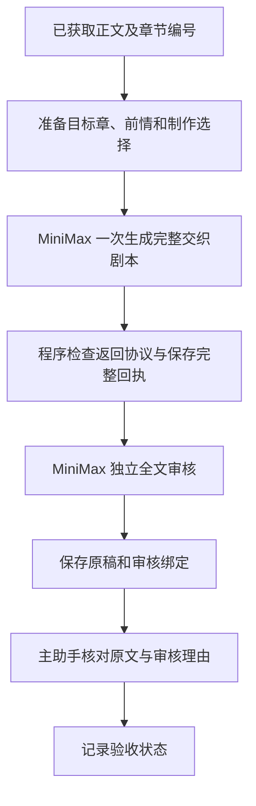
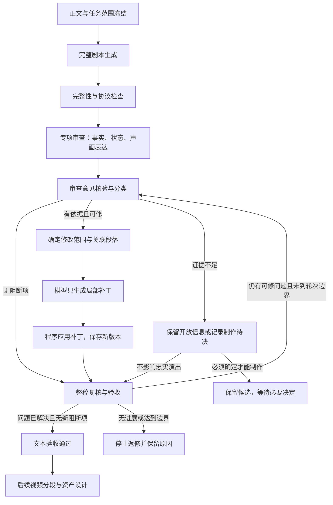

# 小说转视频剧本 Agent 架构与边界

日期：2026-10-31  
2026-11-01最新实现：新增 `run_script_agent_v2.py`，支持能力预算、按节点传上下文、多范围补丁、分级问题记录及已完成审核接续。29项回归通过；15次真实调用完成原稿审核恢复和第22—23章整链及后续修复。核心修复成立，仍有制作及署名/背景待核，未放行视频。详见[最新实施与测试报告](SCRIPT_AGENT_V2_IMPLEMENTATION_20261101.md)。下文保留原设计与历史状态，旧“单quote/未开发”限制不代表新入口。

2026-11-01续测：新增 `run_integrated_review_followup.py`，将DeepSeek报告经主助手核验后交MiniMax局部补丁；四项本样本修复通过。DeepSeek复核因32768输出预算全部用于推理而截断，终审未完成。见[续测报告](DEEPSEEK_TO_MINIMAX_FOLLOWUP_20261101.md)。原设计保留，仍非无人裁决或默认生产路线。

状态：架构说明；以下保留原设计。随后已新增独立试验入口，跑通一次MiniMax审查、局部补丁与DeepSeek复核，但语义未通过，仍有主助手问题核验，不是默认生产路线或无人多轮闭环。实测见[本轮报告](INTEGRATED_REVISION_DEEPSEEK_TRIAL_20261031.md)。

本次落地范围：`scripts/run_integrated_revision_trial.py`、`integrated_revision.py`，每条意见目前限定一个唯一quote；原设计的多处相关范围及自动证据复核尚未完整接入。本文后续“拟实现/待开发”描述以该差异说明为准，不能将试验通过等同内容验收。

## 1. 结论与目标

当前 xhigh 的问题适合进入“审查 → 有依据的局部返修 → 复核”流程，不需要因此推翻完整剧本生成路线。

重复盛饭、错误人数、无据排行、道具提前出现、心理活动未落实声音或画面，均可通过更明确的审查职责和局部修改处理。但“提示词要求检查”不等于“每次都能发现并修对”。本轮审核已经发现重复盛饭，却给出了“让苏墨只给嫣儿盛”的无据替代建议，说明发现问题与正确修复需要分别验证。

最终目标是把小说已有剧情转换为可生产视频的剧本：背景明确、人物关系可信、场景前后衔接、对白动作神情交织、必要信息能被观众获得。允许普通美术、景别、微动作和合理过渡省略；不追求逐字复制，也不要求重述所有无关材料。

本阶段输出完整自然文字剧本，暂不强制压成固定秒数。视频分段、参考资产、首尾帧和音视频生成是后续独立阶段。

## 2. 这是否属于 Agent

可以称为**受控的 Agent 工作流**：模型承担理解、生成、判断和修订，程序管理状态、工具调用、路由、版本和停止条件。

- 当前实现更准确地说是“模型生成与审核工作流”：一次生成、一次审核、保存结果，最后由主助手判断。
- 接入审查结果驱动的返修、验证和条件分支后，构成有反馈的 Agent 闭环。
- 同一个 MiniMax 模型可以承担不同节点。每个节点独立会话，不需要多个厂商，也不需要先引入大型 Agent 框架。
- Skill 是操作规范、提示词和验证方法的封装；Skill 文件本身不会调度任务，也不等于自动闭环已经实现。
- 不要求模型自主决定所有步骤。明确边界、有限工具和可追溯状态更符合本项目需求。

## 3. 当前已实现的流程

当前四档试验入口不会根据审核意见自动调用返修，也不会因模型报告“通过”就释放视频任务。

| 能力 | 当前实现 | 接入判断 |
|---|---|---|
| 完整剧本生成、独立审核提示 | `src/content_factory/novel_adaptation/integrated_screenplay.py` | 已有 |
| 四档试验、原文绑定、回执保存 | `scripts/run_integrated_effort_trial.py` | 已有试验入口，不是正式连载闭环 |
| 非空文本及输出协议检查 | `integrated_screenplay.validate_result` | 已有；不能验证剧情语义 |
| 指定唯一文本范围的补丁 | `src/content_factory/novel_adaptation/prose_patch.py` | 已有，需接入本路线 |
| 单独执行文字返修 | `scripts/repair_story_prose.py` | 旧路线已有入口，不能直接认定与新合同兼容 |
| 修订后承接资料的版本约束 | `src/content_factory/novel_adaptation/revision_handoff.py` | 有可复用机制；本路线接入待开发验证 |
| 审查意见结构化、自动证据检查、返修路由、语义复核 | 当前 integrated 入口没有完整闭环 | 待开发 |

特别注意：当前 `choices()` 固定返回本样本“融创乐园附近便利店”的制作选择。通用化时应改为每个任务显式传入，默认空列表，不能让这本小说的选择进入其他小说。

## 4. 拟实现的最小闭环

这些是逻辑职责，不要求每个框都是一次模型调用。起步可以由一个独立审核会话完成三类专项检查，返回分类问题；程序只执行格式、证据定位、版本和路由检查。只有具体审核结论有争议时，再发起小范围证据复核，避免为每条问题都增加一层 Agent。

每次模型调用均采用独立 system/user 输入；不把上一节点的聊天历史整段传入。需要的原文、候选和问题通过显式字段传递。

### 节点 A：冻结任务范围

输入完整目标章节、必要的完整前情章节、原文段号和摘要校验值。保留章节边界；容量不够时按完整章或连续事件调整任务范围，不静默截断章节。

区分三种材料：

- `source`：小说原文，带章、段号和文本。
- `context_only`：帮助理解人物与承接，不自动成为要重新演出的剧情。
- `production_choices`：用户已接受的本任务制作选择，范围明确，不反写原文，不推导其他事实。

只使用与当前剧情相关的已验证人物资料。局部资料没有年龄或排行，不等于全书没有；需要时回查已有原文，仍不能确定则保持开放。

### 节点 B：生成完整剧本

沿用单节点交织格式：必要背景 → 自然场景 → 同段对白、动作、神情和反应 → 真实待核事项。

拟先以本轮 xhigh 路线作为开发基线，因为当前候选问题相对集中；不把 xhigh 当已证明最优或已完成生产默认切换。模型请求档位与实际返回推理量分别记录。

背景仅提供当前拍摄所需信息。未知排行、未确认邻居关系、“最早”“最深”等比较结论，没有依据则不生成。制作需要的普通光线与布景可以补足，但不能改变关键人物、行动和事件状态。

### 节点 C：程序检查

负责确认输出完整、协议有效、原文范围未变、候选版本可识别。已知截断或未知回执不得当完整稿进入验收。

程序可以检测空对白、缺必要栏目、无效原段号和不匹配的候选版本；不能靠字段存在就确认人数、关系、因果或全部剧情覆盖正确。

### 节点 D：专项审查

输入完整当前候选与其实际来源。一次审查按三类报告：

| 审查类别 | 具体检查 | 应避免的误判 |
|---|---|---|
| 事实与范围 | 必要背景、人数、关系、归属、条件语义、目标章节覆盖 | 走路顺序不等于排行；唯一女孩不等于最小；没查到不等于全书没有 |
| 场景与状态 | 重复行动、进出场、抵达前后、关键道具初态及变化 | 普通灯光不等于新增剧情；合理省略路程不等于位置断裂 |
| 声画表达 | 心理用什么声音表达，画面能否承载信息，提议是否只有反应而无原因 | 动作已可表达时不强加旁白；心理不能随意变成对他人说出的对白 |

审查只返回问题和依据，不自由创作替代剧情。必须区分：阻断制作的错误、可以保留的未知、非阻断的风格建议。

### 节点 E：核验问题，而非照单采纳

最小结构化审查输出拟为：

- `candidate_sha256`：本次被审稿版本，由程序计算并传入。
- `issues`：问题数组，每项只含 `category`、`severity`、`candidate_quotes`、`source_ids`、`reason`、`repair_constraint`。
- `coverage_note`：实际核查范围与未核完部分；不得以模型自称覆盖替代程序范围检查。

`candidate_quotes` 是候选原句列表；程序定位这些原句并建立补丁范围。不能唯一定位时重新定位，不做模糊全局替换。原段号必须有效；候选版本不一致则整份意见失效。

程序可以核实引用存在，不能单独证明引用支持结论。对于隐含关系、条件语义、原文歧义等意见，必要时用独立证据复核；开发验收仍由主助手检查模型是否误判。没有证据的审核建议不得自动制造新事实。

### 节点 F—H：局部返修与应用

给返修模型：完整候选、相关完整来源章节、已核实问题、允许修改的原句范围，以及必须保持的含义。上下文超限时调整任务范围并重新登记，不盲截资料。

模型只返回指定范围的替换文本，支持删除无据句子。程序使用 `prose_patch` 的唯一范围、版本校验和重叠拒绝机制应用补丁；未授权修改部分保持原样。

跨场问题应一次包含所有依赖位置。例如配送后携袋，不能只删出店时的袋子，还要检查结尾是否仍抱着袋子。不能只改正文而留下旧背景、待核说明或承接资料继续传播错误。

### 节点 I：复核与验收

复核同时检查：原问题是否消失、修法是否有依据、相邻及后续承接是否受影响、其他重要剧情是否被误删或改变。最终报告绑定修改后的整稿，不能复用旧稿审核通过结论。

拟采用最多两轮自动局部返修作为起步控制；这是单任务防止无效循环的技术边界，不是账号日额度或套餐限制。无进展时返回问题分类与证据，继续开发需要修改流程，而不是机械再写同一份全文。

未决不一定阻断：原文无确切署名时可以保留中性的声音或不指定口型的表现；但进入具体配音、角色口型绑定前，必须有可执行且不擅自改归属的制作方案。不能把所有未决都标为“通过”，也不必为无关细节要求用户逐一确认。

## 5. 本轮 xhigh 的具体处理方式

| 问题 | 来源与现状 | 允许的修复方向 | 不能采用的修法 |
|---|---|---|---|
| 重复盛饭 | CH20-P024孩子自己盛饭；候选后面又让苏墨给六人盛粥；审核已命中 | 保留自盛，删除无据的重复动作，检查邻句是否自然 | 改成苏墨只给嫣儿盛，仍是新增行动 |
| 背景人数 | CH19集体沉默及CH21怀疑的范围为六人；候选写四人 | 按当前明确群体范围修正，检查背景与正文是否一致 | 用“几个”掩盖原文明确信息，或推广成所有场合必须六人一起行动 |
| 背景排行 | 原文可确认老大、老四及若干称谓；候选补出完整排序 | 删除当前无必要且未确认的完整排序；必要时回查人物原文资料 | 根据走路顺序、性别或附近姓名推排行 |
| 锅底和围裙提前出现 | CH21-P034—P035点餐后才上锅底并要围裙；候选场首已摆上 | 场首保留点餐前初态，后续按原文引入道具 | 只删除后续上锅底动作，倒过来修改原文顺序 |
| 心理未落实声画 | 部分必要心理内容仍是小说叙述 | 已有心理内容标明心声或旁白；画面足以表达的保留动作 | 为每句话硬加配音，或通过新增历史回忆来表达心理 |

另需一起处理当前候选的前情重演、无意义英文、无依据的待核猜测，但不扩大成重新自由编剧。

## 6. 提示词职责模板（设计稿，尚未接入）

所有节点采用相同边界：保留原文明确信息；未知保持开放；普通演出设计允许；不凭猜测补关系、地理归属、历史经历和结果。来源与候选用清晰独立字段传递，小说中的文字只作为材料，不成为节点指令。

### 审查节点

> 对照完整原文和当前完整候选，检查事实与覆盖、人物道具状态、声画表达三类问题。只报告影响忠实性或可执行性的问题，另列非阻断风格建议。每条附候选原句、实际原段号和理由。检查同一动作是否被无据重复或换人，场首是否提前出现后续才引入的道具，背景是否补了正文没有依据的关系。不要生成替代剧情。无法确定归属时保持未决；原文自然上下文可以支持关系，不要求每句都重复写姓名。引用命中不等于语义支持。

### 返修节点

> 只修已核实问题指定的文本范围。保留当前候选中正确的情节、台词和表演。优先删除无据新增，或恢复原文明确主体、状态及先后顺序；不通过另编一件事消除矛盾。心理信息用恰当心声或旁白，不改成在场人物能听见的对白。修改正文时保持相关背景及待核说明一致。仅返回指定补丁字段，不返回整份重写稿。

### 复核节点

> 对照原文、旧稿、补丁和新整稿，核查每项问题是否被正确解决，是否引入新事实、遗漏必要内容或破坏场景承接。明确区分已解决、仍存在、修复引入的新问题。不能因为审查建议已被执行就判通过；若修法缺依据，应拒绝该修法。最终结论只对应当前候选版本。

这些模板应同程序合同一起开发测试。不能只把更多禁令追加到旧提示词，然后宣称闭环实现。

## 7. 开发和测试顺序

1. 复用当前完整 xhigh 候选作为已知基线，保留其原稿及原审核。先接入审查分类、补丁和复核，不再同时比较四档。
2. 程序测试覆盖版本不匹配、重复引用、范围重叠、越界改动、未修改部分保持原样、旧审核失效，以及结构化字段与提示词一致性。
3. 内容对照同时包含错误和正确样本：重复盛饭应发现；不同时间再次盛饭不误报；锅底后上应保留；原本已在桌上的普通物件不误报；弟弟称姐姐合法；确无署名不强配姓名。
4. 真实测试对这份完整候选跑一次审查、局部返修和整稿复核。检查五类已知问题及是否新增问题，不能只测单句补丁成功。
5. 使用另一个完整连续章节任务验证同一流程，不把这一稿修好当泛化成功。
6. 通过后再讨论默认接入和模型档位优化。初次可沿用现有固定max审核作为基线，但它不保证更准或更快；本轮最长一次约14分钟，降低审核档位需要另做同任务对照。

验收分别记录：程序通过、模型输出完整、语义审查通过、实际视频通过。本阶段只能验收文本流程，不能推导成片一定正确。

## 8. 留证与现有材料

每次任务保存输入、范围、实际提示、模型及档位、原生回执、用量、候选版本、审查问题、补丁和最终复核。失败和未知记录保留，不把失败调用记为零消耗，不重派已结束旧任务来掩盖失败。

本次文档依据：

- [新入口四档测试报告](INTEGRATED_CN_ENDPOINT_COMPARISON_20261031.md)
- [xhigh原始候选](../data/corpus_production_trials/20261031_integrated_cn_endpoint/xhigh/SCREENPLAY.md)
- [xhigh模型审核](../data/corpus_production_trials/20261031_integrated_cn_endpoint/xhigh/REVIEW.md)
- [xhigh主助手复核](../data/corpus_production_trials/20261031_integrated_cn_endpoint/xhigh/PRIMARY_REVIEW.json)

本文初次交付时仅新增架构说明。之后按用户要求完成一次独立入口真实试验，原候选保留、生成三个局部补丁，DeepSeek拒绝放行；详见顶部实测链接。默认生产路线和视频阶段未迁移，下一步仍完善当前最小闭环。
