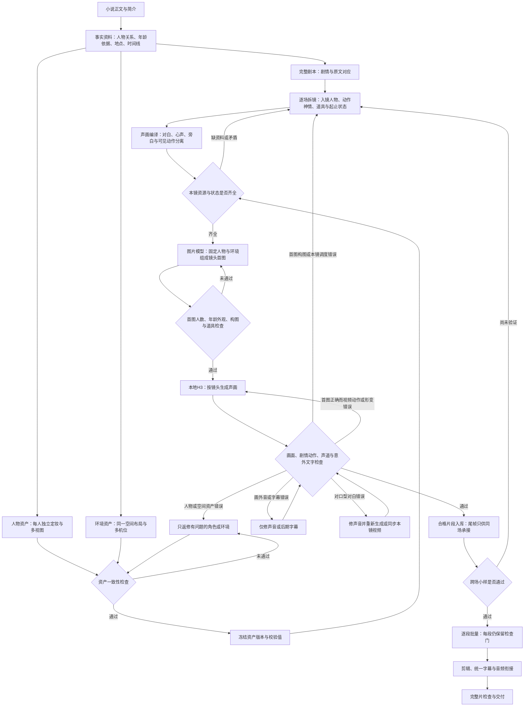

# 小说到视频：修正后的制作流程（建议版）

这是流程设计，尚未代表默认生产入口全部接通。旧视频批次保持暂停，新图片模型只做独立小样。

## 参考分配

- 人物按身份建独立卡，不以同框位置作为身份，不把漂移生成帧自动提升为基准图。年龄事实与视觉设计分别标注来源。
- 同一厨房的晚饭与早餐共用空间资产，变化的是时间、灯光、摆设状态；场次不等于新地点。
- 首图仅使用实际入镜角色和当前环境；画外说话者不因此入镜。镜头内多地点先拆镜。
- 同场连续动作可接已检查的原生尾帧；换场使用人物资产和对应场景重新构图，不能带卧室合照去解释厨房。
- 声音仅取已核的台词/心声/旁白文本，导演说明不发声。统一字幕后期制作，不能把生成出来的乱码字幕当合格产物。

## 小样与模型试验

先对同一组输入做人物侧面、双人同框、同屋换机位三项静态对照。Klein 4B与Qwen-Image-Edit-2511分别保存模型文件来源、量化类型、实际参数、耗时、分辨率、显存与图片结果。量化和采样不同不宣称公平的模型能力排名；只判断本机配置是否适合这项工作。

图片小样通过后再试少量单人、多人与转场视频。技术成功、文字完整覆盖和视觉一致性检查分别记录；任何一项未验收都不称整链质量通过。

## 运行恢复（与内容返修分开）

服务退出→身份/端口证据核对→服务有界重启→检查原ID与原产物→接续已有任务或按已批准规则登记替代尝试。未知无ID不盲重派。人工暂停优先于任何自动恢复；修改资产后依赖旧资产的未生产镜头重新编译，旧成片保留版本，不覆盖为新版本。

## 本次控制层实现

`src/content_factory/visual_repair_flow_v1.py` 与独立 `scripts/visual_repair_flow_v1.py` 实现版本绑定的返修计划和登记。审核必须绑定当前项目摘要，问题必须带观察证据；未知问题停止，不默认回到首图。人物/空间资产问题标记所有引用该资产的镜头；其他问题只影响指定镜头。产物原路径与校验值保留，仅取消新版交付资格。重复应用、过期审核和覆盖已有输出均拒绝。

声音明确为画外声时可保留画面；需要口型同步或不明确时，不保证视频可直接复用。生成画面内自带错误字幕属于视频问题，后期字幕修改不能消除它。

此入口只登记待办，不执行模型调用，不解除暂停。现有资产编译门、独立图片试验与返修控制分开验收；未把旧批次改造成新流程，也未声称语义审核已无人化通过。
