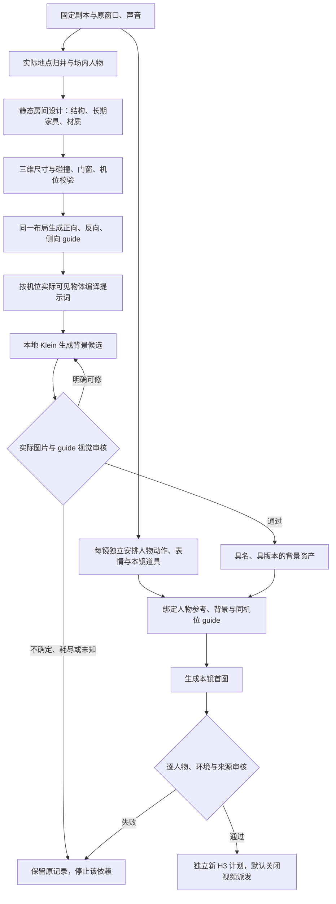

# 当前小说视觉流程重跑（2026-11-06）

本轮按用户“重新跑这个小说的流程，自动生成看看效果”执行。输入是当前小说**前三章已固定剧本**，不是重新改写69章，也不是恢复旧119段视频计划。旧片和原暂停记录保留。本轮不涉及账号、发布、后台重启或下载。

## 新流程

## 实测后修复的流程缺口

- **证据抄写错误**：改为模型引用原段 ID，程序回填原文、位置和 SHA。纯旁白回忆不变成当前实景。
- **顶灯落地**：新设计强制物体底部高度 `base_z`，碰撞和相机按三维检查。旧数据原样保留。
- **未来道具提前进入背景**：房间设计仅接收地点结构材料。长期家具与材质采用类型、枚举和程序编译；药瓶、食物、碗筷等只进入当前镜头层。模型自由描述保留为审计，不重新附入背景生成提示词。
- **画外家具被强行画进当前机位**：新背景提示仅包含 z-buffer 实际可见物件与门窗，不把全房物件清单当作本镜绘制任务。
- **邻镜原段串用**：镜头安排改为每窗口独立请求；最近前情属于 `context_only`，不能用作本窗口引用。
- **本地图像/视觉模型资源交接**：新批次可显式启用受锁和队列保护的资源交接。资源已足够时不请求卸载；异步释放未确认前不进入后继推理。不重启服务。

## 本轮实际范围与证据

- 文本规划：MiniMax-M3.1-Flash，独立请求、结构校验与有限返修。
- 生图：本地 FLUX.2 Klein4B distilled，BF16 主模型、FP4 编码器、4步。
- 视觉审核：本地 Qwen3-VL-4B NF4，实际读图；程序测试不替代语义验收。
- 本轮4个人物正面实际审核通过：苏墨、叶南、叶西决、叶嫣儿；这不代表81张视图全通过。
- 最终文本规划目录：`data/visual_novel_reruns_v4/six_children_20261106_v43`。
- 本轮选择3房：苏墨卧室、孩子房、厨房；厨房旧饭桌属于同一厨房布局。原文明确的客厅早餐桌另属客厅，尚不在本轮3房小样内。
- 本轮镜头安排只选择 F0001 / F0026 / F0063。不是完整三章视频已生成。
- 原生图像与审核目录：`data/visual_asset_pipeline/runs/novel_rerun_20261106_v43_rooms`。
- 实验、失败回执与最终结果：`data/qa/novel_visual_rerun_20261106`。

早期真实卧室候选已生成768×1024，并保留原生ID `3a27171b-abed-4c00-be11-38fdfd5cefd7`。独立看图发现额外门、桌；本地视觉审核仅给 `needs_review`，没有可靠指出全部布局问题，因此没有批准。它是诊断证据，不能冒充正式环境验收图。

## 实际小样结果

本轮共5次新的本地Klein原生POST：早期诊断1张、三房正面3张、修复后厨房正面1张。原文件、原ID、生成节点与所选副本的SHA均已核对；当前8190队列空。实际文本调用25次，实际视觉推理18次；这些是本轮真实记录数，不与此前试验累加。

| 范围 | 结果 | 能否送视频 |
| --- | --- | --- |
| 苏墨卧室初轮诊断 | 多门、多桌，保留原记录 | 否 |
| v4.3三房正面 | 均已保存768×1024；空房间计数null导致三张needs_review | 否 |
| 厨房分件家具修复版 | 相同布局/机位，桌椅腿恢复；v9实际BLIND人数0，四项审核通过 | 仅厨房正面通过，不构成整套通过 |
| 三房反向、侧面 | 尚未生成验收 | 否 |
| 三段人物首图与新H3视频 | 未生成，视频POST为0 | 否 |

原实心cuboid虽然位置正确，却使Klein将椅子画成木箱。新renderer `cpu_zbuffer/v4`按家具类型画桌板、腿、座面、椅背和搁板；不改原布局尺寸、位置或对象ID。静态资产资格绑定renderer，旧指南生成的图不能冒充新版。

空房间计数修复使用新v9合同：无人物为0，无法观察才是null；若仍null，最多一次独立只看实际目标图的计数复核，不从说明文字或expected count填0。未知请求不重发。新厨房首次BLIND已正确返回0，本轮**未实际触发**计数复核fallback或旧needs_review刷新；这些分支仅有离线协议测试。

本地4B视觉模型未可靠发现早期所有布局错误，也曾把椅子数描述错误。因此单张自动四项true不等于全场空间、跨机位或成片质量验收。当前整套生产资格仍false，原H3 PAUSE字节SHA未变，没有恢复旧批次、F0087、发布或账号业务。

实际清单：`data/qa/novel_visual_rerun_20261106/ACTUAL_RERUN_EVIDENCE.json`。

管理后台仍有旧缓存，不将直接CLI实测称为旧后台界面已加载新功能。

## 图片

前三房正面候选（不是通过清单）：

同一厨房布局的修复前后对照：

对照保留相同布局、机位、材质、模型、步数和尺寸；种子随原生作业摘要变化，不能称为固定种子的单变量基准实验。

## 最终程序验收

15个相关测试文件、535个独立测试ID全部通过，0失败、0跳过、0重复；344.23秒。19个源码文件及测试/配置的前后SHA一致。唯一最终XML为`data/qa/visual_novel_rerun_v44_count_release_20261106.xml`；完整计数与SHA记录为`data/qa/VISUAL_NOVEL_RERUN_V44_COUNT_RELEASE_ACCEPTANCE_20261106.json`。此前472、505和各子代理测试是历史阶段，不累加。

535证明程序与协议回归通过，不证明九张环境机位、人物组合或视频成片通过。当前剩余的验收内容是新版三房的完整机位覆盖、场内人物组合、动态道具/光照及真实视频效果；本轮预览到此收尾，原任务暂停保持。
