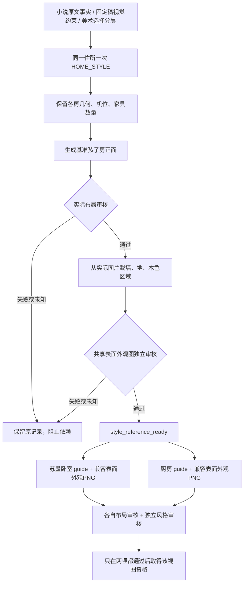

# 同一住所跨房间参考与联动实测（2026-11-06）

用户指出苏墨卧室、孩子房和厨房风格差异大，要求生成时同步参考。本轮以同一住所共享风格、实际表面外观图参照修复；旧图、旧原生ID和原暂停保留。没有视频、发布、账号或后台服务重启。

## 原因

原先每间房独立选择 `room_appearance`：苏墨房棕色旧墙/木地板，孩子房奶油色旧墙/木地板，厨房奶油瓷砖墙/瓷砖地。房间正面只有自己的几何guide；反向与侧面也只参考本房正面。固定剧本前部的整体画风段落没有进入逐房设计，厨房稿中已有的“水泥地”也遗漏了。

## 新的顺序

同住所的房间直接参考同一基准材质，不串行沿用上一个房间的生成结果。没有将整张卧室塞进厨房的生成输入。布局仍以各自guide为准，独立风格审核只比较色板、表面质感、年代/档次、磨损和写实感；正常曝光与时段差异不等同风格错误。

## 来源与实际规划

- 新规划：`data/visual_residence_plans_v5/six_children_home_20261106`。
- 读取当前前三章原小说JSON与已固定剧本；原小说事实、后续剧本视觉约束和未定美术选择分开标记，不把剧本补充的床数/材质说成小说原文。
- 一次真实 MiniMax-M3.1-Flash 共享风格请求完整返回；没有重新生成剧情或三房几何。
- 共享结果：灰色涂装旧墙、水泥地、棕木色、陈旧状态、昏黄基础灯光；当前厨房水泥地依据是固定剧本SP_0224，不是声称原小说明确写出水泥地。
- `GEOMETRY_PRESERVATION.json`核对三房原尺寸、相机、门窗、家具ID/数量/位置/旋转/高度保持。木色和表面材质属于本轮有意统一的美术部分。
- 基准选孩子房，因为该机位有足够墙面、地面和木家具区域，材质ROI最低边64像素、最高边256像素。

## 接线与资格

规划入口为`visual_residence_plan_v5`；材质清单/裁剪/依赖为`visual_residence_style_v5`；独立实际视觉审核为`visual_residence_review_v5`。在现有asset pipeline中显式`style_groups`才启用，旧无group流程保持兼容。

组定义、源剧本、风格版本、基准资产ID/版本/图SHA、原布局审核、裁剪坐标及真实PNG SHA均绑定。改变风格、基准或裁剪使对应依赖失效，不能用别的房间/书籍/旧参考代替。先以仅布局通过的master作材质引导启动；正式交付资格仍要求材质READY，不循环依赖也不把style通过冒充layout通过。

原旧shot提示中有棕墙/木地板等旧文字。本轮只导出背景包，旧shot保留原摘要并标记`needs_restage`；新首图和H3要求当前`home_style_sha256`，不能给旧shot补新标签假装已重排。

## 本轮实测边界

本轮只测试三房各一张正面，图像为现有本地FLUX.2 Klein4B、BF16主模型、FP4编码器、4步、768×1024；视觉模型为本地Qwen3-VL-4B NF4。新run为`data/visual_asset_pipeline/runs/novel_residence_style_20261106_v5`，原始证据与预览在`data/qa/residence_style_v5_20261106`。

## 实际结果与审核范围

三张已实际保存，均为768×1024。基准孩子房生成一次，卧室和厨房各生成一次；不是将旧图调色后充作新图。两间房的原生工作流各有4个LoadImage：自己的几何guide与同一组墙、地、木色裁图。实际原生图与选定副本SHA、输入原件与staged副本SHA已逐项核对，见`data/qa/residence_style_v5_20261106/FINAL_ACCEPTANCE.json`和`ACTUAL_REFERENCES_CONSUMED.json`。

最终原生交叉核对另存`ALL_ACTUAL_REFERENCES_CONSUMED.json`。Comfy history将唯一CFGGuider的cfg从整数1规范为浮点1.0，原始图SHA因此与提交JSON摘要不同；审计保留两种摘要与唯一字段类型转换，只在该已知字段数值严格相等时核对语义一致。其它图结构、输入引用、原提交REQUEST/PLAN/receipt摘要均匹配，没有改写原生history。

主代理已直接查看三张原图及并排预览：灰旧墙、水泥地、棕木家具、昏黄方形顶灯的外观接近，卧室没有复制孩子房的三张床，厨房仍保留自己的窗户、桌椅及柜体。正常朝向和曝光导致暖冷差异，不宣称每间房像素相同。苏墨卧室当前构图较空、只露出床边；厨房画面更接近餐区，本轮未重设计家具/机位。

独立阅读实际视觉原始回答后，4B的说明仍较概括，例如地面被描述为“无光泽”，而图上可见反光。这没有改变本轮同色系、同档次外观接近的人工观察，但不能据其true承诺精确物理材质、完整空间或所有制作细节可靠。当前仅为三正面的共享风格样本验收。

### 保留旧失败，不混淆审核目标

原material/v5路线的两次真实审核分别为needs_review和repair_required，旧记录均未升级。第一批木色区域过暗；改进为实际曝光选区并加入全图审核上下文后，4B仍将均匀灰墙/MDF外观判为材质不可辨。用户要求的是同一家的装修外观，未要求鉴定木种或物理材料；因此独立建立`appearance/v1`合同，不把旧材质否决改成通过。

新的appearance/v6沿用第二批裁图的完全相同字节，单独调用一次源参考审核，实际accepted。四项为色板、年代/表面风格、磨损、写实方式；裁图只审核可用颜色、可见表面和无房间布局。明确保留`material_identity_approved=false`、`layout_approved=false`、`novel_fidelity_approved=false`。源全图仅作为视觉审核上下文，不作为兄弟房间生成输入。新run为`data/visual_asset_pipeline/runs/novel_residence_appearance_20261106_v6`。

基准孩子房布局与源外观参照通过；苏墨卧室和厨房的布局、目标外观审核均已实际accepted。最终本次三front范围为`assets_ready`，selected=3/complete=true；不是三房全部机位或整套视频通过。

| 本轮新图 | 真实原生prompt_id | 结果 |
| --- | --- | --- |
| 孩子房基准 | dc6744bd-02d4-4061-93b4-916b3f3a62d8 | 布局accepted；源外观参照accepted |
| 苏墨卧室 | dab1798c-7e84-4064-b5cf-8b6def831137 | 布局/目标外观accepted |
| 厨房 | 3b8014fd-254c-4174-bb42-98b3910b436e | 布局/目标外观accepted |

本轮共1次真实MiniMax共享风格规划、3次Klein图像POST、11次真实Qwen3-VL视觉推理。视觉次数按inner CLAIM与NATIVE成对计数，MODEL/OBSERVATION的重复收存不重复计数，两个未进入模型的外层超时不算真实推理。

### Windows本地审核启动证据

卧室首次外观审核的900秒超时原记录保留为unknown。只读进程证据显示venv launcher忙等待、实际Python子进程尚未加载解释器；独立无模型短/长路径对照复现launcher失败，直接base解释器加`__PYVENV_LAUNCHER__`在相同venv依赖环境正常启动。修复仅作用于本审核子进程，物理解释器、有效sys.executable/prefix和依赖来源均落盘，不更新依赖/权限/服务。

在原家族已退出、原始无模型入口证据和原布局结果完整绑定后，通过`visual_local_review_recovery_v6`在既有2次审核预算内新建一次目标审核。新回执证明模型实际启动并accepted；原unknown未改成known，源参考与布局没有重跑。详见该run的`local_unstarted_recoveries/sufu_target_after_native_start_proof/APPLIED.json`。

厨房新进程已写WORKER_RUNTIME进入脚本，但`probe_resources()`的nvidia-smi子进程停在创建阶段，父进程忙等待，5秒内部timeout尚未生效；本机直接查询显存正常。独立无模型矩阵进一步复现：相同长HF环境下，TEMP/TMP为132字符时查询立即成功，271或290字符时创建子进程卡住，CREATE_NO_WINDOW开关不改变结果。仅收尾这些新QA进程；没有杀原审核/服务/浏览器来冒充恢复。

已补Windows审核私有短TEMP/TMP：`data/visual_worker_runtime/temp/<jobSHA32>`，全SHA owner校验，缓存路径、原REQUEST/CLAIM、全局环境与依赖不改。真实无模型“direct worker→嵌套nvidia-smi”已通过；原厨房超时与进程全家族退出证据保留。新target审核须同时绑定原阶段、DLL/无模型入口证据、原worker源码控制流及已完成布局，最多使用原预算第二次，不能据“没有native文件”普遍重放unknown。此证据与卧室首次未进入脚本的故障分开记录，不断言CUDA损坏或Windows内部故障细节已完全查明。

厨房独立分支的真实prepare逐项通过，只有原stage=loading、末次超时前30秒观测、两次无Torch/CUDA的DLL快照、未初始化nvidia子进程、原worker代码中资源探测在模型加载之前、原全家族退出等证据齐备才允许新target。缺ppid/name的第二次观测仅按同PID+同创建时间继承首样身份，不伪造已退出进程的新观察。新的`kitchen_target_after_short_temp_proof`实际推理约24.47秒，style和combined均accepted，原unknown仍在review_history、总attempt=2，source/layout/image未重跑。运行时回执在`data/qa/residence_runtime_start_20261106/KITCHEN_NEW_SHORT_TEMP_RUNTIME.json`，源证据在`KITCHEN_RESOURCE_PREFLIGHT_FINAL_EVIDENCE.json`。

原两次未知记录均保持unknown；没有将它们标成已知失败或删除。新审核完成后，主代理先纯只读核对3项requirements全部ready，再仅移除本轮试验run的暂停并用`tick(reviewer=None)`计算assets_ready；此步骤不调用模型、图像或H3。旧H3暂停与任务完全不动。

## 最终程序回归与保留边界

短TEMP与严格preflight恢复门补齐后，最终统一22份测试文件，**678个独立测试ID全部通过，0失败、0跳过、0重复，532.20秒**。26份源码、22份测试及2份配置前后SHA一致；主代理再次核对当前SHA。唯一当前最终XML为`data/qa/visual_residence_short_temp_final_20261106.xml`，完整清单`data/qa/VISUAL_RESIDENCE_SHORT_TEMP_FINAL_ACCEPTANCE_20261106.json`。XML SHA为`045e8786c028d23a31366cd034aeb2a8798071599f9b7d20af7217095dda5783`；不累加旧661、637、132、30、16、1等计数。该回归无模型/GPU或生产写，实际语义结果单独记录。

原H3暂停文件SHA仍为`9d5d0c747ef006a715dafe3ed527b7d4f94414ff7479b2c4155442cfebff377e`；新首图0、H3视频POST0。未恢复F0087、收存旧F86、发布、处理账号、重启服务或添加定时监控。原8501仍旧缓存，不称新入口已上线。旧镜头含棕墙/木地板旧文字，必须按新住所风格重新安排并绑定SHA后才可使用，不能简单给旧镜头补新标签。

本轮只验证三房正面共享外观方向；反拍/侧面、逐镜人物组合、完整自动审核及视频资格仍需独立验收。程序回归通过不等于这些未跑项目已通过。
