# 空间与声画承接：A/B两版一分钟实验

> 最终更新：两版均已完成。请看[最终结果、完整视频及审核](D:/IT/ai_douyin/docs/SPATIAL_MINUTE_A_B_FINAL_REVIEW_20261108.md)。下文保留04:51历史快照，不代表当前仍有生成任务。

**本页是2026-11-08北京时间04:51的只读证据快照：A已完成并展示，B/S01已实际提交、仍在生成。** 主线目标保持：同一小说开篇、同样10句原对白/心声，两份新的自动化输出视频，各4×362帧、24fps、60.333333秒、736×1312、含原生声音。B四段重新实际生成，不拿A片段或旧片凑B。A是保留缺陷的完整诊断基线，`production_approved=false`；B尚无完整片，不能提前称修复有效。

实验根：`data/video_generation/spatial_minute_experiments_20261107_v1`。原旧一分钟、旧五分钟、旧H3暂停、账号业务及后台不因本实验恢复。

## 流程与实际来源

```mermaid
flowchart TD
    T[原小说开篇四段 / 10句原音频文字] --> I[INPUTS：原文SHA / 三角色参考 / 适配审计]
    I --> AP[A：具名人物映射 + 原五参考图]
    AP --> A1[A首段：已知原片首图锚定第0帧]
    A1 --> AH[H3 Ref2VA + AddGuide]
    AH --> AT[本次前段原生尾帧 → 下一段第0帧]
    AT --> AH
    AH --> AF[A四段已保存 → CPU合成60.333秒已展示]
    AF --> AR[root已看抽帧 / 原生尾帧 / ASR / 三个接点]

    I --> D[Blender房间与人物调度设计]
    D --> R3[spatial_r3：同坐标房间 / 机位 / 前后状态]
    R3 --> SK[肤色占位材质修正 / 同几何与机位重渲染]
    SK --> K[Klein屏幕顺序参考打包候选]
    K --> SEL[root实际看图后选择]
    K --> Q[仅S02_end另测Qwen：背景墙贴头像失败]
    Q --> QEND[保留失败 / 省略S02可选末帧]
    I --> SP[逐句speaker/mode与源quote索引SHA]
    SP --> N29[v29_r2：官方六节英文 / Subject与局部声号分离]
    N29 --> NL[10句原中文进d标签 / 每句心声紧接本人闭嘴]
    AR --> DEC[root已审四稿 / 冻结正式B SPEC与APPROVAL]
    NL --> DEC
    SEL --> DEC
    R3 --> DEC
    DEC --> BH[B：同片场新首图与两房间参考 / 五槽]
    BH --> BT[本次B原生尾帧接下一段 / 仅S03另加末帧]
    BT --> BH
    BH --> B1[B/S01已实际POST / 原ID收存中]
    B1 --> BF[后续三段串行新生成 → 合成：待完成]
    BF --> BR[完整B后实际比较 / 结果待真实]

    I --> M[MoGe2：单张旧房间图片实际重建]
    M --> N[独立点云/网格/深度 + near_views]
    N --> E[独立几何能力证据：尚未喂入B]
```

图中B方案已冻结并实际提交S01，后续三段和完整比较仍待完成，不能把后续箭头当作已运行回执。MoGe分支没有接入B；采用的B空间图来自同一Blender设计片场及其真人化图，不是小说测量值，也不是MoGe网格的已验证对齐版本。

## 三类空间资料必须分开

|资料|实际来源|能确认的范围|不能冒称|
|---|---|---|---|
|旧房间正面/侧面参考|已有已审图片资产，A继续使用|实际五槽与SHA可追溯|灯具/床品差异已消除，或完整三维一致|
|MoGe重建及附近视角|对旧房间正面图的一次实际GPU推理，随后CPU导出/渲染|保存深度、法线、相机内参、GLB、PLY及center/left/right视图|实测房间尺度、未知背面恢复、与Blender坐标已对齐、已成为B参考|
|Blender空间调度图|从小说场景需求与制作选择建立的一床、一桌、一门、两窗设计|同一份几何和坐标生成各机位、人物前后状态及道具持有人|小说写明了这些米数、从小说测量所得、每张占位图已是真人图|

MoGe实际推理约16.183秒，输入576×768，输出在 `moge/`；低于16GB的这次显存消耗仅说明MoGe单独重建运行成功，不代表H3或其他世界模型的显存需求。`moge/near_views/RESULT.json`对应独立近视角实验；其坐标/来源不与 `spatial_r3/SPATIAL_PLAN.json`混同。

## 当前生产状态（以上述采样时间为准）

|节点|实际状态|
|---|---|
|H3尾帧AddGuide小样|原生ID `9a9025fe-1664-4e31-9356-3df73bf9bccd` 已保存并由root查看；不是正式一分钟|
|A/S01|原生ID `c5eba37f-0657-461b-9ecc-64eb52cb5d14` 已保存。3句ASR文字一致，但约5.33—7.77秒第二句期间弟弟动嘴，root记录说话人失配|
|A/S02|原生ID `e3cec90a-0cb2-494a-8397-e85d04ab2296` 已保存|
|A/S03|原生ID `bdfc3c37-e3c6-44bb-8d6f-aee6cc71b149` 已保存|
|A/S04|原生ID `14ac27d5-7842-43a5-8732-7b13a766a6ea` 已保存|
|A完整片|`variants/A/DIAGNOSTIC_MINUTE_736x1312.mp4` 已CPU合成并展示；1448帧、60.333333秒、736×1312、24fps，音视频起点均0，48kHz/2,896,000音频样本|
|A合成恢复|四段均保存后，原worker36117因S03容器尾时间舍入差0.0003255秒触发过严guard而exit1；独立v30时钟兼容经测试接入后CPU合成成功，未重新生成视频|
|空间r3|Blender实际渲染、机位和状态资料已保存；仍是设计资料|
|Klein首轮/肤色修复轮|两轮各2张实际生成，保留原图与失败结论；不能作为已合格B首图|
|v26屏幕顺序打包|canary两图已实际生成并由root看过，选S01_start及S03_end作诊断guide；另批两空房图选入B，两错误末态图拒绝作guide|
|Qwen2511替代出图|仅实际测S02_end一张，原生ID `99ea1cea-fa56-42eb-b1e1-9d62b85bd1e3` 已保存；把参考头像贴到背景墙，root拒绝，B省略S02可选末帧|
|图片实际计数|11个分支全保存：Klein四批共10张、Qwen1张；失败原图/原生ID全部留存|
|B_speech_r2|4段插入式中间候选已留存，当前B实际采用后续 `B_native_v29_r2` 官方格式；不是已完成B效果验收|
|B正式输入|`B_NATIVE_SPEC.json`、`B_NATIVE_ROOT_APPROVAL.json` 已冻结，root已审4份native_r2稿，显式 `prompt_format=official_ref2va_v29`|
|B/S01|原生ID `77608472-0692-4c2d-8623-d66e52ce12f4` 已实际提交，由原worker65055收存；不重派|
|B/S02—S04|同执行器按前一B实际原生尾帧串行接续，采样时尚未提交；仅S03另有已审末帧锚|
|视频实际提交数|截至本快照6次：4个A正式段 + 1个AddGuide小样 + 1个B/S01，不能当作6份完整片|

后续状态只认各原生STATE/RESULT、追加式LOG、ROOT审核与原ID，不以本页静态快照覆盖新进展。ROOT_CHECKPOINT中仍带旧阶段字段时，以对应新实际回执为准。

## A实际发现与审核范围

root已查看四段各六张时间抽帧、原生尾帧、S04额外动作抽帧及三个接点对照，参考CPU ASR文字、时间范围与文件时钟。**这不是逐帧检查，也不是人工完整听审、声纹或全程口型认证。** ASR文字吻合不能证明指定人物开口、心声闭嘴或动作完成。

|段|实际发现与限制|证据|
|---|---|---|
|S01|第二句约5.33—7.77秒应由哥哥说，抽样画面却为弟弟动嘴；3句ASR一致仍记录speaker失配|`variants/A/ROOT_S01_REVIEW.json`|
|S02|心声窗约1.98—8.70秒内，4.5/7.5秒抽帧可见父亲嘴动；ASR找到两句原话，但另识别前缀“苏沫”同音字，须听审确认，不能直接认定音轨干净|`variants/A/ROOT_S02_REVIEW.json`及ASR区间|
|S03|13.5秒父亲持包；原生尾帧多出米色上衣孩子。10.5秒孩子心声窗内可见嘴开；两句ASR归一吻合也不能抵消此问题|`variants/A/ROOT_S03_REVIEW.json`及原生last|
|S04|1.5秒可见1成人+4男孩，最多5人；5.5—9.5秒抽帧未展示清楚跪下，10.5—11.5秒有后移但未展示通过房门的完整路径；末尾面包袋消失，13.5秒心声窗内父亲嘴开。3句ASR归一吻合|`variants/A/ROOT_S04_REVIEW.json`及ROOT_ACTION_CONTACT|

尾帧guide让接点图像较接近，也把S03多出的孩子传给S04并放大人数错误。像素接近不等于人物、动作或空间连续性通过。`variants/A/ROOT_COMPLETE_REVIEW.json`将A定为完整原始诊断基线，未批准生产或发布。

## B已经冻结的实际改动

- 保留3张原人物图，房间两槽换同一Blender设计片场经Klein实际生成并审过的front/side；S01首图也来自同片场状态图。未输入MoGe图。
- 使用官方六节英文正文；稳定Subject 1/2/3对应苏墨/叶南/叶西决，声音号按每段首次发声事件从S1重排。原10句及标点仅从源文提取，放进 `<d>[Mandarin Chinese] ...</d>`；每句心声紧接具名闭嘴说明，保留原动作和表情，不把整段锁为脸部近景。
- r2仅把S01误加的sleeping/asleep修成闭眼躺着，未擅加醒着状态。四段任务类型为reference generation + keyframe completion，从实际frame-zero guide的位置构图承接。
- 后段接本次B前段原生尾帧；仅S03另加已审3人站立、父亲持包末态。最后从原手脸中近景退至全身是显式构图取舍。S01/S02/S04没有末帧锚。

`B_FIRST_ACTUAL_POST_AUDIT.json`已核实际S01 REQUEST：5参考槽、frame_idx=0，正文SHA `3dde9f647841b27946cb32e5910e29ac69a5832f1078ffd8ba93f19347ccc7d8` 与native_r2编译结果相同。显式官方格式分支不追加旧中文参考尾注，guide未伪标为Picture6。以上是输入与接线证据；能否改善speaker、闭口心声、人数及动作仍待真实B完整片。

## 失败→改流程→再跑的证据

所有路径相对实验根，原失败图/原ID及旧审计保留，不用新namespace抹掉消耗。

|发现与修正|原结果/失败证据|修正后重新运行或当前准备证据|
|---|---|---|
|实际H3 canary在POST前遇staging Config包含gpu_lock_root|`CANARY_A_EXECUTE.log`；当时无CLAIM/REQUEST/原生ID|仅修窄Config适配；真实本地文件staging黑盒补测；同一prepared计划运行，结果见 `CANARY_A_EXECUTE_R1.log`、`CANARY_A_ROOT_REVIEW.json`。旧源码/测试/XML归档QA目录 `spatial_v24/pre_stage_cfg_fix`|
|早期空间取景/投影迭代|`spatial/`、`spatial_r1/`、`spatial_r2/ACTUAL_VIEW_REVIEW.json`|最终采用设计r3：`spatial_r3/HANDOFF.json`、`CAMERA_PROJECTION.json`、`blender_fov_r1/RESULT.json`；旧图不覆|
|首轮真人化保留青色塑料头/手|`stills_r3/batches/canary/{RESULT,CANDIDATES}.json`；`STILLS_R3_CANARY_ROOT_REJECTION.json`；原生ID `82fc29a2-c14e-4f78-85e1-aec3a7cc42a6`|改占位材质：肤色只用于裸露头/手臂，身份色仅服装；同几何/状态/机位重渲染于 `spatial_r3/blender_skin_proxy_v25/`，然后真实重跑 `stills_r3_skin_v1/batches/canary/`|
|肤色修正后已是3真人，但哥哥衣服/持有人或兄弟位置仍不符|`STILLS_SKIN_CANARY_ROOT_REVIEW.json`；原生 `e527a547-71b5-4aec-93a2-2983175b7e51` 的2张全保存|改屏幕顺序参考打包；真实新原生 `15f5e646-f6e9-4d7f-8c78-180dc3f0080a` 的S01_start/S03_end已看并选作诊断guide，见 `STILLS_SCREENORDER_ROOT_REVIEW.json`|
|补末态与房间图：S02多出橙衣成年男，S04添家具且全身构图冲突|原生 `45b0f483-ce10-4e3e-8467-657b4f4986fb` 4张全保存；`STILLS_END_ROOM_ROOT_REVIEW.json`和逐图review|两空房图选入B，S02_end拒绝、S04_end仅留QA，不作guide|
|S02_end改测Qwen仍失败|仅1张，原生 `99ea1cea-fa56-42eb-b1e1-9d62b85bd1e3`；参考头像贴到背景墙，`qwen_fallback_v27/ROOT_S02_END_REVIEW.json`|保留失败并省略S02可选末帧，不无限补，不称Qwen替代成功|
|A错speaker、心声张嘴、额外人物|4份 `variants/A/ROOT_Sxx_REVIEW.json`，原片保留|先做可逆 `B_speech_r2` 对照，后采用已审官方 `B_native_v29_r2`；B四段重新实际生成，当前仅S01已提交|
|v29 r1误把闭眼写成睡着|`B_native_v29/` 原稿/验收保留|`B_native_v29_r2/INPUT_SPEC.json`白名单纠正与实际guide任务说明，原中文源及10句不改，root审后用于B|
|A合成因S03容器尾时间舍入过严而拒绝|`A_EXECUTE_FINAL2.log`，worker36117 exit1；不是GPU生成失败|独立v30与受影响测试后，`A_ASSEMBLY_RECOVERY_V30.log`、`variants/A/FINAL_RESULT.json`证明CPU合成恢复，0视频重试|

## B_speech_r2独立只读复核

此前CPU整理已对4份实际源及编译输出重算SHA，并独立按audit字符区间逆向删除插入文本：**4份均逐字节恢复原稿**。原引号按序计数为3、2、2、3，总10处，内容/标点/顺序均保持；没有工程标签，没有新增统一纯脸部近景锁定。原S04跪下、起身、牵手跑出等动作原句保留。本次仅更新状态文档，没有重新运行该组测试。

speaker/mode完全来自显式记录：S01弟弟对白/哥哥对白/弟弟对白；S02父亲心声/弟弟对白；S03父亲心声/弟弟心声；S04父亲对白/弟弟对白/父亲心声。没有按附近最后人名猜说话人。

实际r2 AUDIT SHA：`547cac3a417f49f7a18a94960bb5a4cda7fb3faf3c5c6fbc5f8ecc37bcacee99`。35项CPU测试只证明编译合同、可逆性、引用及失败拒绝正确，**不证明B的说话人、闭口心声、动作、空间或画质通过**。详见 `data/qa/spatial_v26/SPEECH_GROUNDING_R2_ACCEPTANCE.json`。

该插入稿是历史中间候选，实际B已换 `B_native_v29_r2` 六节英文稿；原10句/源SHA及r1→r2精确变换另有37项CPU验收。原七模块190项CPU回归、后续接线105项唯一CPU回归（40core+37native+28clock）不累加为内容验收。105初次C临时目录拒访问setup证据保留，正确D临时目录重跑105全过，不重复计数。

项目QA `data/qa/spatial_v29_delivery_bridge_20261108/ACCEPTANCE.json`绑定最终接线验证：四个实际A REQUEST重建逐字段及graph SHA均相同；只有显式官方格式跳过旧中文尾注。程序通过不能替代真实B音画审核。

## 完整成片结果——B仍待实际完成

|结果项|A|B|
|---|---|---|
|完整60.333秒原生四段齐全|已齐并CPU合成展示|仅S01已提交，尚无完整片|
|最终视频路径|`variants/A/DIAGNOSTIC_MINUTE_736x1312.mp4`|待真实完成|
|最终SHA|`0c4e0df68ae5c9e71ce7993016fbe5ba0c94d66b5d6db055dc5fe2b63a28ddf5`|待真实完成|
|实际1448帧/736×1312/24fps/原声音轨检查|`FINAL_RESULT.json`及`qc/final/FINAL_OBJECTIVE_QA.json`已核，48kHz/2,896,000样本，AV起点0|待实际片独立CPU核验|
|人物/环境/道具/动作/心声口型|上表列真实缺陷，审核为抽帧+ASR，非逐帧/完整听审|待实际生成及相同范围核验|
|图片producer与guide来源|原五参考、已知原生首图与前段尾帧|3原人物图+Klein同Blender片场2房间图；同片场S01首图、各B原生尾帧、仅S03设计末图；未输入MoGe|
|保留缺陷与换线路判断|完整诊断基线已交付，未批准生产|待完整A/B对照，不先宣称修复成功|

A完片ROOT审核SHA `492368141eda13b050b4698ed06a56da08f4f7cd1b90f8e0cd8bd1bb7f569f41`；B正式SPEC SHA `0fe394a6bdc1d60c46ff310dde0d656bc60217ca825be8c7aba25aedef7bc4f5`，ROOT_APPROVAL SHA `d93da2a1216dca7b27f949382aaf53ffe2763afd550c9733dd6d5d03a88904a9`。

成片用于展示自动化真实输出，语义缺陷记录后保留，不冒称production_approved。技术失败、未知结果仍保留原ID，不盲重派。当前只有A完整一分钟，B尚待完成；本页不授权新模型调用，不修改代码、预算、依赖、服务或任何冻结输入。
