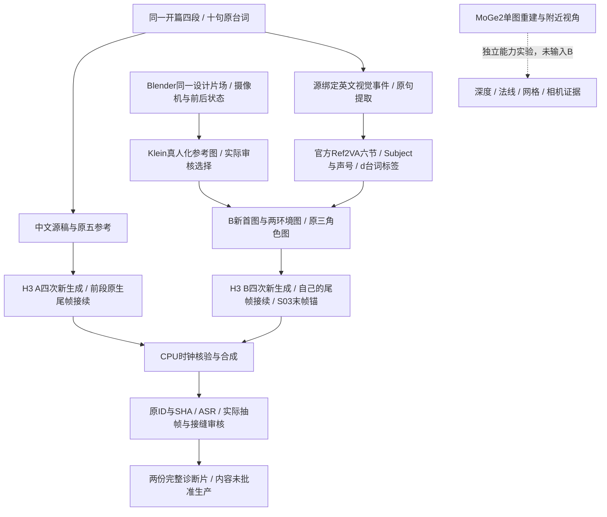

# 两版一分钟自动化实测：最终结果

2026-11-08。两版均已实际生成、合成并审核，都是本地 H3 视频及原生声音；没有用旧一分钟或低清探针替代。**技术链已运行成功，内容一致性仍未通过。**

## 完整视频

|版本|完整文件|规格|SHA256|
|---|---|---|---|
|A：具名参考与原生尾帧接续|[A 完整片](D:/IT/ai_douyin/data/video_generation/spatial_minute_experiments_20261107_v1/variants/A/DIAGNOSTIC_MINUTE_736x1312.mp4)|736×1312，1448帧，24fps，60.333333秒|`0c4e0df68ae5c9e71ce7993016fbe5ba0c94d66b5d6db055dc5fe2b63a28ddf5`|
|B：空间参考与官方声画格式|[B 完整片](D:/IT/ai_douyin/data/video_generation/spatial_minute_experiments_20261107_v1/variants/B/DIAGNOSTIC_MINUTE_736x1312.mp4)|736×1312，1448帧，24fps，60.333333秒|`327d200322847342ee1f986b33a9b6dc5f188f3c984f508221d0b0a4abd65147`|

两片音视频起点均为0，合片音频为48kHz双声道、2,896,000有效样本。音频来自H3；合成仅统一采样时钟与编码。原段视频、FLAC、原生首尾PNG、请求及历史回执均保留。

本轮为8个正式H3段、1个5.167秒探针，以及5批共11张图片。探针不计入上述完整片。8个正式原生ID均唯一且已保存，执行器和有限QA监测均已退出；最终检查原生队列为空。旧H3暂停SHA仍为 `9d5d0c747ef006a715dafe3ed527b7d4f94414ff7479b2c4155442cfebff377e`。

## 实际流程与A/B差别

|项目|A|B|
|---|---|---|
|人物|原三张正面参考|同三张正面参考|
|环境|原房间front/side|同一Blender设计片场经Klein生成的两个视角|
|第一段首图|已有已审原生首图|同一新设计片场的真人化三人首图|
|后段首帧|本版前段真实原生尾帧|本版前段真实原生尾帧|
|额外末帧|无|仅第三段：三人站立、父亲持面包袋|
|提示词|中文动作、对白、具名图片对应|[H3官方Ref2VA格式](https://github.com/MiniMax-AI/MiniMax-H3/blob/main/skills/h3-prompt-writing/references/ref-en.txt)：六节英文、稳定视觉Subject、局部声号、原中文台词及心声模式|

B四段均为新原生ID，未复用A片段。十句原文及顺序保留；四份实际POST文本SHA全部匹配预审稿，没有旧中文尾注。没有统一固定机位。此为多因素流程对比，不能把差别全部归因于某一个提示词字段。

## 真实内容审核

审核范围：四段各六个时间点、原生尾帧、心声/第二句台词区间加密抽帧、末段动作加密抽帧、三个最终接缝及CPU ASR。**不是逐帧检查、完整听审或声纹认证。** ASR正确不能证明演员开口正确；张嘴画面也不能单独证明声学上已变为对白。

|位置|A实际观察|B实际观察|
|---|---|---|
|第一段|第二句应哥哥说，弟弟却动嘴|转兄弟近景后出现重复的两对兄弟和两袋面包；不能验收唯一演员对应|
|第二段|心声窗内父亲嘴开；ASR另识别“苏沫”前缀|仍嘴开；采样回到父亲加两个孩子；两句时间更接近原分镜，未再识别额外前缀，但末尾父亲提前触接面包袋|
|第三段|尾帧多出孩子，错误传到下一段|中段仍多出灰衣哥哥；**指定末帧确实将段尾恢复为三人持包状态**，不代表中段通过；父亲与孩子心声窗均有开口表现|
|第四段|采样出现父亲加四男孩；跪姿不清，末尾面包袋消失|采样保持三人及父亲持包，出现跪姿/屈腿与起身跑动；但最后一镜生成未经请求的金色乱码文字和星形装饰，心声仍张嘴|
|分段接点|相邻边缘画面接近，但会继承错误人物|相邻边缘画面接近，第三段正确末态可接入第四段；仍不能证明动作速度和全过程一致|

B第四段ASR“做的很好”和原文“做得很好”是同音字差异，保留原转录，未当作真实音轨读错。B其他句子归一吻合。金色文字已存在于H3原生尾帧，不是CPU合成添加。

## 原因与边界

1. **空间资料没有成为全过程物理约束。** Blender能给出同坐标的机位、位置和前后状态，但本轮H3主要接收二维参考和首尾锚点。第三段“尾帧正确、中间仍增人”是实际反例。
2. **图片资产层也有残留问题。** 指定末态图本身有兄弟高矮比例、合影式朝向的差异；模型匹配目标图不能证明与前段身份完全一致。Klein的四人错误末态、Qwen把参考头像贴墙等失败都保留，未作为合格替代图。
3. **视频生成层未可靠执行演员实例、延后接物及闭口心声。** 原始首图只有三人，后续镜头才复制人物。实际输入、引用、完整提示词及特殊token编号均已核对，不能把这些结果简单解释成“要求没有传进去”。
4. **合成的真实软件缺陷已修复。** A第三段容器结束时间少4个时间刻度、约0.3255ms，而362帧实际PTS与帧时长全部正确。新v30仅在小于1ms且真实逐帧时钟精确时兼容；缺证据、读失败或更大偏差仍拒绝。原视频未改、未重新投递。

下一条值得验证的路线是按**实际分镜**分别生成、按镜头选择可见人物和所需环境方向，再由剪辑执行切镜；镜头内仍可移动及表演。逐帧深度/姿态控制是另一候选，[候选报告](D:/IT/ai_douyin/docs/H3_TEMPORAL_CONTROL_CANDIDATES_20261108.md)已核具体权重与兼容边界，但尚未安装实测。这些候选没有经过本轮完整试片验证。

## 下载、代码验证与复现证据

Blender4.5.9便携版与MoGe2权重均位于项目D盘目录。MoGe2已实际单独推理、导出网格并渲染附近视角；它没有直接喂入B，也不能恢复图片没见到的完整房间。B采用的是Blender设计布局及Klein真人化图，不是小说实测尺度。原服务、账号业务、原项目及Comfy依赖和旧暂停保持。

- [主执行器/官方格式/时钟修复105项回归及源码SHA](D:/IT/ai_douyin/data/qa/spatial_v29_delivery_bridge_20261108/ACCEPTANCE.json)。四份实际A POST图重建逐字段相同，默认行为保持；只对显式B官方格式跳过旧尾注。
- [CPU QA工具50项回归与源码SHA](D:/IT/ai_douyin/data/qa/spatial_movie_cpu_v24_B_native_refs_RELEASE_20261108.json)。修复旧literal参考ID假设，按角色、视角、唯一ID、真实图及审核SHA核对。旧失败记录保留；两组数字不叠加冒充内容通过。
- [A最终实际审核](D:/IT/ai_douyin/data/video_generation/spatial_minute_experiments_20261107_v1/variants/A/ROOT_COMPLETE_REVIEW.json)、[B最终实际审核](D:/IT/ai_douyin/data/video_generation/spatial_minute_experiments_20261107_v1/variants/B/ROOT_COMPLETE_REVIEW.json)。
- [B完整CPU交付索引](D:/IT/ai_douyin/data/video_generation/spatial_minute_experiments_20261107_v1/variants/B/qc/FINITE_CPU_QA_COMPLETION.json)、[四段真实POST文本核验](D:/IT/ai_douyin/data/video_generation/spatial_minute_experiments_20261107_v1/variants/B/qc/NATIVE_REQUEST_AUDIT.json)。
- [B完整提示词与源动作对照](D:/IT/ai_douyin/data/video_generation/spatial_minute_experiments_20261107_v1/B_native_v29_r2/READING.md)、[最终队列与八个原生ID](D:/IT/ai_douyin/data/video_generation/spatial_minute_experiments_20261107_v1/FINAL_TECHNICAL_STATUS.json)。

两份是自动流程的真实诊断结果，均为 `production_approved=false`，没有发布。后续若修改生成流程，应新建版本并重新生成相应完整试片，保留本轮原始证据。
