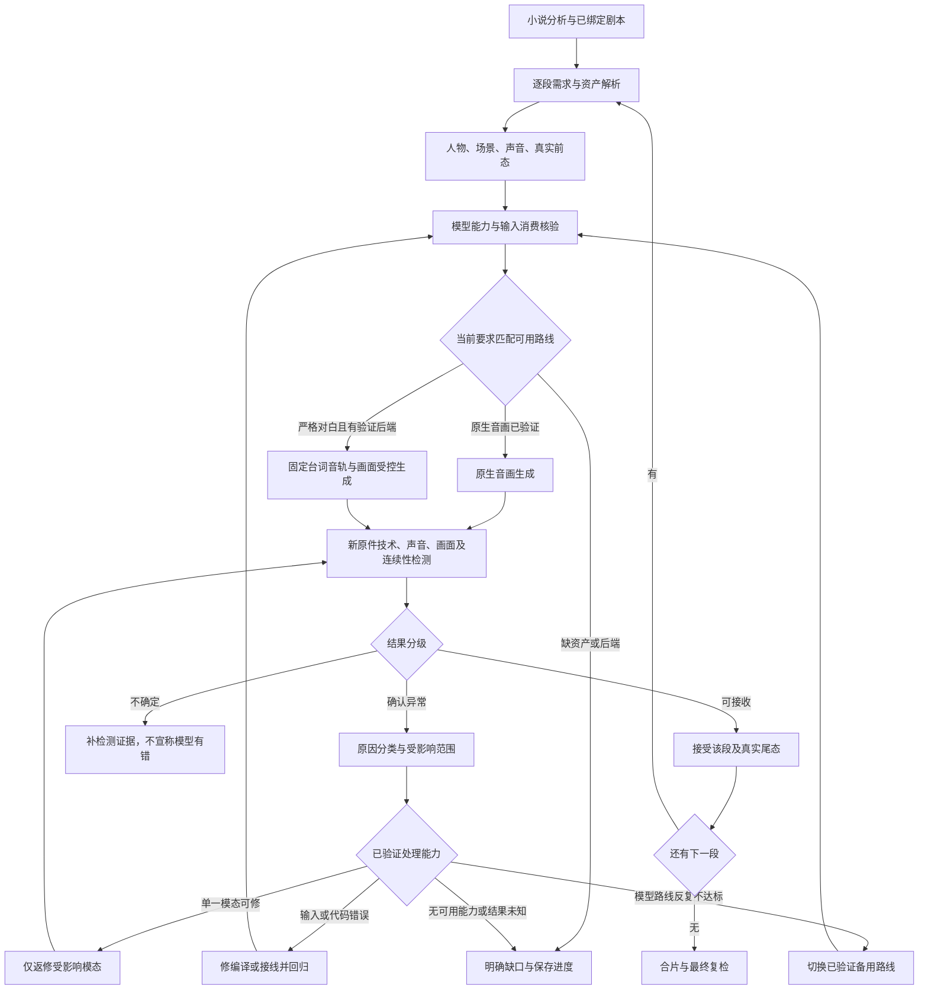

# 视频生产流程：原因诊断与路线选择

## 目标与当前结论

目标是从绑定的剧本与资产自动产出可用视频：发现问题后能识别责任层、选择经过验证的处理办法、复检并继续后续片段。单片被拒绝、手工修好一段或测试替身通过，都不能单独证明该生产流程已经验收。

用户已明确以完整流程为目标。当前8e4第三段的CPU局部声音编辑未执行，不为交付这一段而继续编辑或重拍。

当前可明确定位：额外声音出现在这套本地H3生成链的原始输出，输入中没有这些额外台词，尚未经过合片。因而可以判定为生成内容不符合输入，不能归因合片新增。还不能仅凭这两次测试断言H3所有版本都无法使用；当前量化权重、文本编码、12步采样及软声音控制需要分开核验。

## 当前证据与责任边界

| 层 | 已确认的事实 | 尚缺的证据或能力 |
| --- | --- | --- |
| 剧本与实际prompt | 两句原台词各出现一次，计划时窗不交叠；新旧9张实际参考图及seed一致 | prompt完整写入REQUEST不等于编码器完整消费，需独立核截断与运行证据 |
| 原生输出与合片 | 额外声音在未合片的8e4原件内；该候选未被选择、未被合片 | 无法据ASR片段推定额外词、语言或声源；用户已确认该区声音有问题 |
| 本地H3配置 | ref2va pruned INT8模型、NVFP4/AWQ文本编码器、12步res_multistep/simple、BasicGuider | 未做足够控制变量测试来区分模型本体、量化、采样与长调度的影响 |
| 声音控制 | 台词、声线和时间当前靠自然语言提示，未输入确认音色资产；起音前置能改善但额外发声仍存在 | 尚无严格台词执行保证，也没有已验证的H3局部音频重生成入口 |
| 检测 | 已有同原件ASR与完整台词对齐；用户确认后声音可离线判拒绝 | ASR不能验证声线、说话人、年龄、口型；目前画面为代理实看，非后台独立视觉检测全接通 |
| 自动返修 | 通用控制器有claim、原ID续查、拒绝、选择与合片协议 | 当前真实生成适配器固定S03/A001与一次尝试，尚非任意分段、自动备用路线的生产适配器 |

旧片首句约5.25秒开始，额外识别位于0.07—5.01秒；新片首句0.42—8.76秒，额外识别8.94—11.98秒，下一句12.82—14.285秒。支持“前置台词改善起音，但声音软调度仍失控”的判断；“模型在空档自行补语”仍是解释假说，不能当作唯一内因。

同轮输入审查补证：本地H3所用Qwen3VL tokenizer的纯文本计数为旧2263、新2192 tokens；完整编码后解码逐字相同，尾部保留，静态代码也未发现静默截断路径。这排除了“按通用CLIP的77 tokens截断”这一解释。该检查没有载入模型权重或前向，不是实际生成时的embedding消费回执，视觉扩展tokens未实测。时窗和台词仍是文字软条件；12步和BasicGuider并未因此变成经过质量验证的官方预设。

## 统一流程

## 需落到代码中的规则

1. **生产入口通用。** 输入为项目、剧集、分段及绑定版本，不写死S03、A001、固定角色或本次时间点。上游仍提供人物、时间、地点、动作、对白、画面；每段解析并发送所需资产和真实前态。
2. **编译与模型职责分开。** 编译器证明实际图、文本、图片、声音及状态送入哪个节点；模型输出按结果检测，不因参数校验通过就标内容通过。文本token超限或编码消费无法核验须明确记录，不能凭REQUEST字符串就排除输入问题。
3. **能力按模型和配置版本登记。** 原生音画、严格对白、声音参考、音频局部重生成、唇形同步分别验证。节点有mask或参考音频端口不等于该路线已可生产。当前H3原生音轨不能直接视为严格对白后端。
4. **异常须有分类与证据。** 区分技术执行失败、输入消费问题、额外发声、错词、错说话人、声线变化、画面人物错位及承接错误。不用一句“模型问题”覆盖所有责任层，也不对每个问题都加一句prompt后整段重拍。
5. **返修按原因选路。** 输入或代码错，先修输入/代码；模型原生声音反复失控，转已验证的受控台词音轨路线或合格备用模型。无可用后端则明确阻塞原因，不伪造成功，也不无限重试同一配置。
6. **局部静音仅为可选组件。** 只适用于已确认、完全可与实际正常台词隔离的额外声音；时窗必须来自完整匹配的实际语音，不能依据计划时窗或用户粗定位直接删除。与对白重叠、错说话人或缺台词均不走该支路。人物错位不会因修声音而通过。
7. **声音身份需真资产。** 绑定固定版本声样、参考文本、角色与声音特点。缺少有效绑定时明确缺资产；不能回退默认成人声，也不能把文字声线或假测试音频当已确认音色。
8. **每个新结果独立复检。** 证据必须匹配该候选原ID、媒体SHA、来源和资产；修复声音不沿用旧音频的通过结论，修复画面也要检查与前后段的承接。只有可接收的新尾态可交给下一段。
9. **运行与业务均需闭环。** 原ID续查、未知不重派、断点恢复和缓存验真解决执行问题；有效返修/备用路线与复检解决业务问题。两者缺一都不能宣称无人生产已完成。

研发模式保留并展示所有真实候选，包括失败片，便于比较路线；展示失败片不等于生产接受。生产模式按影响分级，允许已约定的小偏差，额外台词、错说话人、明显人物或身体错位须处理。不能将所有问题一律拦截，也不能为了走完流程降低重要问题的判定。

ASR未映射片段属于检测不确定性，自动流程应补独立语音证据或进入已验证备用路线；不能把“每次等用户听一下”作为常态自动化节点。当前这项自动补证据能力仍待后端验证。

## 验收方式

- 从统一公开入口输入新剧本与资产运行，覆盖多个分段、说话人和场景；不能由Root为每条片手填固定案例才算成功。
- 除正常生产外，注入缺资产、错绑定、额外声音、说话人错误、人物承接错误、子进程失败及提交未知，核对选择的处理路线与恢复状态。
- 真实模型对照应一次改变一个关键因素，记录完整输入消费、配置与输出。当前模型路径若持续失败，就登记该能力未通过并使用已经验证的备用路线。
- 模块与黑盒测试先验证调度逻辑，真实新材料再验业务效果。必须至少验证真正的“发现问题→自动选路→产生新结果→独立复检→继续后段/合片”，不能只展示拒绝坏片的分支。

本文件是完整流程的归因和设计规范，尚不代表受控音轨、备用模型、视觉/说话人检测均已部署。现有接口与模型库存以同轮本地清点报告为准。

## 本地可复用组件与实际缺口

- `voice_asset_registry_v1.py`已有版本、角色绑定、听审记录和缺失通知；当前小说尚无确认儿童声样，实际仍为prompt_only。该模块管理资产，不负责自动创建合格音色。
- 旧TTS入口只有Edge和GPT-SoVITS；存在默认成人声或默认参考的回退。严格角色声音路线需要显式解析已绑定资产，不能直接沿用这些回退。
- 本地CosyVoice3有模型、环境与逐句批处理入口，可作为受控台词音轨接入候选；尚未与声音资产库、任务claim及完整自动生产路线连接。
- 本地MuseTalk有模型、环境和固定音轨推理包装；历史个案脚本尚不能证明多角色、自由机位中的角色身份→人脸区域→唇形处理→质量检测已自动闭环。
- H3节点底层有独立音视频遮罩，但当前生产图与适配器没有已验证的局部音频重生成入口。不能仅增加一个能力标志就把它放进自动备用路线。

因此，下一阶段应优先补统一输入、能力登记、原因分类与路线调度，再接通受控台词音轨及其适用范围验证。CosyVoice3/MuseTalk当前属于候选组件，不是已验收的组合主线。局部gap静音仅为未来可选处理器，不能代替这些工作。
