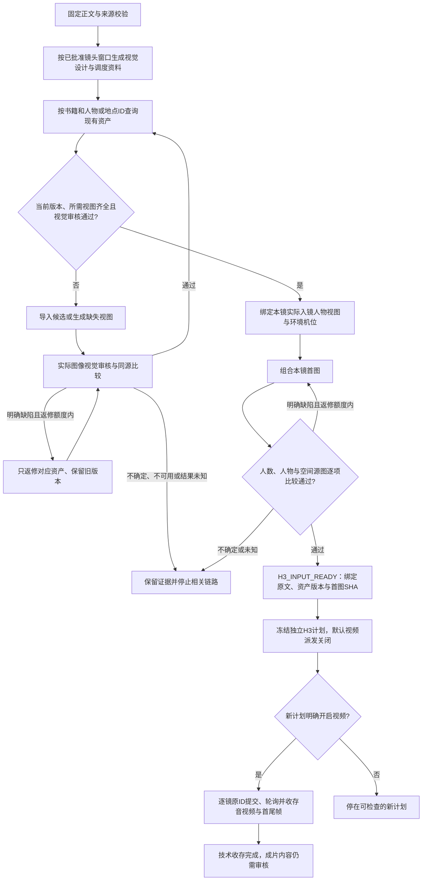

# 小说剧本到人物、环境与镜头资产自动化 v3

本轮按用户“主 agent 发布需求、子 agent 并行补齐开发测试”执行。主代理负责合同整合、真实本地模型联调和验收；三个子代理分别负责资产与依赖、图像任务与界面接线、真实视觉审核与 H3 适配。不是各子代理测试数直接累加，最终结果以统一验收 XML 和实际原生回执为准。

## 从哪一阶段接入

接在**剧本文本固定之后、视频分段提交之前**。新小说只消费已经落盘且来源校验通过的文本集数，不重新改写对白、人物关系或情节。文本 PLAN 的 `media:false` 保持原样，独立 `visual_media_policy/v3` 记录媒体授权。

当前已有稿另有资产补齐入口：导入《你敢惹我？我有六个反派儿子》现有前三章完整稿的九位入镜人物 81 张图片，保留原生 prompt/save_node、源稿 SHA、图像 SHA 与候选状态。这不是69章全书人物已穷尽，也不把旧稿宣称成新合同的终审通过稿。

不合格图片没有通往组合首图的旁路；组合首图不合格也没有通往视频的旁路。旧完整片119段计划及原 PAUSE 不参与解除和恢复。

## 模块、模型与数据

| 模块 | 实际职责 | 模型或实现 |
|---|---|---|
| `visual_asset_handoff_v3` | 冻结原文、读取已批准窗口、视觉设计与机位、设计缓存 | 现有本地 Ollama `qwen2.5:7b`；独立请求与 JSON Schema；不改写剧情 |
| `visual_asset_registry_v3` | 书籍/人物/地点/视图/设计版本，候选、审核、版本和依赖 | 延续现有 v2 `INDEX.json` 与共享锁，不建另一个浏览式资产库 |
| `visual_image_jobs_v3` | 可恢复的本地图像原生作业 | FLUX.2 Klein 4B distilled，BF16主模型、Qwen3-4B FP4编码器、4步；人物图768×1024 |
| `visual_asset_review_v3` | 真正读取目标和源图；盲观察、同源比较、ROI证据 | 本地 Qwen3-VL-4B-Instruct，NF4；方向另有只可否决的CPU辅助 |
| `visual_shot_binding_v3` | 只绑定本镜实际入镜人物，不把整场 cast 当镜头可见名单 | 显式 visible_cast、单一所需视图、环境机位；声音保持原字句 |
| `visual_asset_pipeline_v3` | 依赖分层、生成、审核、有限返修与首图交接 | 真实作业ID、跨进程执行锁与共享GPU锁 |
| `visual_h3_handoff_v3` | 真正消费已审核首图的新H3计划 | 本地 MiniMax H3 FL2VA INT8；24fps，音画同生；默认不派发 |
| `visual_assets_panel_v3` | 候选预览、缺项、审核、原生ID、暂停/继续和执行器 | 普通查看只读，写操作在服务端重新核验管理员身份 |

人物包括正面、左右斜侧、左右侧面、背面、脸、衣服、手九种视图。双胞胎可共享外貌身份，但仍有不同角色ID与独立输入槽。小说明确年龄与美术外观设计分开；审核仅判断儿童/成人等宽泛外观，不凭图像断定确切岁数。

环境要求正面、布局及本集实际使用的反拍或侧机位。**生成另一张房间图片不等于空间反拍一致**；此前环境反拍失败记录保留。首图默认736×1312，可独立配置；H3默认按已审核首图统一实际尺寸冻结，显式尺寸需保持纵横比，防止默默裁掉人物。

## 自动恢复和返修边界

- 原生ID已返回：继续轮询、校验原图和输出SHA，不重复POST。网络中断、缺ID或服务重启后原ID消失：保留未知，不猜成未提交。
- 暂停不杀GPU；已提交作业仍可收存，停止后续审核、生成和提交。继续使用同一个新资产任务；子解释器自行登记真正PID与退出回执，不把Windows虚拟环境启动器PID当实际执行器。
- 审核明确失败可局部返修，默认最多两轮。已知完成的协议错误可有限重试；语义不确定和未知不会靠无限重问刷出通过。
- 更新正面、身份或设计版本，会使依赖的方向图和相关首图失效；无关镜头保留。跨任务只复用SHA绑定且有效的ROI和审核证据。
- 自动入口提供完整九视图清单。自定义 `required_views` 必须包含父项：细节图依赖正面，右侧面依赖正面和右斜侧，双胞胎正面依赖共享身份的正面；缺父项明确阻断，本版不偷偷扩大生成清单。
- 同一地点不同场景不能随便沿用尾帧；尾帧必须同场景、同地点、同资产版本且文件SHA未变。
- 首图目前每镜最多两位明确入镜人物加环境。超过范围明确阻断，不声称已支持七人群像；需要上游安排可用镜头或另行扩大并实测多人构图。
- 真实对照中4B视觉模型曾将左侧面判为右侧面，原错误回执保留。CPU方向辅助只会撤销不可靠通过，也可能挡住合理图；不能据此声称81张均已自动视觉验收。
- 新H3段落需完整声音和动作边界，单镜超过15秒退回上游分镜。原生帧数存在padding，保存请求时长与原生时长，不自动截断台词，不把容器校验当声画质量通过。

## 本轮现场与上线状态

九人81张真实候选已登记到 `data/serial_story_assets`，新任务位于 `data/visual_asset_pipeline/runs/cast_a6fd1c96393dd5403d2d37f4`。仍为候选，没有启动81张整批视觉审核或视频派发。

真实本地模型联调在独立QA库进行：将一张全身图故意登记成脸部特写；实际视觉模型检出构图错误；管线自动用同源已审脸部ROI派发Klein生成新的特写；原生ID `0dc2606a-ff98-4d70-bed3-b2c8200dfbcf` 已保存。初次复核返回 `needs_review`，保留原结果。一次ROI增强后，模型结构化检查为 identity/anatomy=true、clothing=null，但将程序的像素xywh抄成了归一化四角框，合同拒收为已知完成的 `unavailable`；不能称整链视觉通过。

v7已把审计坐标、SHA和版本从MODEL提示隔离，只传语义要求与真实源裁剪；61项视觉节点回归验证坏原生框仍拒收、null仍不升级。旧任务两次审核记录及上限保持，没有再做GPU复核，v7真实语义质量仍待验收。本轮该QA链共8次真实视觉推理和1次真实图像提交；原始输出全部保留。

管理页源码已挂接视频制作路由，AppTest覆盖按钮、角色降级、缓存兼容与同次渲染去重。真实IAB查看8501仍是旧缓存页面。当前原服务关闭文件监听且缓存已编译脚本，本轮没有清全局缓存、重载业务模块或重启原后台；因此**源码已接入不等于8501已加载**。下次安全正常启动加载后再核对实际入口。

独立文本接入执行器支持 `--watch --execute`，仅被明确保存并启用的策略生效；就绪后自动冻结新H3计划，视频默认关闭。本轮没有安装任何Windows周期任务或Codex定时监控，没有改账号、发布、原服务参数或依赖。

## 入口

- `scripts/run_visual_asset_pipeline_v3.py`：prepare / prepare-cast / run / tick / status / pause / resume，仅新资产任务命名空间。
- `scripts/run_visual_asset_watch_v3.py`：显式策略扫描，默认不执行媒体；普通查看不会启动watch。
- `scripts/run_visual_h3_v3.py`：prepare / status / tick / run / pause / resume。只有新prepare明确 `--enable-video` 才允许派发；不能给已冻结的关闭计划事后悄悄加开关。

最终统一回归 **384项通过、0失败、0跳过**（260.43秒），原始报告 `data/qa/visual_automation_v3_release.xml`。这是同一最终运行的唯一测试ID计数，不与子代理旧XML或重复运行累加。范围包括新管线、临时HTTP黑盒、独立CLI、Streamlit AppTest、旧v2连载与视频管理页兼容。

程序测试、真实模型结果、当前源码与测试SHA及限制见 `data/qa/VISUAL_AUTOMATION_V3_ACCEPTANCE_20261106.json`。`production_ready=false`；各类验收分别记录，不能互相替代。
