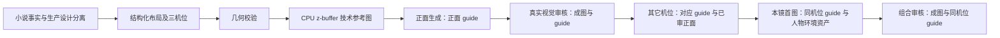

# 固定环境布局与机位接线 v4（2026-11-06）

本模块补齐环境几何输入：同一份结构化布局产生俯视、正面、反向和侧面技术参考图，再将对应机位的图像真正传入图片生成与视觉审核。它不把模型随机生成的一张俯视图当作几何真值，也不表示生成照片或成片已经通过视觉验收。

## 来源与设计边界

小说原文、引用与生产设计分开保存。原文决定房间用途、已知物件及关系；没有原文尺寸的门窗位置、家具尺寸和镜头位置由外部规划节点提出，明确标为美术设计补全。模块本身不写死本书卧室、厨房或角色。

`src/content_factory/visual_environment_v4.py` 的 `layout_schema()` 是结构合同，`validate_layout()` 进一步检查几何。坐标以米计，西南角为原点，x 向东、y 向北、z 向上；每个物件有稳定 ID、种类、描述、中心、长宽高、旋转及底面离地高 `base_z`。新规划使用 `layout_schema(require_base_z=True)` 强制显式底高；旧结果读取允许缺省 0，保持旧 JSON 不变。门窗绑定具体墙面。三台相机各有 eye、target 和 fov，反向必须与正向相对，侧面必须方向不同。

检查包括物件三维越界、旋转后实体重叠、门窗越界或重叠、悬空门、相机进入实体、退化视线、反向或侧向错轴、重复 ID、非有限数值及多余字段。投影重叠但上下分离或恰好接触的物件允许共存；相机可以位于吊物下方，但不能进入其实体高度。该合同是房间级粗结构，不是通用三维建模引擎。

## 实际条件与依赖

正面只有技术参考图；其它机位另用已审正面保持材料和房间身份。技术参考图不是资产父节点，不形成正面与俯视互相等待的循环。每镜仍限制最多两个人物加环境，guide 是额外图像条件，不扩张人物容量。

`render_guides()` 使用已有 Pillow 和 NumPy，不下载依赖、不调用 GPU。透视图使用实际深度缓冲，包含悬空物的底面；当前 renderer 为 `cpu_zbuffer/v4`。桌子由桌板和四腿、椅子由座面和四腿及椅背、凳子由座面和四腿、架子由搁板和立柱组成，避免图片模型把实心占位箱照抄成家具。子几何始终位于原有旋转包围盒内，保留原位置、尺寸、yaw 与对象 ID；碰撞仍使用原完整包围盒保守判断。所有子面归回同一对象的可见 ID。输入图没有坐标标签或审计文本。不同机位共享同一组家具和开口。俯视图、透视图和 `GUIDES.json` 保存实际 SHA、renderer 版本、布局及相机绑定。固定输出目录中既有文件不允许静默覆盖；输入变更须新目录，文件篡改会拒绝复用。

## 管线与审核

`visual_asset_pipeline_v3` 已接实际 guide 图像：环境生成、环境审核、本镜首图生成及组合审核均使用对应机位。环境的 `layout_design` 现在会进入审核，修复旧代码只读 `appearance_design` 导致描述为空的问题。

审核同时得到图像和纯语义 `environment_context`：环境设计、空间种类、机位说明、可见锚点及允许遮挡的比较规则。模型不会收到审计 SHA、像素坐标或世界坐标数组。回执必须绑定实际 `layout_guide_sha256`；guide 变更、布局变更、美术描述或 front prompt 变更均会使旧环境资格失效。缓存首图即使此前通过，也须重新核对当前 guide 绑定。

`visual_asset_handoff_v3` 增加显式配置 `environment_contract="layout_camera_v4"`。旧配置默认仍为 `legacy`，不把旧缓存结果自动重标成新合同。新规划结果必须带有效 `spatial_layout`。

v4.3 小说入口进一步区分永久背景与本镜剧情道具。带 `background_contract="static_room_per_shot_props/v1"` 的环境只由枚举 `static_materials` 提供墙面、地面、状态和光照；生成提示忽略整房 `layout_design`、`front_prompt` 及自由物件描述。相机裁剪直接使用同一个 CPU 深度缓冲器的可见像素 ID，仅把真正入画且未被遮挡的固定家具、门窗放入正向生成条件。顶灯类型翻译为照明氛围，不因光源说明要求画出画外灯具。组合首图也使用这一裁剪条件；完整房间设计仍留在 manifest 与视觉审核上下文中。材质合同进入环境依赖 SHA，材质改变会撤销旧资格。

H3 消费端 `validate_ready()` 也独立执行只读核验，不能绕过管线 tick 后使用陈旧的 READY：从当前布局、renderer 和首图实际尺寸推导既有 guide 目录，核对文件 SHA、manifest、机位、美术设计及顶层和环境子审回执。路径必须位于本 run 的 `environment_guides`，缺图、缺 manifest 或篡改时拒绝交付，不在核验中重新渲染。旧无 v4 布局及 guide 的冻结输入保持兼容。

## 验证范围

环境、既有资产管线与文本接入三个测试文件合计 **131 项通过，0 失败、0 跳过**，134.36 秒；唯一汇总 XML 为 `data/qa/environment_v4_full.xml`。包含真实临时 HTTP 的图片条件传送、同设计版本改布局失效、机位错误、guide 篡改、审核绑定错误、首图条件以及深度遮挡回归。这些是协议和几何测试，假审核回执不冒充真实视觉审核通过。

随后新增 H3 独立核验与 CLI 覆盖，该测试文件 **71 项通过，0 失败、0 跳过**，67.88 秒，XML 为 `data/qa/environment_v4_h3.xml`。新增用例使用不同尺寸的资产 guide 和首图 guide，确保首图篡改由 H3 新门独立发现；真实子进程 CLI 完成 prepare/status，随后篡改 guide 后 status 返回错误且没有视频 POST。

实际文本设计小样暴露了高度字段缺项：顶灯虽描述为天花板物件，旧合同仍把它放到地面。对此增加上述显式 `base_z`，而不是按名称暗猜高度；新规划 schema 和对应缓存键一并换版。高度补测后环境文件 **35 项通过，0 失败、0 跳过**，16.90 秒，XML 为 `data/qa/environment_v4_height.xml`。覆盖旧结果不变、新结果强制底高、三维实体碰撞、相机上下关系、吊物底面及新版本 guide 独立生成。此前 131 与 71 项是各阶段记录，最终统一发布回归另行汇总，不把它们当最新源码全部复测结果。

机位提示裁剪补齐后，环境文件最新 **43 项通过，0 失败、0 跳过**，21.65 秒，XML 为 `data/qa/environment_v43_camera.xml`。新增正反机位不携带全局清单、遮挡柜后的小凳不列入提示、非法材质拒绝、材质资格变化以及首图生成条件与审核上下文分离测试。

随后正式图片暴露出模型照抄实心占位箱的问题，补齐上述家具分件几何。环境文件最新 **49 项通过，0 失败、0 跳过**，21.93 秒，XML 为 `data/qa/environment_kind_v4.xml`。新增旋转包围盒不变、子面身份不变、桌下实际开放像素，以及 renderer 升级使 static 资产资格失效、旧 legacy 设计摘要不变测试。static 环境依赖摘要明确纳入 renderer；H3 使用同一个只读摘要函数，旧 v3 guide 产物不能冒充 v4。

最新高度 CPU 视检参考在 `data/qa/environment_v4_height_guides`，使用 `cpu_zbuffer/v3`。`data/qa/environment_v4_guides_zbuffer` 是旧 v2 回归参考；更早的 `data/qa/environment_v4_guides` 是已弃用的 painter 原型，仅保留试验记录。以上图片是通用测试房间，不能作为小说正式背景。此次未运行 GPU、未启动旧视频、未改账号、原 H3 PAUSE 或服务配置。正式背景及图生视频效果由后续新 run 实测验收。

最新家具分件 CPU 参考 `data/qa/kind_guide_v4_20261106/kitchen` 使用真实已冻结厨房布局的只读副本，输出到独立 QA 目录，未改正式布局或旧图。主代理独占真实图像推理与视觉验收；CPU 分件图清楚不能代替照片审核通过。
